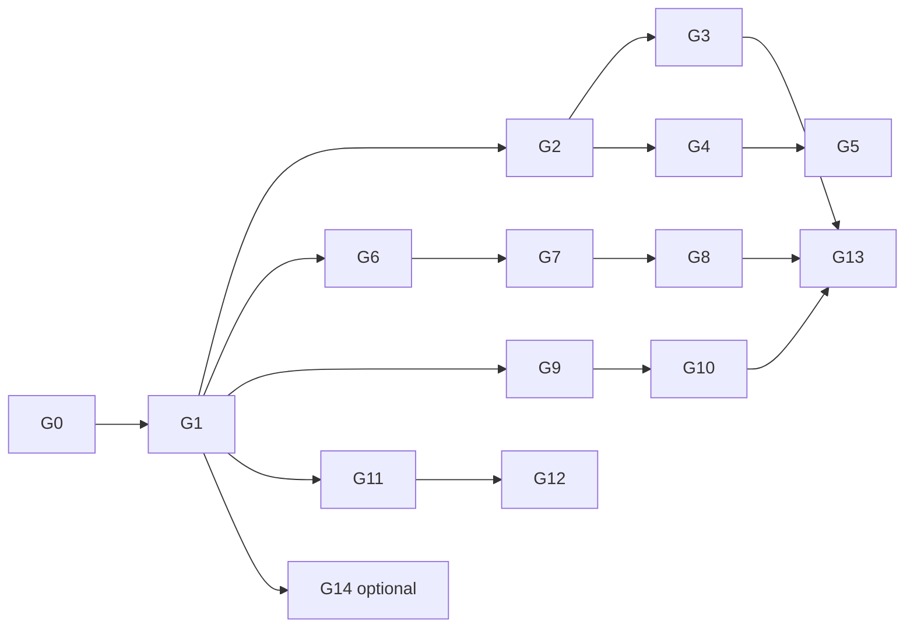

# Trae 多 Agent Goals：按章实现教学 OS

本目录为 Trae（或多 Agent 编排）可直接引用的 **Goal 正文**；实现须严格对照两本教材：

| 教材 | 范围 |
|------|------|
| **王道** | 《2027 王道操作系统考研复习指导》第 1–5 章 |
| **汤小丹** | 《计算机操作系统》（第 4 版常见分章） |

**宏内核根目录**：`/home/jerry/Projects/from-scratch/operating-systems-lab/mono`

**全局合同**（每个 Agent 开工前必读）：[`GLOBAL-CONTRACT.md`](GLOBAL-CONTRACT.md)

## 依赖与波次



| 波次 | 可并行 Goal |
|------|-------------|
| 1 | G0 |
| 2 | G1 |
| 3 | G2、G6 |
| 4 | G3、G4、G7 |
| 5 | G5、G8、G9、G11 |
| 6 | G10、G12 |
| 7 | G13 |
| 旁路 | G14（依赖 G1，不阻塞 QEMU 主线） |

## Goal 索引

| ID | 文件 | 王道 | 汤小丹 | 简述 |
|----|------|------|--------|------|
| G0 | [G0-baseline.md](G0-baseline.md) | 1.1–1.6 | 第 1 章 | 基线冻结与路线图 |
| G1 | [G1-privilege-syscall.md](G1-privilege-syscall.md) | 1.5–1.6 | 1.3–1.5 | 双模式、ABI、最小用户态 |
| G2 | [G2-process-pcb.md](G2-process-pcb.md) | 2.1 | 第 2 章 | PCB 与内核线程 |
| G3 | [G3-scheduler.md](G3-scheduler.md) | 2.2 | 第 4 章 | 时间片调度 RR |
| G4 | [G4-sync.md](G4-sync.md) | 2.3 | 第 3 章 | 信号量与互斥 |
| G5 | [G5-deadlock.md](G5-deadlock.md) | 2.4 | 第 5 章 | 银行家教学模块 |
| G6 | [G6-mmu-paging.md](G6-mmu-paging.md) | 3.1 | 第 6 章 | 分页与内核映射 |
| G7 | [G7-user-vma.md](G7-user-vma.md) | 3.1–3.2 | 第 7 章（前） | 用户虚址与 exec/fork |
| G8 | [G8-page-fault.md](G8-page-fault.md) | 3.2 | 第 7 章（后） | 缺页与置换 |
| G9 | [G9-block-cache.md](G9-block-cache.md) | 4.1、4.3 | 第 8 章（前） | 块设备与缓冲 |
| G10 | [G10-filesystem.md](G10-filesystem.md) | 4.2–4.3 | 第 8 章 | 简易可读写 FS |
| G11 | [G11-device-framework.md](G11-device-framework.md) | 5.1–5.2 | 第 9 章 | 设备独立层 |
| G12 | [G12-disk-sched.md](G12-disk-sched.md) | 5.3 | 第 9 章 | 磁盘 SCAN/C-SCAN |
| G13 | [G13-init-shell.md](G13-init-shell.md) | 1.2 等 | 综合 | init、shell、综合演示 |
| G14 | [G14-z7-lite-optional.md](G14-z7-lite-optional.md) | — | — | Z7-Lite 实机（可选） |

## 建议 Agent 分工

| Agent | Goals |
|-------|--------|
| A0 | G0 |
| A1 | G1 |
| A2 | G2 → G3 |
| A3 | G4 → G5 |
| A4 | G6 → G7 |
| A5 | G8 |
| A6 | G9 → G10 |
| A7 | G11 → G12 → G13（G14 可选） |

## 教材检索（本机）

```bash
# 王道全库关键词（示例）
python3 /home/jerry/Projects/tools/questions.py --subject 操作系统 --query "信号量" --summary
# 或 learn-operate-system 内 MinerU 原文路径见 learn-operate-system/README.md
```

每个 Goal 文末均含：**必读 / 冲突裁决 / 提交范围** 三行纪律。