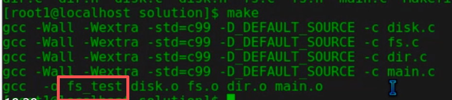
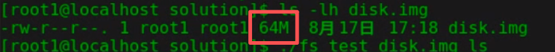
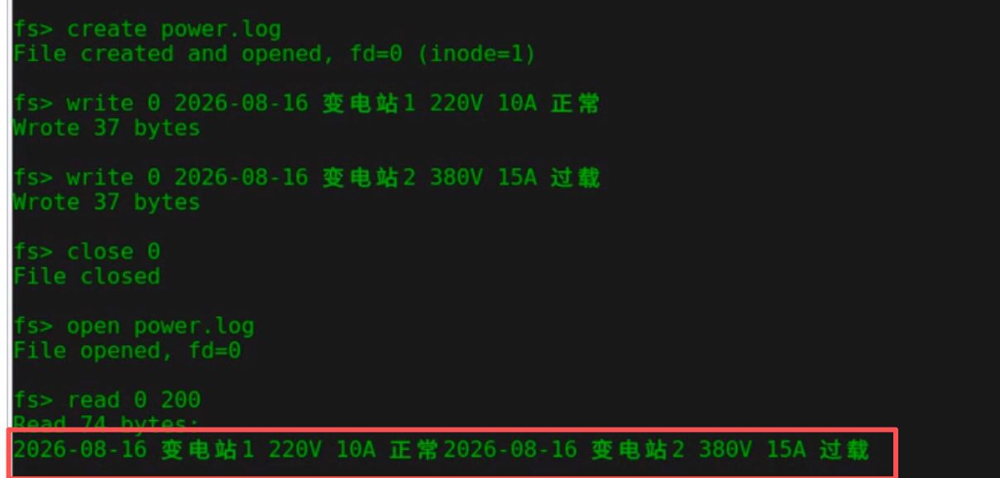
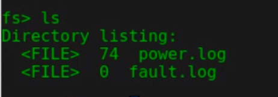
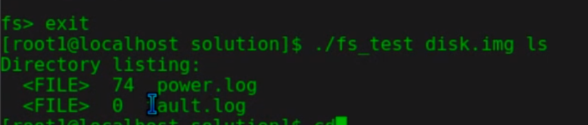
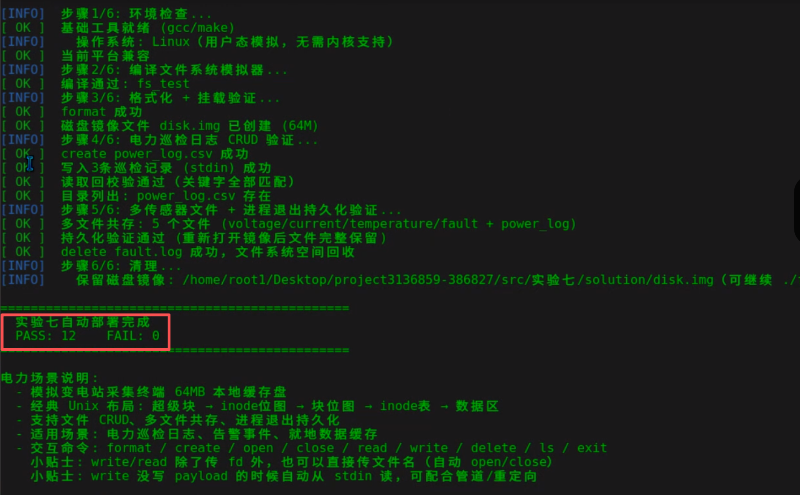

# 实验七：文件管理 - 实验指导书

## 一、实验概述

本实验要求在**用户态**下用C语言编程实现一个简单的文件系统，模拟文件系统的核心功能。通过本实验，你将深入理解文件系统的核心概念和工作流程。

本实验与电力行业场景深度结合：在智能变电站巡检系统中，电压、电流等传感器采集到的海量数据需要持久化存储到磁盘，告警日志、巡检记录也需要按文件方式管理。本实验将实现巡检日志文件的存储、查询与持久化功能，模拟真实电力运维场景下的文件系统需求。

## 二、实验目标

1. 理解文件系统的层次结构
2. 掌握超级块、inode、目录项的概念
3. 实现文件的创建、打开、读写、关闭、删除操作
4. 理解数据块分配和回收机制

## 三、实验环境

- 操作系统：openEuler 24.03 LTS / Windows / Linux（用户态模拟跨平台）
- 编程语言：C
- 编译器：gcc

## 实验原理

### 文件系统基本概念

文件系统是操作系统中管理磁盘数据的核心模块，提供文件的创建、读取、写入、删除等操作。本实验实现用户态文件系统模拟器，帮助理解文件系统的核心设计。

### 磁盘布局

典型的文件系统磁盘布局包含以下区域：
- **超级块 (Superblock)**：存储文件系统的整体元信息（块大小、inode数量、数据块数量等）
- **inode 位图**：标记哪些 inode 已分配/空闲
- **数据块位图**：标记哪些数据块已分配/空闲
- **inode 表**：存储所有 inode 结构（文件元信息：大小、权限、数据块指针等）
- **数据块区**：实际存储文件内容

### inode 与目录项

- **inode (索引节点)**：文件的元数据结构，包含文件大小、类型、引用计数、数据块指针等
- **目录项 (DirEntry)**：目录中的条目，记录文件名到 inode 编号的映射

### 位图管理

使用位图高效管理 inode 和数据块的分配与回收：
- 位为 1 表示已分配，0 表示空闲
- 分配时从位图中查找第一个空闲位
- 回收时将对应位清零

## 四、文件结构

```
实验七/
├── doc/                            # 文档目录
│   └── 实验七/
│       ├── README.md               # 项目说明
│       └── 实验指导书.md            # 实验指导文档
│
└── src/                            # 源代码目录
    └── 实验七/
        ├── Makefile                # 顶层编译脚本
        ├── starter/                # 学生填空版
        │   ├── disk.c / disk.h
        │   ├── fs.c / fs.h
        │   ├── dir.c / dir.h
        │   ├── main.c
        │   └── Makefile
        └── solution/               # 参考答案
            ├── disk.c / disk.h
            ├── fs.c / fs.h
            ├── dir.c / dir.h
            ├── main.c
            └── Makefile
```

## 五、数据结构设计

### 5.1 超级块 (Superblock)

存储文件系统整体信息：

```c
typedef struct {
    uint32_t magic;           // 魔数：0xDEADBEEF
    uint32_t total_blocks;    // 总块数
    uint32_t free_blocks;     // 空闲块数
    uint32_t inode_table_start; // inode表起始块
    uint32_t data_block_start; // 数据块起始块
    uint32_t root_dir_inode;  // 根目录inode号
} Superblock;
```

### 5.2 inode (索引节点)

存储文件元数据：

```c
typedef struct {
    uint32_t inode_id;        // inode编号
    uint32_t size;            // 文件大小
    uint32_t blocks[16];      // 直接块指针
    uint16_t type;             // 类型：0=空闲, 1=文件, 2=目录
    uint16_t ref_count;        // 引用计数
} Inode;
```

### 5.3 目录项 (Directory Entry)

用于目录结构，存储文件名和inode映射：

```c
typedef struct {
    char filename[28];         // 文件名
    uint32_t inode_num;        // 对应inode编号
} DirEntry;
```

## 六、磁盘布局

| 块号 | 内容 | 说明 |
|------|------|------|
| 0 | 超级块 | 文件系统元数据 |
| 1 | inode位图 | 记录inode使用情况 |
| 2 | 块位图 | 记录数据块使用情况 |
| 3-34 | inode表 | 存储inode结构 (32块) |
| 35+ | 数据块 | 存储文件数据 |

## 七、功能实现

### 7.1 disk.c - 虚拟磁盘模拟

```c
// 初始化虚拟磁盘
Disk* disk_init(const char *filename);

// 读取块 (块号从0开始)
int disk_read(Disk *disk, int block_num, void *buffer);

// 写入块
int disk_write(Disk *disk, int block_num, const void *buffer);

// 关闭磁盘
void disk_close(Disk *disk);
```

### 7.2 fs.c - 文件系统核心

```c
// 格式化文件系统
int fs_format(Disk *disk);

// 挂载文件系统
int fs_mount(FileSystem *fs);

// 创建文件 (type: 1=文件, 2=目录)
int fs_create(FileSystem *fs, const char *filename, uint16_t type);

// 打开文件，返回文件描述符
int fs_open(FileSystem *fs, const char *filename, int flags);

// 关闭文件
int fs_close(FileSystem *fs, int fd);

// 读取文件
int fs_read(FileSystem *fs, int fd, void *buffer, int size);

// 写入文件
int fs_write(FileSystem *fs, int fd, const void *buffer, int size);

// 删除文件
int fs_delete(FileSystem *fs, const char *filename);

// 列出目录
int fs_ls(FileSystem *fs);
```

### 7.3 dir.c - 目录管理

```c
// 添加目录项
int dir_add_entry(FileSystem *fs, int dir_inode_num, const char *filename, int inode_num);

// 删除目录项
int dir_remove_entry(FileSystem *fs, int dir_inode_num, const char *filename);

// 读取目录项
DirEntry* dir_read_entries(FileSystem *fs, int dir_inode_num, int *count);
```

### 7.4 位图操作

```c
// 分配inode
int alloc_inode(FileSystem *fs);

// 释放inode
void free_inode(FileSystem *fs, int inode_num);

// 分配数据块
int alloc_block(FileSystem *fs);

// 释放数据块
void free_block(FileSystem *fs, int block_num);

// 读取inode
Inode* read_inode(FileSystem *fs, int inode_num);

// 写入inode
int write_inode(FileSystem *fs, int inode_num, Inode *inode);
```

## 八、实验步骤

### 第一步：实现虚拟磁盘 (disk.c)

创建 `disk.img` 文件模拟磁盘，提供块读写接口。

### 第二步：定义数据结构 (fs.h)

定义 Superblock、Inode、DirEntry、FileDescriptor 等结构。

### 第三步：实现文件系统格式化 (fs_format)

1. 初始化超级块
2. 初始化inode位图（预留根目录inode 0）
3. 初始化块位图（预留元数据块）
4. 创建根目录inode和目录项

### 第四步：实现位图管理

实现 `alloc_inode`、`alloc_block`、`free_inode`、`free_block` 函数。

### 第五步：实现文件操作

- `fs_create`: 分配inode，添加目录项
- `fs_open`: 查找目录项，分配文件描述符
- `fs_close`: 释放文件描述符
- `fs_read`/`fs_write`: 根据inode的blocks数组读写数据块
- `fs_delete`: 释放inode和数据块，删除目录项

### 第六步：实现目录操作

- `dir_add_entry`: 在目录数据块中添加目录项
- `dir_remove_entry`: 删除目录项
- `dir_read_entries`: 读取目录下所有条目

### 第七步：编写测试程序 (main.c)

实现命令行解释器，支持交互操作。

## 九、测试验证

> 说明：请先完成 starter 版代码填空，再按以下步骤验证。本章节所有步骤与「演示视频_实验七.mp4」完全一致，截图可直接从视频关键帧截取（学生正确实现 starter 后，运行效果与视频中 solution 版一致）。

### 第一步：编译 starter 版
```bash
cd src/实验七/starter
make
```

 验收标准：`make` 完成后无 error，生成可执行文件 `fs_test`。



### 第二步：格式化 64MB 虚拟磁盘
```bash
./fs_test disk.img format   # 创建并格式化 64MB 磁盘镜像
ls -lh disk.img             # 查看大小，应为 64M
./fs_test disk.img ls       # 首次查看根目录，应为空
```

 验收标准：format 输出成功提示，disk.img 文件大小精确为 64MB。



### 第三步：进入交互 Shell，走电力巡检日志完整链路

```bash
./fs_test disk.img          # 进入 fs> 交互模式
```

交互模式下按以下顺序执行（与视频演示的电力场景完全一致）：

```
fs> create power.log                         # 【1】创建巡检功率日志文件
```

```
fs> write 0 2026-08-16 变电站1 220V 10A 正常  # 【2】写第一条巡检记录
fs> write 0 2026-08-16 变电站2 380V 15A 过载  # 【3】写第二条巡检记录（同一fd自动追加写入）
fs> close 0
```

```
fs> open power.log
fs> read 0 200                                # 【4】重新打开并读取，应完整读出两条日志
fs> close 0
```

 验收标准：`read 0 200` 输出与之前写入的 2 条巡检记录**逐字节一致**（含「变电站1 正常」「变电站2 过载」关键字样），证明 create → write → close → open → read 核心链路全通。



```
fs> create fault.log                          # 【5】创建故障日志（空文件）
fs> ls                                        # 【6】查看根目录清单
```

 验收标准（**与答辩PPT效果演示页截图100%对应**）：`ls` 输出中必须能看到 —— `power.log` 文件大小非空（已写入数据）、`fault.log` 文件大小为 0（刚创建未写入）。



```
fs> exit                                      # 退出交互，自动 sync 将所有脏数据刷回 disk.img
```

### 第四步：持久化验证（退出后重新挂载）

```bash
# 不执行 format，直接再次 mount 同一个 disk.img 镜像
./fs_test disk.img ls
```

验收标准：exit 后**重新挂载同一镜像**，`ls` 仍然显示 `power.log` 和 `fault.log` 两个文件，大小与退出前完全一致，证明数据**真实持久化到 disk.img 而非仅存在于内存**（这是视频里强调的关键验证步骤）。



### 第五步：自动评测（deploy.sh 一键 PASS）

```bash
cd .. && bash deploy.sh starter
```

验收标准：deploy.sh 自动完成「环境检查 → 编译 → mkfs → create/write/read 全链路 → fsck 一致性校验」，最终输出一连串 `[OK]` / `PASS`，无 FAIL 项。



## 十、实验总结

1. **块对齐**: 所有读写操作必须以块(512字节)为单位
2. **文件名限制**: 最大28字节，以'\0'结尾
3. **文件大小限制**: 最大16个直接块 = 8KB
4. **打开文件数**: 最多64个同时打开的文件
5. **根目录**: inode号固定为0

## 十一、思考题

1. 为什么需要超级块？它包含哪些信息？
2. inode中的blocks数组有什么作用？为什么限制为16个？
3. 位图管理有什么优缺点？
4. 如何实现目录的递归删除？
5. 如何扩展支持目录层级？
