# 实验二：OpenEuler 基本Linux指令使用和内核模块编程

## 实验目的

1. 理解 Linux 内核模块的基本概念与开发流程
2. 掌握内核模块的编写、编译、加载和卸载
3. 学会使用模块参数与用户态交互
4. 理解字符设备驱动的基本框架（misc设备、file_operations）
5. 结合电力行业场景，体验嵌入式设备驱动开发

---

## 第一部分：基本 Linux 指令使用

本部分为**自主练习**，不需要编写内核代码，但需要在实验报告中提供命令执行截图。

### 1. 用户管理

| 命令 | 作用 | 示例 |
|------|------|------|
| `who` | 查看当前登录用户 | `who` |
| `last` | 查看最近登录记录 | `last -n 5` |
| `login` | 切换用户 | `login`（需要 root 密码） |

**任务**：执行上述命令，截图记录输出。

### 2. 文件管理

| 命令 | 作用 | 示例 |
|------|------|------|
| `cd` | 切换目录 | `cd /home` |
| `ls` | 列出文件 | `ls -la` |
| `pwd` | 显示当前路径 | `pwd` |
| `mkdir` | 创建目录 | `mkdir test_dir` |
| `mv` | 移动/重命名 | `mv old.txt new.txt` |
| `cp` | 复制文件 | `cp a.txt b.txt` |

**任务**：在 `/tmp` 下创建目录 `exp2_files`，在其中创建文件 `test.txt`，复制一份并重命名，最后删除。截图记录每一步。

### 3. 系统管理

| 命令 | 作用 | 示例 |
|------|------|------|
| `top` | 动态进程监控 | `top`（按 `q` 退出） |
| `ps` | 静态进程列表 | `ps aux` |
| `ip a` | 查看网卡配置 | `ip a` |
| `kill` | 终止进程 | `kill -9 PID` |

**任务**：运行 `top` 并截图，运行 `ps aux | grep bash` 并截图，使用 `ip a` 查看 IP 地址并截图。

### 4. 电源管理（可选，虚拟机中谨慎使用）

| 命令 | 作用 | 示例 |
|------|------|------|
| `shutdown` | 关机/重启 | `sudo shutdown -h now` |
| `reboot` | 重启 | `sudo reboot` |

**注意**：虚拟机中可以尝试 `sudo shutdown -h +1`（延迟1分钟关机），然后 `sudo shutdown -c` 取消。

### 5. 常用快捷键

- `Ctrl + C`：终止当前运行的程序
- `Ctrl + L`：清空屏幕
- `Alt + F1` ~ `F6`：切换虚拟控制台（可以在不同终端间切换）

### 6. 使用 gcc 编译 C 程序

```bash
# 编写一个死循环程序
cat > loop.c << EOF
#include <stdio.h>
int main() {
    while(1) printf("6");
    return 0;
}
EOF

# 编译并运行
gcc loop.c -o loop
./loop
```

运行后按 `Ctrl + C` 终止。截图记录。

### 实验报告要求

将上述所有命令的执行过程**截图**，整理成一个文档（PDF 或 Word），随代码一起提交。

---

## 实验环境

- 操作系统：openEuler 24.03 LTS (内核 6.6+)
- 开发工具：gcc, make, kernel-devel
- 硬件：x86_64 虚拟机（VMware/VirtualBox）

### 环境准备

```bash
# 安装内核开发包（若未安装）
sudo dnf install -y kernel-devel gcc make

# 检查内核版本（应与 kernel-devel 版本一致）
uname -r
```

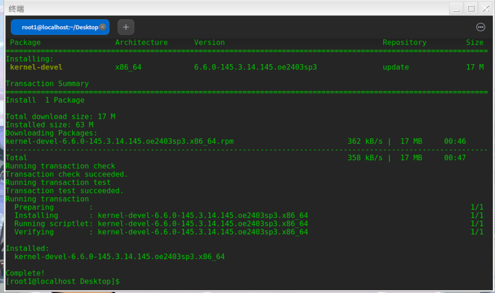

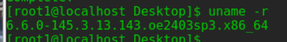

> ⚠️ 如果 `dnf install` 提示无法解析域名，请先检查网卡状态并获取IP：
>
> ```bash
> sudo ip link set ens33 up
> sudo dhclient ens33
> ```

---

## 实验原理

### 内核模块基础

Linux 内核模块是一种可以动态加载和卸载的代码单元，无需重新编译内核即可扩展内核功能。模块加载后成为内核的一部分，可以访问内核提供的所有接口和数据结构。

### misc 设备框架

本实验采用 misc 设备框架实现字符设备驱动。misc 设备是字符设备的一种简化形式：
- 主设备号固定为 10，由内核统一管理
- 注册时自动在 `/dev/` 下创建设备文件
- 通过 `file_operations` 结构体实现设备的操作接口

### file_operations 结构体

```c
static const struct file_operations power_fops = {
    .owner = THIS_MODULE,
    .open = power_open,
    .release = power_release,
    .read = power_read,
    .write = power_write,
};
```

该结构体将系统调用（read/write/open/release）映射到模块中的具体实现函数。

### 互斥锁保护

使用 `DEFINE_MUTEX` 定义互斥锁，在读写操作中加锁保护共享数据，防止多进程并发访问导致数据不一致。

---

## 第二部分：内核模块编程

---

## 仓库目录结构

本实验采用单仓库双目录结构：`doc/` 目录存放文档，`src/` 目录存放源代码。

```
仓库根目录/
├── doc/                            # doc 分支 - 文档
│   └── 实验二/
│       ├── 实验指导书.md           # 本文档
│       ├── 电力场景.md             # 行业背景扩展阅读
│       └── README.md               # 实验概述
│
└── src/                            # src 分支 - 源代码
    └── 实验二/
        ├── starter/                # 学生填空代码框架
        │   ├── cp1_basics/         # Checkpoint 1：基础模块
        │   │   ├── power_device_cp1.c
        │   │   └── Makefile
        │   ├── cp2_params/         # Checkpoint 2：模块参数
        │   │   ├── power_device_cp2.c
        │   │   └── Makefile
        │   └── cp3_device/         # Checkpoint 3：字符设备驱动
        │       ├── power_device_cp3.c
        │       └── Makefile
        ├── solution/               # 完整参考实现（教师/自查用）
        │   ├── cp1_basics/
        │   ├── cp2_params/
        │   └── cp3_device/
        ├── tests/                  # 自动化测试脚本
        │   └── test_module.sh
        ├── Makefile                # 顶层 Makefile
        └── module.c                # 示例模块代码
```

**使用方法**：每个 Checkpoint 使用独立的代码目录，按顺序完成三个阶段。每完成一个 checkpoint 执行一次 git commit。

---

## 实验总体任务

我们将编写一个**模拟电力设备的内核模块**，最终实现：

- 设备文件 `/dev/power_device`，支持读写操作
- 读操作返回当前电压、电流、功率（模拟数据）
- 写操作设置新的电压和电流，并自动计算功率
- 支持模块参数（设备名称、默认电压）

整个开发分为 **3 个独立的 Checkpoint**，每个 checkpoint 是一个完整的、可独立运行的模块：

| Checkpoint | 目录 | 核心功能 |
|------------|------|----------|
| CP1 | `cp1_basics/` | 基础加载/卸载日志 |
| CP2 | `cp2_params/` | 添加模块参数 |
| CP3 | `cp3_device/` | 实现字符设备驱动 |

---

## Checkpoint 1：基础内核模块（加载/卸载日志）

### 学习目标

- 理解内核模块的入口/出口函数
- 学会使用 `printk` 输出内核日志
- 掌握模块编译和动态加载流程

### 任务

补全 `starter/cp1_basics/power_device_cp1.c` 中标记为 `TODO 1-4` 的代码，实现模块加载时打印 `"Power Device Module Loaded"`，卸载时打印 `"Power Device Module Unloaded"`。

### 代码框架（starter/cp1_basics/power_device_cp1.c）

```c
#include <linux/module.h>
#include <linux/kernel.h>
#include <linux/init.h>

MODULE_LICENSE("GPL");
MODULE_AUTHOR("Your Name");
MODULE_DESCRIPTION("电力设备模拟驱动 - 阶段1");
MODULE_VERSION("1.0");

/* TODO 1: 实现模块加载函数 power_init
 * 要求：使用 printk(KERN_INFO) 打印 "Power Device Module Loaded"
 * 返回：0
 */
static int __init power_init(void)
{
    // 在这里添加你的代码
    
    return 0;
}

/* TODO 2: 实现模块卸载函数 power_exit
 * 要求：使用 printk(KERN_INFO) 打印 "Power Device Module Unloaded"
 */
static void __exit power_exit(void)
{
    // 在这里添加你的代码
    
}

/* TODO 3: 使用 module_init() 注册加载函数 */

/* TODO 4: 使用 module_exit() 注册卸载函数 */
```

### 操作步骤

1. **准备代码**
   将 `starter/cp1_basics/` 目录复制到你的工作目录（例如 `~/kernel-lab/cp1`）。

2. **编辑代码**
   使用 VSCode 或 vi 打开 `power_device_cp1.c`，根据 `TODO` 注释补全代码。

3. **编译模块**
   ```bash
   make
   ```
   成功后会生成 `power_device_cp1.ko`。

   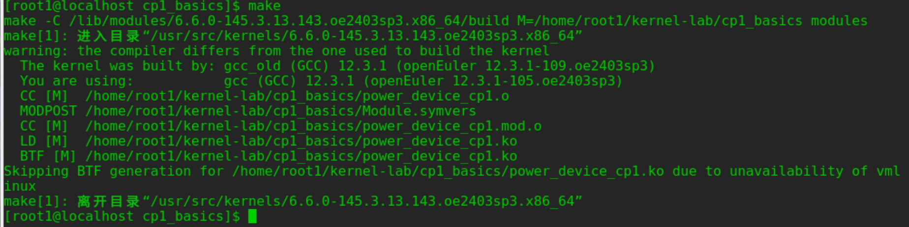
   
4. **加载模块**
   ```bash
   sudo insmod power_device_cp1.ko
   ```

5. **查看日志**
   ```bash
   dmesg | tail
   ```
   应看到 `"Power Device Module Loaded"`。

   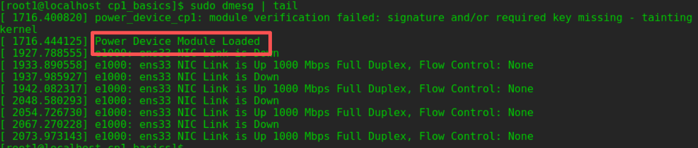
   
6. **卸载模块**
   ```bash
   sudo rmmod power_device_cp1
   dmesg | tail
   ```
   应看到 `"Power Device Module Unloaded"`。
   
   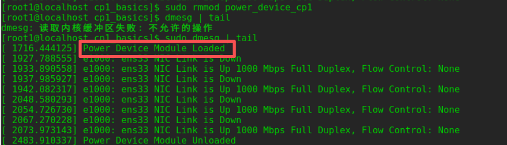

### 验收标准

- [ ] 编译无错误，生成 `.ko` 文件
- [ ] `insmod` 后 `dmesg` 显示加载信息
- [ ] `rmmod` 后 `dmesg` 显示卸载信息

### Git 提交（无要求）

```bash
git add power_device_cp1.c Makefile
git commit -m "实验2 checkpoint1: 实现基础加载/卸载日志"
```

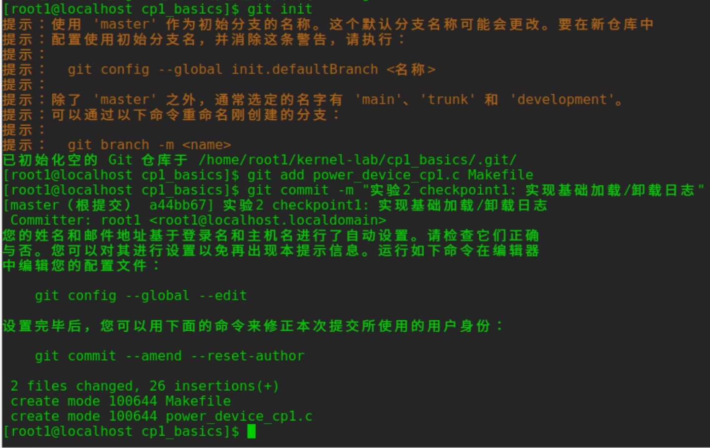


---

## Checkpoint 2：添加模块参数

### 学习目标

- 掌握 `module_param` 宏的使用
- 学会在 `/sys/module/参数/` 下查看模块参数

### 任务

添加两个模块参数：
- `dev_name`：字符串，设备名称，默认值 `"power_sensor"`
- `default_voltage`：整型，默认电压（伏特），默认值 `220`

加载时打印这两个参数的值。

### 代码框架（starter/cp2_params/power_device_cp2.c）

```c
#include <linux/module.h>
#include <linux/kernel.h>
#include <linux/init.h>

MODULE_LICENSE("GPL");
MODULE_AUTHOR("Your Name");
MODULE_DESCRIPTION("电力设备模拟驱动 - 阶段2");
MODULE_VERSION("1.0");

/* TODO 5: 声明模块参数
 * 要求：
 *   - 字符串参数 dev_name，默认值 "power_sensor"
 *   - 整型参数 default_voltage，默认值 220
 *   - 使用 module_param() 和 MODULE_PARM_DESC() 注册
 */

/* TODO 1: 实现模块加载函数 power_init */
static int __init power_init(void)
{
    printk(KERN_INFO "Power Device Module Loaded\n");
    
    /* TODO 6: 打印模块参数值
     * 格式："Device name: %s, default voltage: %d V\n"
     */
    
    return 0;
}

/* TODO 2: 实现模块卸载函数 power_exit */
static void __exit power_exit(void)
{
    printk(KERN_INFO "Power Device Module Unloaded\n");
}

/* TODO 3: 使用 module_init() 注册加载函数 */

/* TODO 4: 使用 module_exit() 注册卸载函数 */
```

### 操作步骤

1. 将 `starter/cp2_params/` 目录复制到你的工作目录。

2. 编辑 `power_device_cp2.c`，补全 `TODO 5` 和 `TODO 6`。

3. 编译模块（`make clean; make`）。

   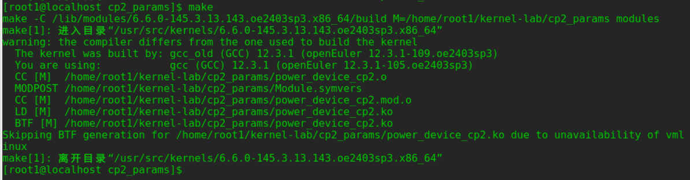

4. 使用默认参数加载：
   ```bash
   sudo insmod power_device_cp2.ko
   dmesg | tail
   ```
   应看到类似 `"Device name: power_sensor, default voltage: 220"`。

   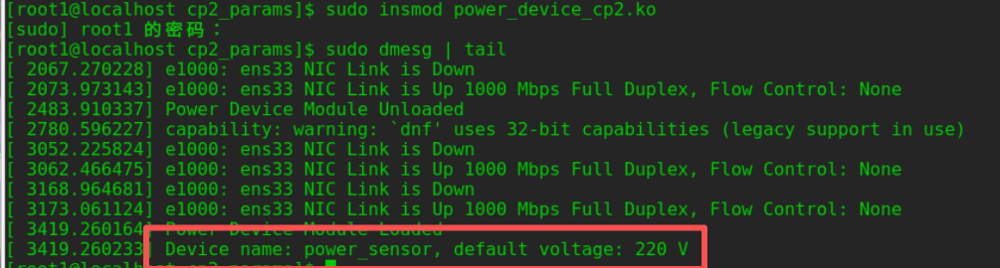

5. 使用自定义参数加载：
   ```bash
   sudo rmmod power_device_cp2
   sudo insmod power_device_cp2.ko dev_name="grid_sensor" default_voltage=380
   dmesg | tail
   ```
   应看到新的值。

   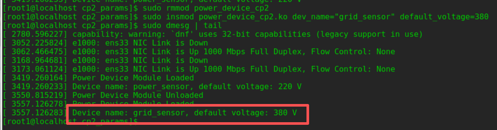

6. 查看 `/sys/module/power_device_cp2/parameters/` 下的文件：
   ```bash
   ls /sys/module/power_device_cp2/parameters/
   cat /sys/module/power_device_cp2/parameters/dev_name
   cat /sys/module/power_device_cp2/parameters/default_voltage
   ```

   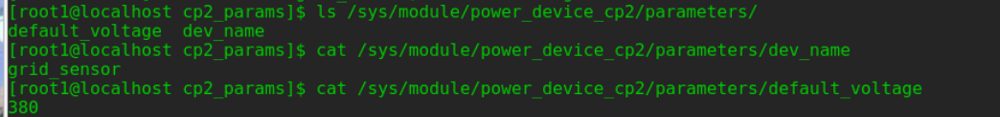

### 验收标准

- [ ] 不传参数时，使用默认值
- [ ] 传入参数后，模块加载日志显示自定义值
- [ ] `/sys/.../parameters/` 下存在对应文件且内容正确

---

## Checkpoint 3：实现字符设备驱动（电力数据读写）

### 学习目标

- 理解 misc 设备注册流程
- 掌握 `file_operations` 中 `read` / `write` 的实现
- 学会使用 `copy_to_user` / `copy_from_user`
- 体验互斥锁保护共享数据

### 任务

实现完整的字符设备驱动：

- 设备文件 `/dev/power_device`（动态分配次设备号）
- `read` 操作：返回当前电压、电流、功率（格式：`"Voltage: %d V\nCurrent: %d A\nPower: %d W\n"`）
- `write` 操作：接收格式 `"<voltage> <current>"`，更新电压和电流，并自动计算功率 `power = voltage * current`
- 使用互斥锁保护共享数据

### 代码框架（starter/cp3_device/power_device_cp3.c）

#### 数据结构与锁定义（已提供）

```c
struct power_data {
    int voltage;
    int current;
    int power;
};

static struct power_data dev_data = {
    .voltage = 220,
    .current = 10,
    .power = 2200,
};

static DEFINE_MUTEX(data_mutex);
```

#### 需要补全的 TODO

```c
/* TODO 7: 实现 read 函数
 * 要求：
 *   1) 使用 mutex_lock(&data_mutex) 保护数据
 *   2) 将 dev_data 格式化为字符串 (建议用 snprintf)
 *   3) 使用 copy_to_user 将数据复制到用户空间
 *   4) 解锁并返回实际复制字节数
 */
static ssize_t power_read(struct file *file, char __user *buf,
                          size_t len, loff_t *off)
{
    // 在这里添加你的代码
    return 0;
}

/* TODO 8: 实现 write 函数
 * 要求：
 *   1) 使用 copy_from_user 获取用户输入
 *   2) 使用 sscanf 解析 "电压 电流" 两个整数
 *   3) 加锁更新 dev_data 并计算功率
 *   4) 解锁，返回 len
 */
static ssize_t power_write(struct file *file, const char __user *buf,
                           size_t len, loff_t *off)
{
    // 在这里添加你的代码
    return len;
}

/* TODO 9: 定义 file_operations 结构体 */
static const struct file_operations power_fops = {
    .owner = THIS_MODULE,
    // 添加 read 和 write
};

/* TODO 10: 定义 misc 设备结构体 */
static struct miscdevice power_misc = {
    .minor = MISC_DYNAMIC_MINOR,
    // 添加设备名称和文件操作
};

/* TODO 11: 在 power_init 中注册 misc 设备 */

/* TODO 12: 在 power_exit 中注销 misc 设备 */
```

### 操作步骤

1. 将 `starter/cp3_device/` 目录复制到你的工作目录。

2. 编辑 `power_device_cp3.c`，补全 `TODO 7-12`。

3. 编译模块（`make clean; make`）。

   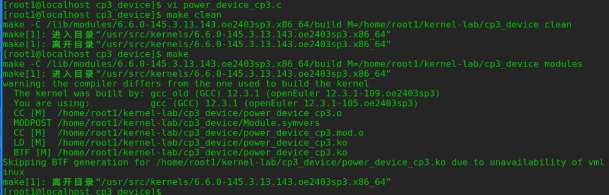

4. 加载模块：
   ```bash
   sudo insmod power_device_cp3.ko
   dmesg | tail
   ```

   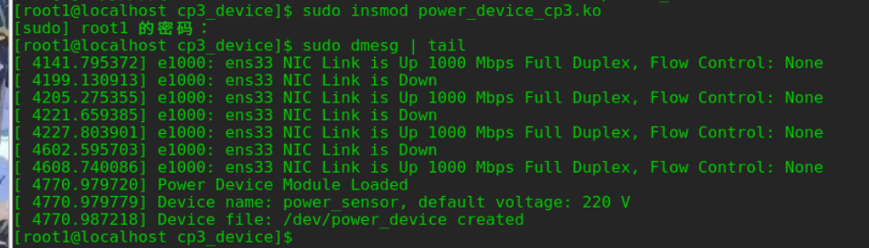

5. 验证设备文件：
   ```bash
   ls -l /dev/power_device
   ```

   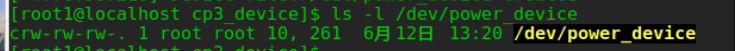

6. 读取设备数据：
   ```bash
   cat /dev/power_device
   ```

   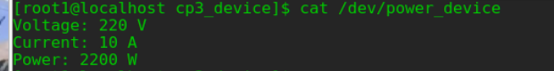

7. 写入设备（修改电力参数）：
   ```bash
   echo "380 15" | sudo tee /dev/power_device
   cat /dev/power_device
   ```

   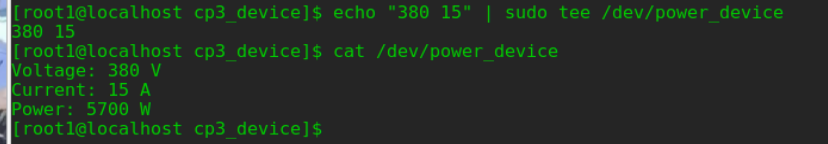

8. 卸载模块：
   ```bash
   sudo rmmod power_device_cp3
   ```

   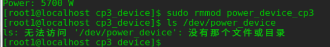

### 验收标准

- [ ] 编译无错误，生成 `.ko` 文件
- [ ] 加载后 `/dev/power_device` 存在
- [ ] `cat /dev/power_device` 显示电压、电流、功率
- [ ] 写入 `"380 15"` 后读取显示正确的计算结果（5700 W）
- [ ] 卸载后设备文件消失

---

## 电力场景应用

### 场景描述

本实验模拟了一个简化的电力设备驱动程序。在实际电力系统中：

1. **电压监测**：实时读取电网电压
2. **电流监测**：监测负载电流
3. **功率计算**：根据电压和电流计算功率
4. **数据保护**：使用互斥锁防止并发访问冲突

### 扩展思考

1. 如何添加温度监测功能？
2. 如何实现过载保护（当功率超过阈值时报警）？
3. 如何使用 procfs 创建更友好的用户接口？

---

## 实验总结

### 常见问题排查

### Q0: 安装软件包时提示 "Could not resolve host"（网卡 DOWN 状态）

**症状**：`sudo dnf install kernel-devel gcc make` 报错，提示无法解析 `repo.openeuler.org`。

**原因**：网卡 `ens33` 处于 DOWN 状态，未获取到 IP 地址。

**排查方法**：

```bash
# 查看网卡状态
ip addr show ens33

# 如果输出中没有 inet 且状态为 DOWN，按以下步骤修复
```

**解决步骤**：

```bash
# 1. 启动网卡
sudo ip link set ens33 up

# 2. 获取动态 IP（DHCP）
sudo dhclient ens33

# 3. 验证网卡状态（应显示 state UP 和 inet IP地址）
ip addr show ens33

# 4. 测试网络连通性
ping -c 4 8.8.8.8

# 5. 直接安装软件包
sudo dnf install -y kernel-devel gcc make
```

### Q1: 编译时找不到头文件

```bash
sudo dnf install -y kernel-devel-$(uname -r)
```

### Q2: 加载模块时提示权限不足

```bash
sudo insmod xxx.ko
```

### Q3: 模块加载后看不到输出

```bash
# 查看内核日志
dmesg | tail -20

# 或使用 journalctl
journalctl -k | tail -20
```

### Q4: 设备文件权限不足

```bash
# 临时修改权限
sudo chmod 666 /dev/power_device

# 或在代码中设置 .mode = 0666
```

---

## 测试脚本

### 脚本位置

自动化测试脚本位于仓库 `tests/test_module.sh`。

### 运行测试

```bash
cd tests
chmod +x test_module.sh
sudo ./test_module.sh
```

### 脚本完整内容

`tests/test_module.sh` 脚本内容如下：

```bash
#!/bin/bash
# test_module.sh - 自动化测试电力设备模块

set -e

MODULE="power_device"
DEVICE="/dev/power_device"

echo "=== 测试1: 编译模块 ==="
make clean > /dev/null 2>&1
make > /dev/null 2>&1
if [ -f "${MODULE}.ko" ]; then
    echo -e "\033[32mPASS\033[0m 编译成功"
else
    echo -e "\033[31mFAIL\033[0m 编译失败"
    exit 1
fi

echo "=== 测试2: 加载模块 ==="
sudo insmod ${MODULE}.ko
if lsmod | grep -q "^${MODULE} "; then
    echo -e "\033[32mPASS\033[0m 模块加载成功"
else
    echo -e "\033[31mFAIL\033[0m 模块加载失败"
    exit 1
fi

echo "=== 测试3: 检查设备文件 ==="
if [ -e "$DEVICE" ]; then
    echo -e "\033[32mPASS\033[0m 设备文件存在"
else
    echo -e "\033[31mFAIL\033[0m 设备文件不存在"
    sudo rmmod ${MODULE}
    exit 1
fi

echo "=== 测试4: 读取初始值 ==="
OUTPUT=$(cat "$DEVICE")
if echo "$OUTPUT" | grep -q "Voltage: 220 V" && \
   echo "$OUTPUT" | grep -q "Current: 10 A"; then
    echo -e "\033[32mPASS\033[0m 初始值正确"
else
    echo -e "\033[31mFAIL\033[0m 初始值错误"
    sudo rmmod ${MODULE}
    exit 1
fi

echo "=== 测试5: 写入并验证 ==="
echo "380 15" | sudo tee "$DEVICE" > /dev/null
OUTPUT=$(cat "$DEVICE")
if echo "$OUTPUT" | grep -q "Voltage: 380 V" && \
   echo "$OUTPUT" | grep -q "Current: 15 A" && \
   echo "$OUTPUT" | grep -q "Power: 5700 W"; then
    echo -e "\033[32mPASS\033[0m 写入后数据正确"
else
    echo -e "\033[31mFAIL\033[0m 写入后数据错误"
    sudo rmmod ${MODULE}
    exit 1
fi

echo "=== 测试6: 卸载模块 ==="
sudo rmmod ${MODULE}
if ! lsmod | grep -q "^${MODULE} "; then
    echo -e "\033[32mPASS\033[0m 模块卸载成功"
else
    echo -e "\033[31mFAIL\033[0m 模块卸载失败"
    exit 1
fi

echo -e "\n\033[32m所有测试通过！\033[0m"
```

### 测试通过示例

```
=== 测试1: 编译模块 ===
PASS 编译成功
=== 测试2: 加载模块 ===
PASS 模块加载成功
=== 测试3: 检查设备文件 ===
PASS 设备文件存在
=== 测试4: 读取初始值 ===
PASS 初始值正确
=== 测试5: 写入并验证 ===
PASS 写入后数据正确
=== 测试6: 卸载模块 ===
PASS 模块卸载成功

所有测试通过！
```

---

## 参考资料

1. Linux Kernel Module Programming Guide
2. OpenEuler 官方文档: https://docs.openeuler.org/
3. Linux Device Drivers, 3rd Edition

---

## 作者信息

- 参赛队伍: 每天好懵逼地活着（上海电力大学）
- 适用版本: openEuler 24.03 LTS
- 最后更新: 2026年6月6日