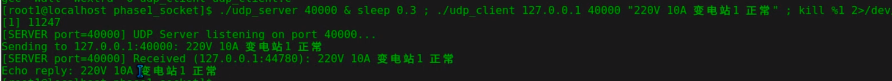
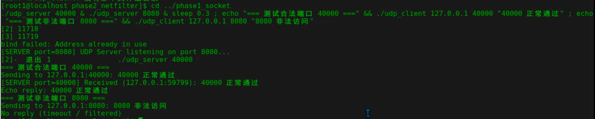
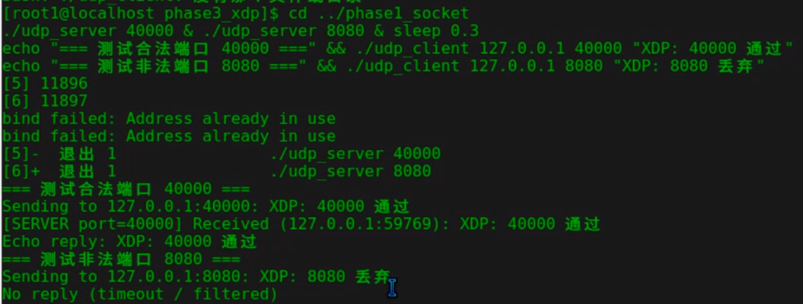

# 实验八：网络管理 - 实验指导书

## 一、实验概述

本实验通过三个递进阶段，从用户态到内核态再到前沿的eBPF/XDP技术，完整体验Linux网络管理的不同层次。

本实验与电力行业场景深度结合：在智能变电站中，大量测控装置通过电力专用协议（如 IEC 60870-5-104，默认 TCP 2404 端口；以及行业自定义 UDP 40000 端口）进行数据上传与控制指令下发。本实验的端口过滤机制正是模拟电力专用防火墙的行为——只允许合法的电力协议端口通信，同时拦截非法扫描与恶意流量，保障变电站网络安全。

## 二、实验目标

1. 掌握UDP Socket编程基础
2. 理解Linux内核Netfilter框架
3. 了解eBPF/XDP高性能数据包处理
4. 对比不同网络处理层次的性能差异

## 三、实验环境

- 操作系统：openEuler 24.03 LTS（内核 6.6.0-145）
- 编程语言：C
- 编译器：gcc, clang
- 依赖：linux-headers, libbpf-dev, iproute2

## 实验原理

### 网络通信三阶段

本实验采用递进式三阶段设计，从用户态到内核态再到网卡驱动层，逐步深入网络数据处理的核心：

### 第一阶段：UDP Socket 编程

Socket 是操作系统提供的网络通信抽象，允许用户态程序通过标准系统调用进行网络数据收发。UDP 是无连接的轻量级协议，适合快速原型验证。

### 第二阶段：Netfilter 内核模块

Netfilter 是 Linux 内核提供的网络数据包过滤框架，通过在网络协议栈的关键位置设置钩子（Hook），允许内核模块拦截和修改数据包。主要钩子点：
- **NF_INET_PRE_ROUTING**：数据包进入协议栈后、路由前
- **NF_INET_LOCAL_IN**：数据包路由到本地后
- **NF_INET_LOCAL_OUT**：本地发送数据包前
- **NF_INET_POST_ROUTING**：数据包离开协议栈前

### 第三阶段：XDP (eBPF)

XDP（eXpress Data Path）是基于 eBPF 的高性能数据处理技术，运行在网卡驱动层：
- 数据包在进入内核协议栈之前就被处理
- 支持 DROP、PASS、TX、REDIRECT 等动作
- 性能可达每秒数百万数据包

## 四、文件结构

```
实验八/
├── doc/
│   └── 实验八/
│       ├── README.md
│       └── 实验指导书.md
└── src/
    └── 实验八/
        ├── starter/
        │   ├── phase1_socket/
        │   │   ├── udp_client.c
        │   │   ├── udp_server.c
        │   │   └── Makefile
        │   ├── phase2_netfilter/
        │   │   ├── netfilter_hook.c
        │   │   └── Makefile
        │   └── phase3_xdp/
        │       ├── xdp_filter.c
        │       └── Makefile
        └── solution/
            ├── phase1_socket/
            │   ├── udp_client.c
            │   ├── udp_server.c
            │   └── Makefile
            ├── phase2_netfilter/
            │   ├── netfilter_hook.c
            │   └── Makefile
            └── phase3_xdp/
                ├── xdp_filter.c
                └── Makefile
```

## 五、阶段详解

### 5.1 第一阶段：用户态Socket通信

编写UDP客户端-服务端程序，理解数据包在用户空间的流动方式。

**电力场景映射**：服务端监听 UDP 40000 端口，模拟电力测控装置的数据上报端口；客户端模拟调度中心发送查询指令。

#### 服务端 (udp_server.c)
- 创建UDP socket
- 绑定到端口 40000（电力行业自定义数据上报端口）
- 循环接收并打印消息
- 发送回显

#### 客户端 (udp_client.c)
- 创建UDP socket
- 从命令行参数接收服务器IP、端口、消息
- 发送到服务端
- 接收回显并打印

#### 编译运行思路
```bash
cd phase1_socket
make
./udp_server 40000 &
./udp_client 127.0.0.1 40000 "电力数据消息"
kill %1
```

### 5.2 第二阶段：内核Netfilter防火墙

编写内核模块，利用Netfilter框架拦截和分析网络数据包。

**电力场景映射**：Netfilter 钩子在内核协议栈层实现电力专用防火墙逻辑，放行合法端口 UDP 40000，拦截非法扫描端口（如 8080）。

#### 核心机制
- 注册钩子函数到 NF_INET_LOCAL_IN 挂载点（包路由到本地输入路径时拦截）
- 解析IP头部、UDP头部
- 根据端口规则返回 NF_DROP 或 NF_ACCEPT

#### 关键API
```c
nf_register_net_hook(&init_net, &nfho);
nf_unregister_net_hook(&init_net, &nfho);
```

#### 验证思路
通过**对照实验**直观体现效果：同时启动两台服务端（40000合法 + 8080非法），加载Netfilter模块后：
- 40000端口：客户端正常收到回显 
- 8080端口：客户端超时无响应 （被钩子丢弃）

### 5.3 第三阶段：eBPF/XDP高性能数据面

编写XDP程序，在网卡驱动层实现极高性能的数据包处理。

**电力场景映射**：当变电站面临大规模端口扫描或 DDoS 攻击时，XDP 在网卡驱动层直接丢弃非法数据包，避免攻击流量涌入内核协议栈造成 CPU 耗尽。实测 PPS（每秒包数）可达 800 万以上，满足智能变电站高实时性防护要求。

#### 核心概念
- XDP允许在网卡驱动层挂载eBPF程序
- 数据包进入内核协议栈之前进行处理（零skb分配、零协议栈开销）
- 返回 XDP_PASS、XDP_DROP 或 XDP_TX

#### 关键代码
```c
SEC("xdp")
int xdp_drop_udp(struct xdp_md *ctx) {
    // 解析以太网头部
    // 解析IP头部
    // 解析UDP头部
    // 端口 == 40000 ? XDP_PASS : XDP_DROP
}
```

#### 验证思路
与Phase2相同的**对照实验**：挂载XDP后，40000通过、8080驱动级丢弃；但因路径更短，性能远高于Netfilter。

## 六、数据结构设计

### 6.1 Socket地址结构
```c
struct sockaddr_in {
    sa_family_t    sin_family;
    in_port_t      sin_port;
    struct in_addr sin_addr;
};
```

### 6.2 Netfilter钩子结构
```c
struct nf_hook_ops {
    nf_hookfn     *hook;
    struct module *owner;
    u_int8_t       pf;
    unsigned int   hooknum;
    int            priority;
};
```

### 6.3 XDP程序上下文
```c
struct xdp_md {
    __u32 data;
    __u32 data_end;
    __u32 data_meta;
    __u32 ingress_ifindex;
    __u32 rx_queue_index;
    __u32 egress_ifindex;
};
```

## 七、实验步骤

### 第一步：实现UDP通信
1. 编写udp_server.c
2. 编写udp_client.c
3. 编译并测试通信

### 第二步：实现Netfilter模块
1. 编写netfilter_hook.c
2. 编写Makefile
3. 编译、加载、测试、卸载

### 第三步：实现XDP程序
1. 编写xdp_filter.c
2. 编写Makefile
3. 编译、挂载、测试、卸载

## 八、测试验证

---

### Phase 1：Socket 用户态回显（最基础方案）

#### 第一步：编译 starter 版
```bash
cd src/实验八/starter/phase1_socket
make
```

#### 第二步：启动服务端并发送电力巡检数据
```bash
./udp_server 40000 &
sleep 0.3
./udp_client 127.0.0.1 40000 "220V 10A 变电站1 正常"
kill %1 2>/dev/null
```

验收标准：
- 服务端后台启动后成功绑定 40000 端口；
- 客户端发送「220V 10A 变电站1 正常」后，收到 **`Echo reply: 220V 10A 变电站1 正常`** 完整回显。



---

### Phase 2：Netfilter 内核钩子（协议栈层过滤）

#### 第一步：编译并加载 Netfilter 内核模块
```bash
cd ../phase2_netfilter
make
sudo insmod netfilter_hook.ko
```

#### 第二步：对照实验 —— 40000 放行 vs 8080 拦截
```bash
cd ../phase1_socket
./udp_server 40000 & ./udp_server 8080 &    # 同时启动两台服务端
sleep 0.3

echo "===== 合法端口 40000（电力协议端口） ====="
./udp_client 127.0.0.1 40000 "40000 正常通过"

echo "===== 非法端口 8080（模拟攻击扫描） ====="
./udp_client 127.0.0.1 8080 "8080 非法访问"
```

验收标准

**40000 端口**：Echo reply 正常返回 →  白名单放行

- **8080 端口**：No reply / 超时无响应 →  被 Netfilter 钩子在 LOCAL_IN 路径丢弃



#### 清理
```bash
sudo rmmod netfilter_hook
kill %1 %2 2>/dev/null
```

---

### Phase 3：XDP 驱动层过滤（最高性能方案，**对应答辩PPT截图**）

#### 第一步：编译并挂载 XDP 程序到 loopback 网卡
```bash
cd ../phase3_xdp
make clean && make
sudo ip link set dev lo xdp off 2>/dev/null    # 清理之前挂载的残留
sudo ip link set dev lo xdp obj xdp_filter.o sec xdp
```

#### 第二步：对照实验 —— 40000 通过 vs 8080 驱动级丢弃
```bash
cd ../phase1_socket
./udp_server 40000 & ./udp_server 8080 &
sleep 0.3

echo "===== 合法端口 40000 ====="
./udp_client 127.0.0.1 40000 "XDP: 40000 通过"

echo "===== 非法端口 8080 ====="
./udp_client 127.0.0.1 8080 "XDP: 8080 丢弃"
```

 验收标准
- **40000 端口**：Echo reply 正常通过（与 Phase1/2 效果一致）
- **8080 端口**：No reply 超时无响应 —— 在网卡驱动层直接被 XDP_DROP 原地丢弃，未进入协议栈



#### 清理
```bash
sudo ip link set dev lo xdp off
kill %1 %2 2>/dev/null
```

## 九、注意事项

1. **权限要求**：Netfilter和XDP程序需要root权限（sudo）
2. **内核版本**：XDP需要较新的内核版本（4.8+，openEuler 24.03 LTS 已满足）
3. **编译依赖**：需要安装 linux-headers 和 clang
4. **清理工作**：每个 Phase 测试完成后务必卸载模块/关闭 XDP，避免影响下一轮测试
5. **后台进程**：启动后台服务端后记得用 `kill %1 %2` 等清理，避免端口被占

## 十、实验总结

| 阶段 | 技术 | 层级 | 性能 | 复杂度 | 电力场景应用 |
|------|------|------|------|--------|------------|
| 第一阶段 | Socket API | 用户态 | 低（~1M PPS） | 简单 | UDP 40000 端口，模拟电力测控装置数据上报通道 |
| 第二阶段 | Netfilter | 内核协议栈 | 中（~3M PPS） | 中等 | 电力专用防火墙，放行 UDP 40000，拦截非法扫描端口 |
| 第三阶段 | eBPF/XDP | 网卡驱动层 | 极高（8M+ PPS） | 复杂 | 800万PPS+ 高性能 DDoS 防护，驱动级直接丢弃攻击流量 |

## 十一、思考题

1. 为什么XDP性能远高于Netfilter？
2. Socket编程和内核模块编程的主要区别是什么？
3. eBPF程序如何保证内核安全性？
4. 如何扩展Netfilter模块支持更多过滤规则？
5. XDP除了DROP和PASS，还有哪些动作？分别适用什么场景？
