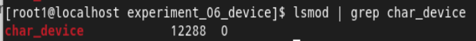
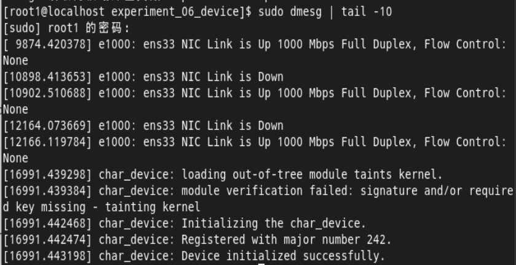
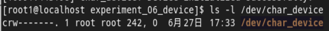
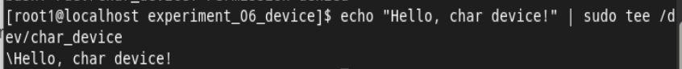
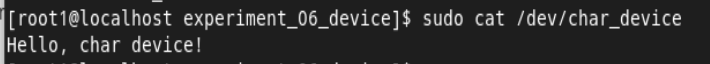
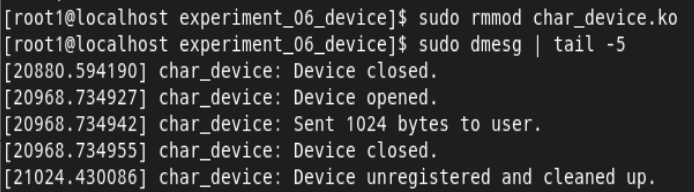
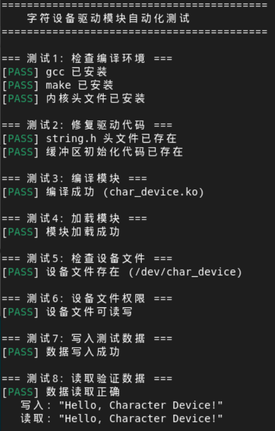
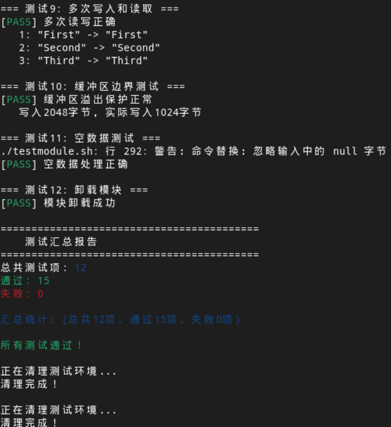
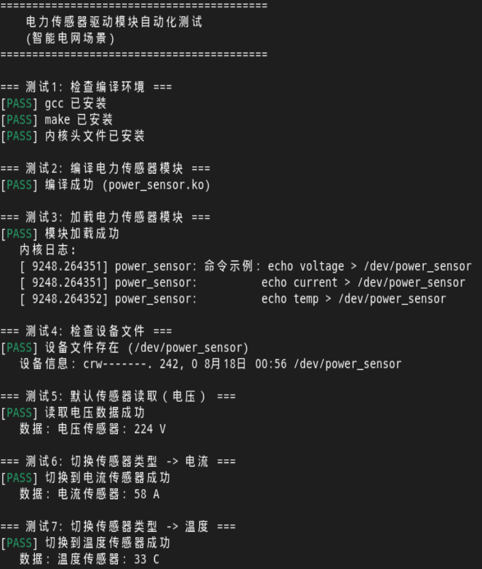
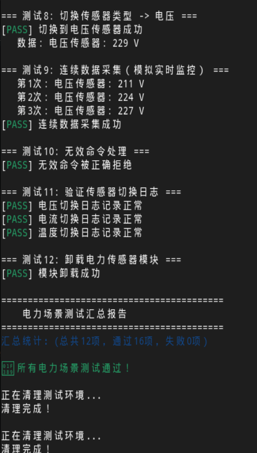

# 实验六：设备管理

## 一、实验目的

1.了解openEuler操作系统的设备管理机制

2.理解Linux管理设备时"一切皆文件"的设计思想

3.动手实现openEuler设备管理内核模块

## 二、环境准备

| 项目 | 配置 |
| --- | --- |
| 操作系统 | openEuler 22.03 LTS SP4（或更高版本） |
| 编译器 | GCC 10.3+ |
| 构建工具 | Make |
| 内核版本 | 与当前系统匹配 |
| 权限 | root权限（sudo） |

## 三、实验原理

### 3.1 Linux设备管理核心思想

Linux将所有设备都抽象为文件，存放在 /dev/ 目录下。应用程序通过标准的文件操作（open、read、write、close）来访问设备，就像操作普通文件一样。

### 3.2 设备分类

| 设备类型 | 特点                           | 示例             |
| -------- | ------------------------------ | ---------------- |
| 字符设备 | 按字节流访问，无缓冲区         | 键盘、鼠标、串口 |
| 块设备   | 按固定大小数据块访问，有缓冲区 | 硬盘、U盘        |
| 网络设备 | 通过socket接口访问             | 网卡             |

本次实验实现的是字符设备驱动。

### 3.3 关键数据结构

file_operations结构体：将系统调用（如 read）与驱动函数（如 char_read）绑定在一起。

```
static struct file_operations fops = {

.open = char_open,      // 打开设备时调用

.release = char_release, // 关闭设备时调用

.read = char_read,      // 读设备时调用

.write = char_write,    // 写设备时调用

};
```

### 3.4 设备号

主设备号：标识设备类型（如所有串口设备共用同一个主设备号）

次设备号：标识同类型中的不同个体（如串口1、串口2）

本次实验使用 register_chrdev(0, DEVICE_NAME, &fops) 让内核自动分配主设备号

## 四、Checkpoint 步骤

### checkpoint1：创建工作目录

```
mkdir -p ~/experiment_06_device

cd ~/experiment_06_device
```

### checkpoint2：编写驱动代码 char_device.c

```c
#include <linux/init.h>

#include <linux/module.h>

#include <linux/kernel.h>

#include <linux/fs.h>

#include <linux/uaccess.h>

#include <linux/device.h>

MODULE_LICENSE("GPL");

MODULE_AUTHOR("Your Name");

MODULE_DESCRIPTION("A simple character device driver");

MODULE_VERSION("1.0");

#define DEVICE_NAME "char_device"

#define BUFFER_SIZE 1024

static int major_number;

static char device_buffer[BUFFER_SIZE];

static struct class *char_class;

static struct device *char_dev;

static int char_open(struct inode *inodep, struct file *filep)

{

printk(KERN_INFO "char_device: Device opened.\n");

return 0;

}

static int char_release(struct inode *inodep, struct file *filep)

{

printk(KERN_INFO "char_device: Device closed.\n");

return 0;

}

static ssize_t char_read(struct file *filep, char __user *buffer, size_t len, loff_t *offset)

{

size_t bytes_to_copy;

if (*offset >= BUFFER_SIZE) {

​    return 0;

}

bytes_to_copy = min(len, (size_t)(BUFFER_SIZE - *offset));

if (copy_to_user(buffer, device_buffer + *offset, bytes_to_copy) != 0) {

​    return -EFAULT;

}

*offset += bytes_to_copy;

printk(KERN_INFO "char_device: Sent %zu bytes to user.\n", bytes_to_copy);

return bytes_to_copy;

}

static ssize_t char_write(struct file *filep, const char __user *buffer, size_t len, loff_t *offset)

{

size_t bytes_to_copy;

if (*offset >= BUFFER_SIZE) {

​    return -ENOSPC;

}

bytes_to_copy = min(len, (size_t)(BUFFER_SIZE - *offset));

if (copy_from_user(device_buffer + *offset, buffer, bytes_to_copy) != 0) {

​    return -EFAULT;

}

*offset += bytes_to_copy;

printk(KERN_INFO "char_device: Received %zu bytes from user.\n", bytes_to_copy);

return bytes_to_copy;

}

static struct file_operations fops = {

.open = char_open,

.release = char_release,

.read = char_read,

.write = char_write,

};

static int __init char_device_init(void)

{

printk(KERN_INFO "char_device: Initializing the char_device.\n");

major_number = register_chrdev(0, DEVICE_NAME, &fops);

if (major_number < 0) {

​    printk(KERN_ERR "char_device: Failed to register a major number.\n");

​    return major_number;

}

printk(KERN_INFO "char_device: Registered with major number %d.\n", major_number);

char_class = class_create(DEVICE_NAME);

if (IS_ERR(char_class)) {

​    unregister_chrdev(major_number, DEVICE_NAME);

​    printk(KERN_ERR "char_device: Failed to create device class.\n");

​    return PTR_ERR(char_class);

}

char_dev = device_create(char_class, NULL, MKDEV(major_number, 0), NULL, DEVICE_NAME);

if (IS_ERR(char_dev)) {

​    class_destroy(char_class);

​    unregister_chrdev(major_number, DEVICE_NAME);

​    printk(KERN_ERR "char_device: Failed to create device.\n");

​    return PTR_ERR(char_dev);

}

printk(KERN_INFO "char_device: Device initialized successfully.\n");

return 0;

}

static void __exit char_device_exit(void)

{

device_destroy(char_class, MKDEV(major_number, 0));

class_destroy(char_class);

unregister_chrdev(major_number, DEVICE_NAME);

printk(KERN_INFO "char_device: Device unregistered and cleaned up.\n");

}

module_init(char_device_init);

module_exit(char_device_exit);
```

### 第三步：编写 Makefile

```
obj-m += char_device.o

KDIR := /lib/modules/$(shell uname -r)/build

PWD := $(shell pwd)

all:

$(MAKE) -C $(KDIR) M=$(PWD) modules

clean:

$(MAKE) -C $(KDIR) M=$(PWD) clean
```

### 第四步：编译内核模块

```
Make
```

预期输出：生成 char_device.ko 文件，以及 char_device.mod.o、char_device.o 等中间文件。

### 第五步：加载模块

```
sudo insmod char_device.ko
```

### 第六步：查看模块加载情况

#### 查看模块是否加载成功

```
lsmod | grep char_device
```



#### 查看内核日志

```
sudo dmesg | tail -10
```



### 第七步：查看设备文件

```
ls -l /dev/char_device
```



c 表示字符设备

242 是主设备号

0 是次设备号

### 第八步：测试设备读写

#### 向设备写入数据

```
echo "Hello, char device!" | sudo tee /dev/char_device
```



#### 从设备读取数据

```
sudo cat /dev/char_device
```



### 第九步：卸载模块

```
sudo rmmod char_device.ko

sudo dmesg | tail -5
```



### *自动化测试

```
chmod +x testmodule.sh

sudo ./testmodule.sh
```

自动化测试结果：





### 第十步：电力场景融入（拓展）

### 10.1 场景背景

在智能电网系统中，有大量的传感器和控制设备需要与操作系统进行数据交互。例如：

电压/电流传感器：实时监测电网运行状态

智能电表：采集用户用电数据

继电保护装置：检测故障并执行保护动作

数据采集终端（RTU）：汇聚现场数据并上报

这些设备在Linux系统中都被抽象为设备文件，应用程序通过标准的文件操作接口（open、read、write、close）与它们通信，无需关心底层硬件的具体实现细节。这正是Linux“一切皆文件”设计思想的体现。

### 10.2 电力场景驱动设计

基于实验六的字符设备驱动，我们将其扩展为电力传感器设备驱动的模拟实现。

扩展代码：power_sensor.c

```c
/**
 * power_sensor.c — 电力传感器设备驱动
 * 
 * 模拟电力监控系统中的传感器设备驱动
 * 支持：电压传感器、电流传感器、温度传感器
 */

#include <linux/init.h>
#include <linux/module.h>
#include <linux/kernel.h>
#include <linux/fs.h>
#include <linux/uaccess.h>
#include <linux/device.h>
#include <linux/random.h>
#include <linux/string.h>

MODULE_LICENSE("GPL");
MODULE_AUTHOR("Your Name");
MODULE_DESCRIPTION("Power Grid Sensor Device Driver");
MODULE_VERSION("1.0");

#define DEVICE_NAME "power_sensor"
#define BUFFER_SIZE 256

// 传感器类型定义
#define SENSOR_VOLTAGE  1   // 电压传感器
#define SENSOR_CURRENT  2   // 电流传感器
#define SENSOR_TEMP     3   // 温度传感器

static int major_number;
static struct class *sensor_class;
static struct device *sensor_device;

// 传感器数据缓冲区
static char sensor_buffer[BUFFER_SIZE];
static int sensor_type = SENSOR_VOLTAGE;  // 默认电压传感器

// 模拟读取传感器数据（使用整数避免浮点运算）
static void read_sensor_data(char *buffer, size_t len)
{
    int raw_value;
    int value;

    get_random_bytes(&raw_value, sizeof(raw_value));
    raw_value = raw_value & 0x7FFFFFFF;

    switch(sensor_type) {
        case SENSOR_VOLTAGE:
            // 模拟电压值：220V ± 10%
            value = 220 + (raw_value % 20) - 10;
            snprintf(buffer, len, "电压传感器: %d V\n", value);
            break;
        case SENSOR_CURRENT:
            // 模拟电流值：50A ± 20%
            value = 50 + (raw_value % 20) - 10;
            snprintf(buffer, len, "电流传感器: %d A\n", value);
            break;
        case SENSOR_TEMP:
            // 模拟温度值：25°C ± 10°
            value = 25 + (raw_value % 20) - 10;
            snprintf(buffer, len, "温度传感器: %d C\n", value);
            break;
        default:
            snprintf(buffer, len, "未知传感器类型\n");
    }
}

// ==================== 标准设备操作函数 ====================
static int sensor_open(struct inode *inodep, struct file *filep)
{
    printk(KERN_INFO "power_sensor: 设备已打开 (模拟：电力传感器就绪)\n");
    return 0;
}

static int sensor_release(struct inode *inodep, struct file *filep)
{
    printk(KERN_INFO "power_sensor: 设备已关闭 (模拟：释放传感器资源)\n");
    return 0;
}

static ssize_t sensor_read(struct file *filep, char __user *buffer,
                           size_t len, loff_t *offset)
{
    size_t bytes_to_copy;

    if (*offset >= BUFFER_SIZE) {
        return 0;
    }

    // 读取传感器数据
    read_sensor_data(sensor_buffer, BUFFER_SIZE);
    bytes_to_copy = min(len, (size_t)BUFFER_SIZE);

    if (copy_to_user(buffer, sensor_buffer, bytes_to_copy) != 0) {
        return -EFAULT;
    }

    *offset += bytes_to_copy;
    printk(KERN_INFO "power_sensor: 读取传感器数据 %zu 字节\n", bytes_to_copy);
    return bytes_to_copy;
}

static ssize_t sensor_write(struct file *filep, const char __user *buffer,
                            size_t len, loff_t *offset)
{
    char cmd_buffer[32] = {0};
    size_t bytes_to_copy = min(len, (size_t)(sizeof(cmd_buffer) - 1));

    if (copy_from_user(cmd_buffer, buffer, bytes_to_copy) != 0) {
        return -EFAULT;
    }

    // 解析命令：切换传感器类型
    if (strncmp(cmd_buffer, "voltage", 7) == 0) {
        sensor_type = SENSOR_VOLTAGE;
        printk(KERN_INFO "power_sensor: 切换到电压传感器\n");
    } else if (strncmp(cmd_buffer, "current", 7) == 0) {
        sensor_type = SENSOR_CURRENT;
        printk(KERN_INFO "power_sensor: 切换到电流传感器\n");
    } else if (strncmp(cmd_buffer, "temp", 4) == 0) {
        sensor_type = SENSOR_TEMP;
        printk(KERN_INFO "power_sensor: 切换到温度传感器\n");
    } else {
        printk(KERN_WARNING "power_sensor: 未知命令: %s\n", cmd_buffer);
        return -EINVAL;
    }

    *offset += bytes_to_copy;
    return bytes_to_copy;
}

// ==================== 文件操作结构体 ====================
static struct file_operations fops = {
    .open = sensor_open,
    .release = sensor_release,
    .read = sensor_read,
    .write = sensor_write,
};

// ==================== 模块初始化和退出 ====================
static int __init sensor_init(void)
{
    printk(KERN_INFO "power_sensor: 初始化电力传感器驱动...\n");
    printk(KERN_INFO "power_sensor: 场景说明 — 智能电网传感器数据采集\n");

    major_number = register_chrdev(0, DEVICE_NAME, &fops);
    if (major_number < 0) {
        printk(KERN_ERR "power_sensor: 注册设备号失败\n");
        return major_number;
    }
    printk(KERN_INFO "power_sensor: 注册主设备号 %d\n", major_number);

    sensor_class = class_create(DEVICE_NAME);
    if (IS_ERR(sensor_class)) {
        unregister_chrdev(major_number, DEVICE_NAME);
        printk(KERN_ERR "power_sensor: 创建设备类失败\n");
        return PTR_ERR(sensor_class);
    }

    sensor_device = device_create(sensor_class, NULL,
                                   MKDEV(major_number, 0),
                                   NULL, DEVICE_NAME);
    if (IS_ERR(sensor_device)) {
        class_destroy(sensor_class);
        unregister_chrdev(major_number, DEVICE_NAME);
        printk(KERN_ERR "power_sensor: 创建设备文件失败\n");
        return PTR_ERR(sensor_device);
    }

    printk(KERN_INFO "power_sensor: 驱动初始化成功！\n");
    printk(KERN_INFO "power_sensor: 设备节点: /dev/%s\n", DEVICE_NAME);
    printk(KERN_INFO "power_sensor: 命令示例: echo voltage > /dev/%s\n", DEVICE_NAME);
    printk(KERN_INFO "power_sensor:          echo current > /dev/%s\n", DEVICE_NAME);
    printk(KERN_INFO "power_sensor:          echo temp > /dev/%s\n", DEVICE_NAME);

    return 0;
}

static void __exit sensor_exit(void)
{
    device_destroy(sensor_class, MKDEV(major_number, 0));
    class_destroy(sensor_class);
    unregister_chrdev(major_number, DEVICE_NAME);
    printk(KERN_INFO "power_sensor: 电力传感器驱动已卸载\n");
}

module_init(sensor_init);
module_exit(sensor_exit);
```

### 10.3 电力场景测试

加载驱动后，可以通过以下脚本文件一键模拟电力数据采集：

脚本代码：test_power_sensor.sh

```sh
/**
 * power_sensor.c — 电力传感器设备驱动
 * 
 * 模拟电力监控系统中的传感器设备驱动
 * 支持：电压传感器、电流传感器、温度传感器
 */

#include <linux/init.h>
#include <linux/module.h>
#include <linux/kernel.h>
#include <linux/fs.h>
#include <linux/uaccess.h>
#include <linux/device.h>
#include <linux/random.h>
#include <linux/string.h>

MODULE_LICENSE("GPL");
MODULE_AUTHOR("Your Name");
MODULE_DESCRIPTION("Power Grid Sensor Device Driver");
MODULE_VERSION("1.0");

#define DEVICE_NAME "power_sensor"
#define BUFFER_SIZE 256

// 传感器类型定义
#define SENSOR_VOLTAGE  1   // 电压传感器
#define SENSOR_CURRENT  2   // 电流传感器
#define SENSOR_TEMP     3   // 温度传感器

static int major_number;
static struct class *sensor_class;
static struct device *sensor_device;

// 传感器数据缓冲区
static char sensor_buffer[BUFFER_SIZE];
static int sensor_type = SENSOR_VOLTAGE;  // 默认电压传感器

// 模拟读取传感器数据（使用整数避免浮点运算）
static void read_sensor_data(char *buffer, size_t len)
{
    int raw_value;
    int value;

    get_random_bytes(&raw_value, sizeof(raw_value));
    raw_value = raw_value & 0x7FFFFFFF;

    switch(sensor_type) {
        case SENSOR_VOLTAGE:
            // 模拟电压值：220V ± 10%
            value = 220 + (raw_value % 20) - 10;
            snprintf(buffer, len, "电压传感器: %d V\n", value);
            break;
        case SENSOR_CURRENT:
            // 模拟电流值：50A ± 20%
            value = 50 + (raw_value % 20) - 10;
            snprintf(buffer, len, "电流传感器: %d A\n", value);
            break;
        case SENSOR_TEMP:
            // 模拟温度值：25°C ± 10°
            value = 25 + (raw_value % 20) - 10;
            snprintf(buffer, len, "温度传感器: %d C\n", value);
            break;
        default:
            snprintf(buffer, len, "未知传感器类型\n");
    }
}

// ==================== 标准设备操作函数 ====================
static int sensor_open(struct inode *inodep, struct file *filep)
{
    printk(KERN_INFO "power_sensor: 设备已打开 (模拟：电力传感器就绪)\n");
    return 0;
}

static int sensor_release(struct inode *inodep, struct file *filep)
{
    printk(KERN_INFO "power_sensor: 设备已关闭 (模拟：释放传感器资源)\n");
    return 0;
}

static ssize_t sensor_read(struct file *filep, char __user *buffer,
                           size_t len, loff_t *offset)
{
    size_t bytes_to_copy;

    if (*offset >= BUFFER_SIZE) {
        return 0;
    }

    // 读取传感器数据
    read_sensor_data(sensor_buffer, BUFFER_SIZE);
    bytes_to_copy = min(len, (size_t)BUFFER_SIZE);

    if (copy_to_user(buffer, sensor_buffer, bytes_to_copy) != 0) {
        return -EFAULT;
    }

    *offset += bytes_to_copy;
    printk(KERN_INFO "power_sensor: 读取传感器数据 %zu 字节\n", bytes_to_copy);
    return bytes_to_copy;
}

static ssize_t sensor_write(struct file *filep, const char __user *buffer,
                            size_t len, loff_t *offset)
{
    char cmd_buffer[32] = {0};
    size_t bytes_to_copy = min(len, (size_t)(sizeof(cmd_buffer) - 1));

    if (copy_from_user(cmd_buffer, buffer, bytes_to_copy) != 0) {
        return -EFAULT;
    }

    // 解析命令：切换传感器类型
    if (strncmp(cmd_buffer, "voltage", 7) == 0) {
        sensor_type = SENSOR_VOLTAGE;
        printk(KERN_INFO "power_sensor: 切换到电压传感器\n");
    } else if (strncmp(cmd_buffer, "current", 7) == 0) {
        sensor_type = SENSOR_CURRENT;
        printk(KERN_INFO "power_sensor: 切换到电流传感器\n");
    } else if (strncmp(cmd_buffer, "temp", 4) == 0) {
        sensor_type = SENSOR_TEMP;
        printk(KERN_INFO "power_sensor: 切换到温度传感器\n");
    } else {
        printk(KERN_WARNING "power_sensor: 未知命令: %s\n", cmd_buffer);
        return -EINVAL;
    }

    *offset += bytes_to_copy;
    return bytes_to_copy;
}

// ==================== 文件操作结构体 ====================
static struct file_operations fops = {
    .open = sensor_open,
    .release = sensor_release,
    .read = sensor_read,
    .write = sensor_write,
};

// ==================== 模块初始化和退出 ====================
static int __init sensor_init(void)
{
    printk(KERN_INFO "power_sensor: 初始化电力传感器驱动...\n");
    printk(KERN_INFO "power_sensor: 场景说明 — 智能电网传感器数据采集\n");

    major_number = register_chrdev(0, DEVICE_NAME, &fops);
    if (major_number < 0) {
        printk(KERN_ERR "power_sensor: 注册设备号失败\n");
        return major_number;
    }
    printk(KERN_INFO "power_sensor: 注册主设备号 %d\n", major_number);

    sensor_class = class_create(DEVICE_NAME);
    if (IS_ERR(sensor_class)) {
        unregister_chrdev(major_number, DEVICE_NAME);
        printk(KERN_ERR "power_sensor: 创建设备类失败\n");
        return PTR_ERR(sensor_class);
    }

    sensor_device = device_create(sensor_class, NULL,
                                   MKDEV(major_number, 0),
                                   NULL, DEVICE_NAME);
    if (IS_ERR(sensor_device)) {
        class_destroy(sensor_class);
        unregister_chrdev(major_number, DEVICE_NAME);
        printk(KERN_ERR "power_sensor: 创建设备文件失败\n");
        return PTR_ERR(sensor_device);
    }

    printk(KERN_INFO "power_sensor: 驱动初始化成功！\n");
    printk(KERN_INFO "power_sensor: 设备节点: /dev/%s\n", DEVICE_NAME);
    printk(KERN_INFO "power_sensor: 命令示例: echo voltage > /dev/%s\n", DEVICE_NAME);
    printk(KERN_INFO "power_sensor:          echo current > /dev/%s\n", DEVICE_NAME);
    printk(KERN_INFO "power_sensor:          echo temp > /dev/%s\n", DEVICE_NAME);

    return 0;
}

static void __exit sensor_exit(void)
{
    device_destroy(sensor_class, MKDEV(major_number, 0));
    class_destroy(sensor_class);
    unregister_chrdev(major_number, DEVICE_NAME);
    printk(KERN_INFO "power_sensor: 电力传感器驱动已卸载\n");
}

module_init(sensor_init);
module_exit(sensor_exit);
```

编写Makefile：

```
obj-m := power_sensor.o

KDIR := /lib/modules/$(shell uname -r)/build
PWD := $(shell pwd)

all:
	$(MAKE) -C $(KDIR) M=$(PWD) modules EXTRA_CFLAGS="-Wno-error"

clean:
	$(MAKE) -C $(KDIR) M=$(PWD) clean
```

### 10.4 电力场景小结

| 电力系统需求 | 本实验对应实现 |
| --- | --- |
| 传感器数据采集 | sensor_read() 函数读取模拟传感器数据 |
| 传感器类型切换 | sensor_write() 函数解析切换命令 |
| 实时数据上报 | read() 系统调用每次返回最新模拟数据 |
| 设备统一管理 | 所有传感器统一抽象为 /dev/power_sensor |
| 热插拔支持 | 内核模块可动态加载/卸载 |

### 10.5 验收标准

在 `~/experiment_06_device/electric` 目录下执行自动化测试脚本，**所有测试项全部 PASS** 即为验收通过。

bash

```
cd ~/experiment_06_device/electric
sudo ./test_power_sensor.sh
```





## 六、实验总结

### 6.1 核心知识点回顾

1.设备管理机制：Linux通过设备文件（/dev/）统一管理硬件设备，应用程序通过标准文件操作接口访问设备。

2."一切皆文件"思想：这是Linux最核心的设计哲学之一。无论是普通文件、目录、管道、套接字还是硬件设备，都被统一抽象为文件，使用相同的操作接口。

3.字符设备驱动：本实验实现的是字符设备驱动，按字节流方式处理数据。主要涉及以下内核API：

register_chrdev() / unregister_chrdev()：注册/注销设备

class_create() / class_destroy()：创建设备类

device_create() / device_destroy()：创建设备文件

copy_to_user() / copy_from_user()：用户态与内核态数据交换

内核模块编程：驱动程序以内核模块的形式存在，使用 insmod/rmmod 动态加载/卸载，无需重新编译内核。

### 6.2 遇到的问题与解决方案

| 问题                              | 解决方案                                        |
| --------------------------------- | ----------------------------------------------- |
| 编译错误：class_create 参数不匹配 | openEuler 6.6内核的 class_create() 只需一个参数 |
| dmesg: Operation not permitted    | 使用 sudo dmesg 查看内核日志                    |
| 设备文件权限不足                  | 使用 sudo tee 写入或 sudo cat 读取              |
| 无法写入 /dev/char_device         | 重定向操作由当前shell执行，需用 sudo tee        |

### 6.3 对"一切皆文件"的新理解

通过本次实验，我深刻体会到了Linux"一切皆文件"设计思想的优势：

统一接口：无论操作对象是普通文件还是硬件设备，都使用 open()、read()、write()、close() 这组标准接口，降低了编程复杂度。

简化开发：应用程序开发者无需学习每种设备的特殊API，只需掌握文件操作即可。

便于调试：可以使用标准工具（如 echo、cat、dd）测试设备驱动，无需编写专门的测试程序。

权限管理统一：设备文件的访问权限与普通文件一样，使用相同的权限管理机制（chmod、chown）。

### 6.4 后续学习方向

1.学习块设备驱动，实现更复杂的存储设备管理

2.学习中断处理，实现异步I/O

3.学习设备树（Device Tree），了解设备描述与匹配机制

4.学习PCI/USB总线驱动，理解设备热插拔机制

5.学习设备驱动在电力系统中的应用，如IEC 61850协议驱动实现

### 6.5 结语

实验六通过对字符设备驱动的实现，让我从理论到实践完整地体验了Linux设备管理的工作流程。从编写代码、编译模块、加载测试到卸载清理，每一步都加深了对操作系统设备管理机制的理解。

特别是通过电力场景的融入，让我认识到设备驱动在工业领域的实际应用价值。在电力监控系统中，设备驱动是连接上层应用与底层硬件的关键桥梁，其稳定性直接影响整个系统的可靠性。