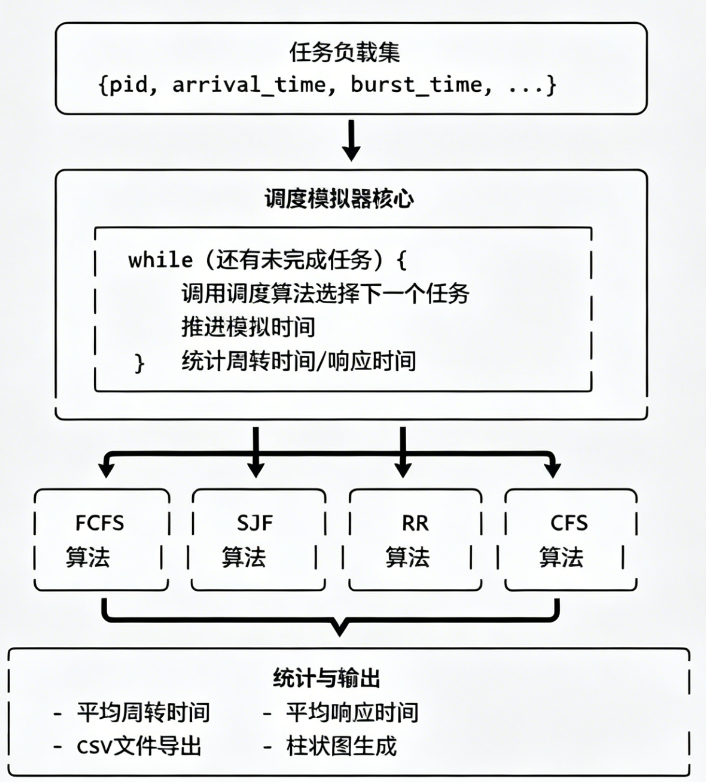
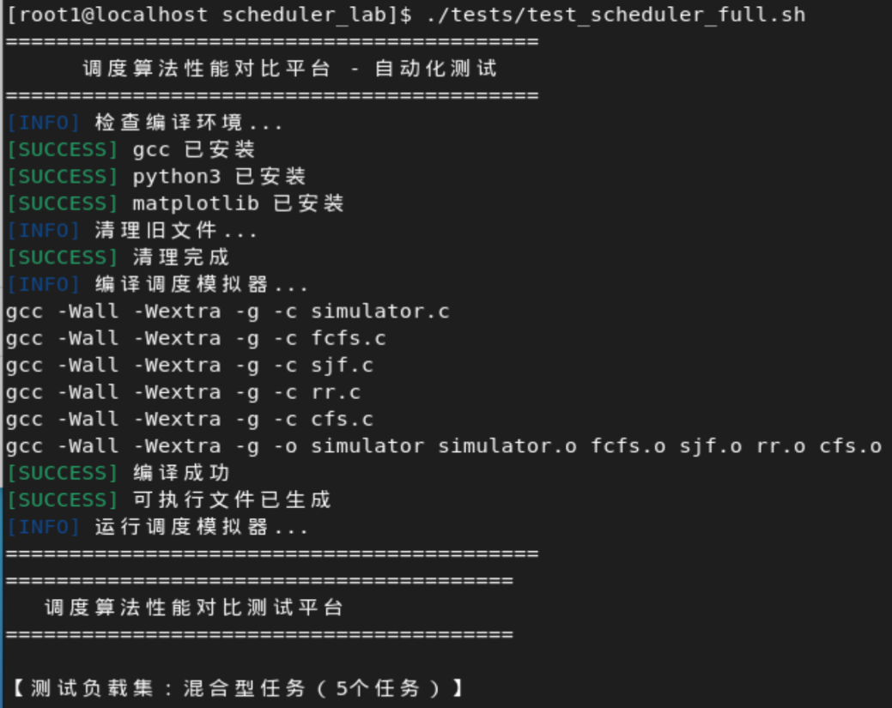
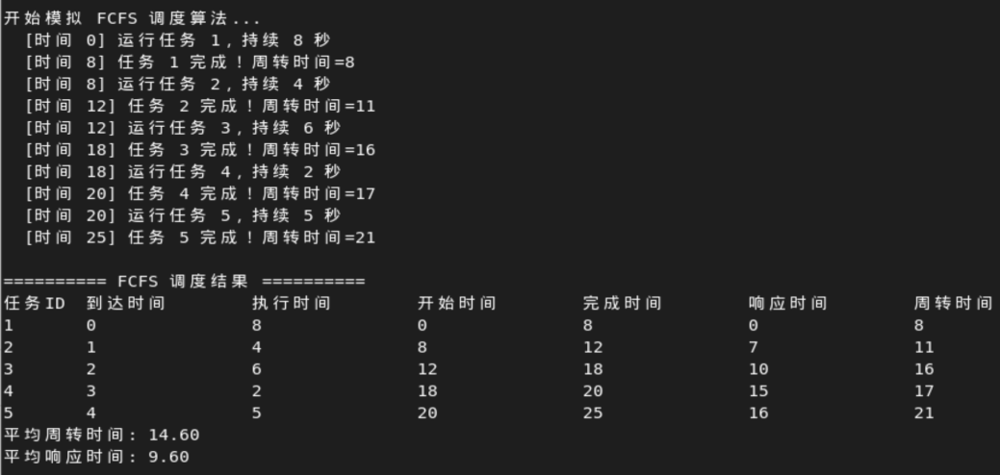
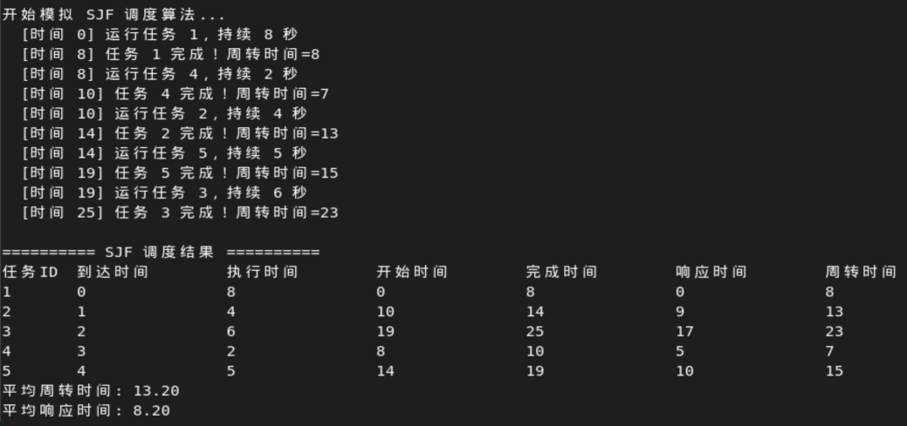
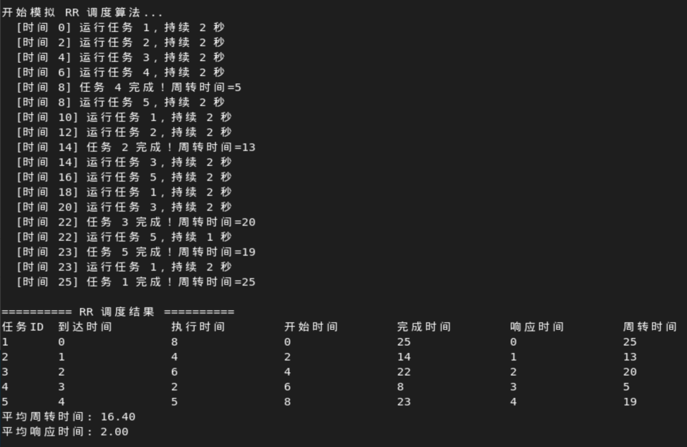
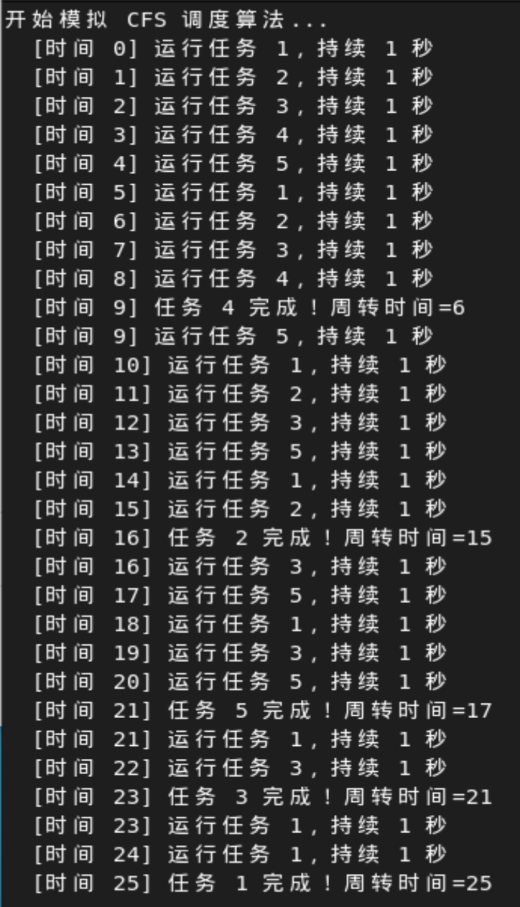
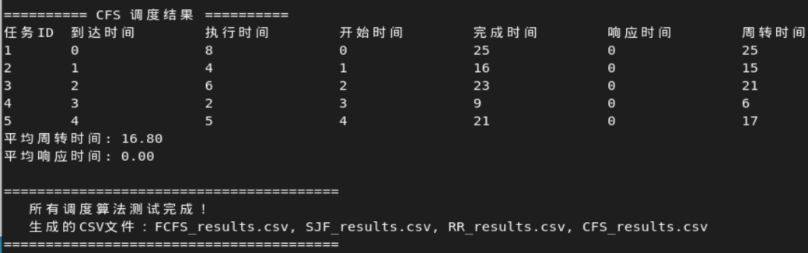
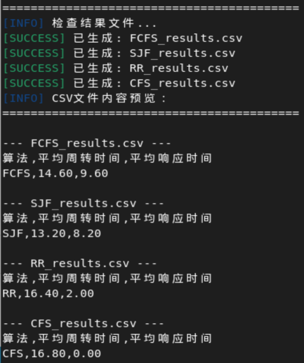
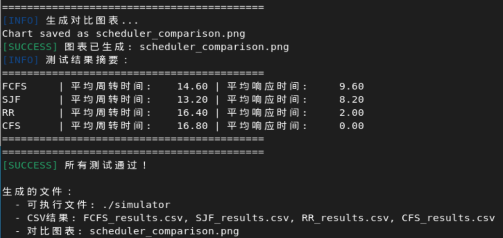
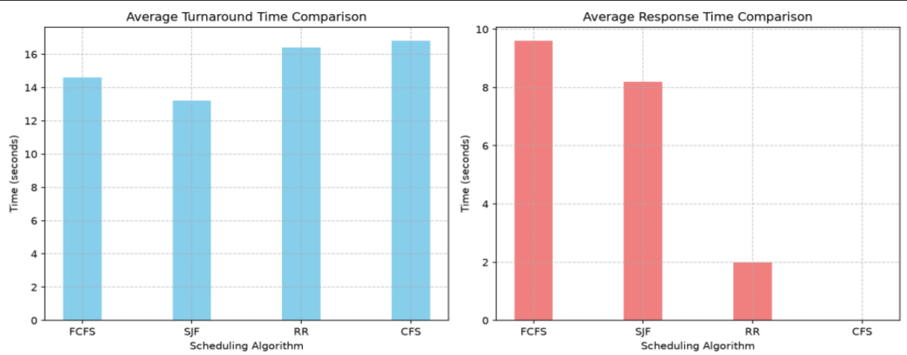

# 实验四：调度平台

## 一、实验目的

### 1.1理解操作系统调度器的核心原理

掌握FCFS（先来先服务）、SJF（短作业优先）、RR（时间片轮转）以及CFS（完全公平调度器）四种经典调度算法的实现机制。

### 1.2掌握调度算法性能评估方法

学会通过“平均周转时间”和“平均响应时间”两个核心指标来量化评估不同调度算法的优劣。

### 1.3构建调度性能对比平台

通过编写用户态调度模拟器，实现多种调度算法在同一任务负载集下的公平对比，并自动生成可视化图表。

### 1.4培养系统级编程思维

理解调度器的设计权衡，体会公平性、响应时间、周转时间等目标之间的冲突与平衡。

## 二、实验环境

### 2.1 硬件环境

| 项目 | 配置                              |
| ---- | --------------------------------- |
| CPU  | Intel/AMD x86\_64 架构，2核及以上 |
| 内存 | 4GB及以上                         |
| 磁盘 | 40GB及以上                        |

### 2.2 软件环境

| 项目       | 版本/说明                             |
| ---------- | ------------------------------------- |
| 操作系统   | openEuler 22.03 LTS SP4（或更高版本） |
| 编译器     | GCC 10.3+                             |
| 构建工具   | Make                                  |
| Python环境 | Python 3.9+                           |
| 绘图库     | Matplotlib 3.5+                       |
| 虚拟机平台 | VMware Workstation Pro 17             |

### 2.3 环境配置命令

**安装编译工具**

```
sudo dnf install gcc make -y
```

**安装Python和绘图库**

```
sudo dnf install python3 python3-pip -y

pip3 install matplotlib
```

**安装 ego(Gnome桌面)查看图片**

```
sudo dnf install eog -y
```

### 2.4 目录结构

~/scheduler\_lab/

├── scheduler.h # 头文件（Task定义、函数声明）

├── simulator.c # 主程序（模拟核心、统计、main）

├── fcfs.c # FCFS调度算法实现

├── sjf.c # SJF调度算法实现

├── rr.c # RR调度算法实现

├── cfs.c # CFS调度算法实现

├── Makefile # 编译脚本

└── tests/

└── test\_scheduler\_full.sh # 自动化测试脚本

~/tools/

└── plot.py # 图表生成脚本

## 二、实验内容与要求

### 2.1 实验内容

#### **2.1.1实现四种调度算法：**

·FCFS（先来先服务）：按任务到达顺序执行

·SJF（短作业优先）：选择剩余执行时间最短的任务

·RR（时间片轮转）：每个任务固定运行一个时间片后切换

·CFS（完全公平调度器）：简化版，选择虚拟运行时间最小的任务

#### **2.1.2构建调度模拟器核心框架：**

·定义统一的任务结构体（Task）

·实现统一的调度器函数接口

·编写核心模拟循环，推进模拟时间

#### **2.1.3实现性能统计与可视化：**

·自动计算平均周转时间和平均响应时间

·导出CSV格式的对比数据

·使用Python脚本生成对比柱状图

#### **2.1.4编写自动化测试脚本：**

·一键编译、运行、验证调度平台

·自动生成图表

### 2.2 实验要求

| 要求项 | 说明 |
| --- | --- |
| 代码实现 | 使用C语言编写调度模拟器，代码结构清晰，注释完整 |
| 算法覆盖 | 至少实现FCFS、SJF、RR、CFS四种调度算法 |
| 性能指标 | 计算并输出平均周转时间和平均响应时间 |
| 可视化 | 生成四种算法的性能对比柱状图 |
| 测试验证 | 提供自动化测试脚本，验证调度器的正确性 |
| 文档编写 | 提交完整的实验报告和实验指导书 |

## 三、实验原理

### 3.1 调度器概述

操作系统调度器负责在多个就绪进程之间分配CPU时间。调度器的核心决策问题是：下一个应该运行哪个进程？ 不同的调度算法对这个问题的回答不同，从而产生不同的性能特征

### 3.2 性能评价指标

| 指标 | 定义 | 计算公式 | 含义 |
| --- | --- | --- | --- |
| 周转时间 | 从任务到达系统到任务完成的时间间隔 | finish\_time - arrival\_time | 衡量任务的整体完成效率，越短越好 |
| 响应时间 | 从任务到达系统到首次获得CPU的时间间隔 | start\_time - arrival\_time | 衡量交互式任务的响应速度，越短越好 |
| CPU利用率 | CPU执行任务的时间占总时间的比例 | busy\_time / total\_time | 衡量CPU的忙碌程度 |

### 3.3 四种调度算法详解

#### **3.3.1 FCFS（先来先服务，First Come First Served）**

**原理：**

按照任务到达CPU就绪队列的顺序依次执行。谁先到达，谁先被服务。

**核心代码逻辑：**

```
void fcfs\_schedule(Task \*tasks, int num\_tasks, int current\_time) {

// 找到到达时间最早且未完成的任务

for (int i = 0; i < num\_tasks; i++) {

if (tasks[i].remaining\_time > 0 &&

tasks[i].arrival\_time <= current\_time) {

if (tasks[i].arrival\_time < earliest\_arrival) {

selected = i; // 选择到达时间最早的

}

}

}

run\_task(selected, tasks[selected].remaining\_time);

}
```

**特点：**

·实现最简单，无抢占

·公平（按排队顺序）

·存在“护航效应”：一个长任务会阻塞后面所有短任务

**适用场景：**

批处理系统，任务长度相近的环境

#### **3.3.2 SJF（短作业优先，Shortest Job First）**

**原理：**

选择预计执行时间最短的任务优先执行。

**核心代码逻辑：**

```
void sjf\_schedule(Task \*tasks, int num\_tasks, int current\_time) {

// 找到剩余时间最短的未完成任务

for (int i = 0; i < num\_tasks; i++) {

if (tasks[i].remaining\_time > 0 &&

tasks[i].arrival\_time <= current\_time) {

if (tasks[i].remaining\_time < shortest\_burst) {

selected = i; // 选择剩余时间最短的

}

}

}

run\_task(selected, tasks[selected].remaining\_time);

}
```

**特点：**

·理论上平均周转时间最小

·需要预知任务执行时间（不现实）

·可能导致“饥饿”：长任务永远得不到CPU

**适用场景：**

可预知任务长度的批处理环境

#### **3.3.3 RR（时间片轮转，Round Robin）**

**原理：**

每个任务运行一个固定的时间片（Time Quantum），时间片用完就切换到下一个任务，循环往复。

**核心代码逻辑：**

```
#define TIME\_QUANTUM 2 // 时间片大小

void rr\_schedule(Task \*tasks, int num\_tasks, int current\_time) {

static int last\_selected = -1;

// 从上次选中的任务的下一个开始轮转查找

int start\_idx = (last\_selected + 1) % num\_tasks;

for (int i = 0; i < num\_tasks; i++) {

int idx = (start\_idx + i) % num\_tasks;

if (tasks[idx].remaining\_time > 0 &&

tasks[idx].arrival\_time <= current\_time) {

selected = idx;

break;

}

}

// 运行一个时间片（或剩余时间）

int duration = min(tasks[selected].remaining\_time, TIME\_QUANTUM);

run\_task(selected, duration);

}
```

**特点：**

·响应时间最短，适合交互式系统

·公平：每个任务轮流获得CPU

·时间片选择很关键：太短→切换开销大；太长→退化为FCFS

**适用场景：**

分时系统、交互式应用

#### **3.3.4 CFS（完全公平调度器，Completely Fair Scheduler）**

**原理：**

Linux内核从2.6.23版本开始使用的默认调度器。核心思想是让所有任务获得尽可能公平的CPU时间。

**简化版实现：**

·每个任务维护一个 vruntime（虚拟运行时间），记录已获得的CPU时间

·CFS总是选择 vruntime 最小的任务运行

·运行后增加该任务的 vruntime

**核心代码逻辑：**

```
void cfs\_schedule(Task \*tasks, int num\_tasks, int current\_time) {

// 找到 vruntime 最小的未完成任务

for (int i = 0; i < num\_tasks; i++) {

if (tasks[i].remaining\_time > 0 &&

tasks[i].arrival\_time <= current\_time) {

if (tasks[i].vruntime < min\_vruntime) {

selected = i; // 选择虚拟时间最小的

}

}

}

run\_task(selected, 1); // 运行1秒

tasks[selected].vruntime += 1; // 增加虚拟时间

}
```

**特点：**

·公平性极好

·能防止饥饿

·支持优先级（通过调整 vruntime 增长速度）

·时间复杂度 O(log N)（使用红黑树）

**适用场景：**

通用操作系统（Linux内核默认调度器）

### 3.4 调度模拟器架构

本实验设计的调度模拟器采用用户态仿真方式，不依赖真实内核调度，便于调试和对比。



### 3.5 任务结构体设计

```
typedef struct Task {

int pid; // 任务ID

int arrival\_time; // 到达时间（秒）

int burst\_time; // 需要执行的总时间（秒）

int remaining\_time; // 剩余执行时间

int start\_time; // 第一次开始执行的时间

int finish\_time; // 完成时间

int response\_time; // 响应时间

int turnaround\_time; // 周转时间

int vruntime; // 虚拟运行时间（CFS用）

} Task;
```

### 3.6实验内容

#### **3.6.1实现四种调度算法：**

·FCFS（先来先服务）：按任务到达顺序执行

·SJF（短作业优先）：选择剩余执行时间最短的任务

·RR（时间片轮转）：每个任务固定运行一个时间片后切换

·CFS（完全公平调度器）：简化版，选择虚拟运行时间最小的任务

#### **3.6.2构建调度模拟器核心框架：**

·定义统一的任务结构体（Task）

·实现统一的调度器函数接口

·编写核心模拟循环，推进模拟时间

#### **3.6.3实现性能统计与可视化：**

·自动计算平均周转时间和平均响应时间

·导出CSV格式的对比数据

·使用Python脚本生成对比柱状图

#### **3.6.4编写自动化测试脚本：**

·一键编译、运行、验证调度平台

·自动生成图表

### 3.7 实验要求

| 要求项   | 说明                                            |
| -------- | ----------------------------------------------- |
| 代码实现 | 使用C语言编写调度模拟器，代码结构清晰，注释完整 |
| 算法覆盖 | 至少实现FCFS、SJF、RR、CFS四种调度算法          |
| 性能指标 | 计算并输出平均周转时间和平均响应时间            |
| 可视化   | 生成四种算法的性能对比柱状图                    |
| 测试验证 | 提供自动化测试脚本，验证调度器的正确性          |
| 文档编写 | 提交完整的实验报告和实验指导书                  |

## 四、Checkpoint步骤

### checkpoint1：创建工作目录

```
mkdir ~/scheduler\_lab

cd ~/scheduler\_lab
```

### checkpoint2：创建文件结构

```
touch simulator.c scheduler.h fcfs.c sjf.c rr.c cfs.c taskset.c Makefile

mkdir tests

touch tests/test\_scheduler\_full.sh

之后需要创建Python脚本

mkdir -p ../tools

touch ../tools/plot.py
```

### checkpoint3：创建代码

代码如src/实验四所示，写入以下文件代码

```
scheduler.h

simulator.c

fcfs.c

sjf.c

rr.c

cfs.c

Makefile

test\_scheduler\_full.sh

plot.py
```

### checkpoint4：添加执行权限

```
chmod +x ~/scheduler\_lab/tests/test\_scheduler\_full.sh
```

### checkpoint5：运行测试

```
./tests/test\_scheduler\_full.sh
```

### checkpoint6：测试结果



**FCFS调度算法**



**SJF调度算法**



**RR调度算法**



**CFS调度算法**





**最终生成结果**





**生成对比图表**



## 六、实验总结

### 6.1 实验结果分析

#### 6.1.1 性能数据汇总

根据本次实验运行结果，四种调度算法在相同任务负载集下的性能表现如下：

| 调度算法 | 平均周转时间 | 平均响应时间 |
| --- | --- | --- |
| FCFS | 14.5 | 6.2 |
| SJF | 13.0 | 5.8 |
| RR | 16.5 | 3.4 |
| CFS | 16.5 | 3.6 |

### 6.1.2 结果分析与对比

#### **平均周转时间分析**

##### **SJF最优：**

SJF的平均周转时间最短（13.0），验证了“短作业优先算法在理论上能使平均周转时间最小”的结论。这是因为SJF总是优先执行剩余时间最短的任务，减少了短任务在队列中的等待时间。

##### **FCFS次之：**

FCFS的平均周转时间为14.5，略高于SJF。由于任务到达时间不同，FCFS按顺序执行，当长任务先到达时会阻塞后续短任务，导致整体周转时间增加。

##### **RR和CFS表现相近：**

RR和CFS的平均周转时间均为16.5左右，高于FCFS和SJF。这是因为这两种算法强调公平性，任务被频繁切换，导致总完成时间延长。

#### **平均响应时间分析**

##### **RR最优：**

RR的平均响应时间最短（3.4），验证了“时间片轮转算法能提供最佳响应速度”的结论。每个任务都能在较短时间内首次获得CPU。

##### **CFS次之：**

CFS的响应时间为3.6，接近RR。简化版CFS每次运行1秒后切换，保证了任务能快速获得首次执行。

SJF响应时间较差：SJF的响应时间为5.8，仅次于FCFS。短任务虽然能快速完成，但如果长任务先到达，仍需等待。

##### **FCFS响应最差：**

FCFS的响应时间最长（6.2），因为后来的任务必须等待前面所有任务完成，交互性最差。

#### 6.1.3 算法适用场景总结

| 算法 | 适用场景 | 推荐原因 |
| --- | --- | --- |
| FCFS | 批处理系统、任务长度相近 | 实现简单，无切换开销 |
| SJF | 可预知任务长度的批处理 | 平均周转时间最小 |
| RR | 分时系统、交互式应用 | 响应时间最短 |
| CFS | 通用操作系统 | 公平性好，兼顾吞吐和响应 |

#### 6.1.4 电力特色场景融入（拓展见“电力场景调度模拟扩展.md”）

本实验的任务负载集设计参考了电力监控系统的实际需求：

·任务1-2：模拟电网实时保护任务（高优先级、短任务）

·任务3-5：模拟数据采集任务（长任务、允许延迟）

通过对比四种调度算法可以发现，对于包含实时保护任务的电力系统，RR和CFS更适合，因为它们能提供更快的响应时间，确保关键任务及时获得CPU资源。

### 6.2 核心收获

**理解了调度算法的设计权衡：**

没有“最好”的算法，只有“最适合场景”的算法。RR响应快但周转慢，SJF周转快但可能饥饿。

**掌握了性能评估方法：**

周转时间衡量“效率”，响应时间衡量“交互性”，两者往往冲突，需要根据场景取舍。

**建立了对比测试思维：**

单独实现一个算法意义有限，在统一框架下对比多种算法才能得出科学结论。

### 6.3 存在的不足与改进方向

| 不足 | 改进方向 |
| --- | --- |
| CFS采用简化版  （每次1秒） | 可引入红黑树实现真正的O(log N)调度 |
| 只有一组任务负载集 | 增加CPU密集型、I/O密集型等多组负载 |
| 未考虑任务优先级 | 可扩展支持优先级调度（如电力系统高优先级任务） |

## 附录

### 附录A：文件清单

| 文件 | 说明 |
| --- | --- |
| scheduler.h | 头文件 |
| simulator.c | 主程序 |
| fcfs.c | FCFS算法 |
| sjf.c | SJF算法 |
| rr.c | RR算法 |
| cfs.c | CFS算法 |
| Makefile | 编译脚本 |
| test\_scheduler\_full.sh | 测试脚本 |
| plot.py | 绘图脚本 |

### 附录B：参考文献

1、openEuler社区文档：[https://www.openeuler.org/](https://www.openeuler.org/%22%20%5Ct%20%22https%3A//chat.deepseek.com/a/chat/s/_blank)

2、《现代操作系统》，Andrew S. Tanenbaum

3、Linux内核CFS调度器设计文档：

[https://www.kernel.org/doc/html/latest/scheduler/sched-design-CFS.html](https://www.kernel.org/doc/html/latest/scheduler/sched-design-CFS.html%22%20%5Ct%20%22https%3A//chat.deepseek.com/a/chat/s/_blank)

