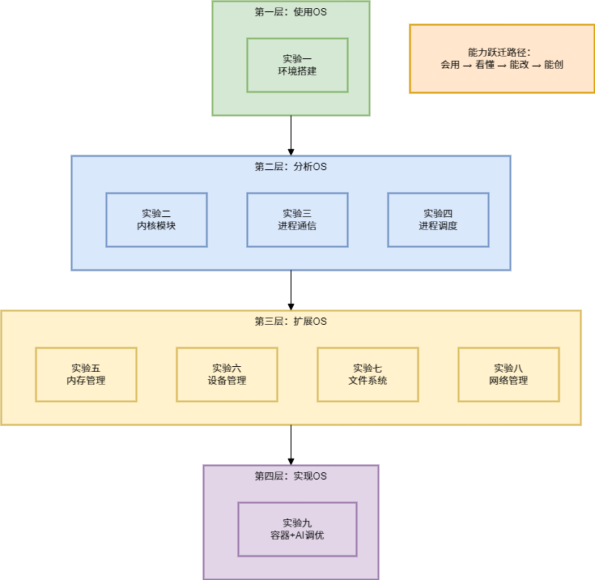
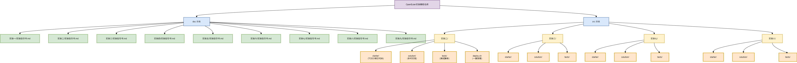
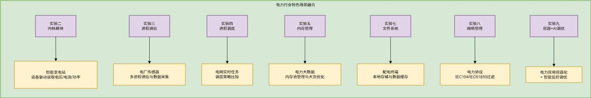

# OpenEuler操作系统实验教程——实验设计文档

---

## 一、文档说明

本文档为参赛作品《OpenEuler操作系统实验教程》的完整实验设计文档，涵盖项目研发的设计思路、实现描述、代码说明、研发过程中遇到的问题及解决方法、非本队来源说明等内容。

本教程基于 **OpenEuler 24.03 LTS** 操作系统，面向高校操作系统课程实验教学，包含 **10个递进式实验**，覆盖从环境搭建到内核模块、进程管理、文件系统、网络管理、容器实践与智能调优等核心知识点。

---

## 二、项目概述

### 2.1 项目名称

**OpenEuler操作系统实验教程——适合电力行业院校的操作系统实验体系**

### 2.2 项目定位

本教程面向操作系统原理课程的实验教学环节，以 OpenEuler 24.03 LTS 为实验平台，设计了一套从 **使用OS → 分析OS → 扩展OS → 实现OS** 的四层递进式实验体系。全套教程包含10个实验，覆盖操作系统核心知识模块，并融入电力行业特色应用场景。

### 2.3 设计目标

| 目标类型 | 描述 |
| :--- | :--- |
| **知识目标** | 帮助学生理解操作系统的基本概念、原理和实现方法 |
| **能力目标** | 培养学生动手编写内核模块、分析系统行为、扩展内核功能的能力 |
| **创新目标** | 通过阶梯式任务设计和自动化测试体系，降低学习门槛，提升学习效率 |
| **特色目标** | 结合电力行业背景，让学生看到操作系统原理与电力应用的直接关联 |

---

## 三、总体设计思路

### 3.1 四层递进实验体系

传统操作系统实验往往停留在使用命令或修改内核参数层面。本教程将10个实验划分为四个递进层次：

| 层次 | 实验内容 | 教学目的 |
| :--- | :--- | :--- |
| **第一层：使用OS** | 实验一 | 建立基础环境 |
| **第二层：分析OS** | 实验二、三、四 | 理解OS内部机制 |
| **第三层：扩展OS** | 实验五、六、七、八 | 动手扩展内核功能 |
| **第四层：实现OS** | 实验九 | 综合应用与创新 |

每个层次的实验在前一层次基础上增加深度和复杂度，形成从 **会用 → 看懂 → 能改 → 能创** 的能力跃迁路径。

### 3.2 阶梯式任务设计

每个核心实验被拆解为 **3-4个可独立运行、可验证的子任务**，每个子任务包含明确的目标、操作步骤和预期结果。这种设计确保学生不会卡死在中间，每个阶段都有明确的小目标，能持续获得成就感。

### 3.3 双分支仓库结构

采用 **doc** 和 **src** 双分支管理：

- **doc分支**：存放所有实验指导书，使用 Markdown 格式，方便在线阅读
- **src分支**：存放所有代码框架和参考实现

每个实验目录下包含：

- `starter/`：学生填空代码框架（带TODO注释）
- `solution/`：完整参考实现（供教师使用）
- `tests/`：自动化测试脚本

### 3.4 填空式代码框架

提供带 **TODO注释** 的不完整代码，学生需要自己补全核心逻辑，避免复制粘贴即可运行的无效学习。

### 3.5 自动化测试体系

每个实验配套自动化测试脚本，学生执行脚本即可获得即时反馈，教师可用于批量评分，解决操作系统实验难以自动评分的痛点。

### 3.6 电力行业特色场景融合

结合上海电力大学行业背景，在多个实验中融入 **电力监控、电网调度、智能变电站** 等应用场景，让学生看到所学知识与行业应用的直接关联。

### 3.7 前沿技术引入

将 **eBPF和XDP**（Linux内核最前沿的可观测性和高性能数据面处理技术）引入实验教学，让学生接触工业级内核编程。

### 3.8 容器加AI调优垂直整合

将 **iSulad容器实践** 与 **A-Tune智能调优** 合并为一个综合实验模块，让学生体验从容器化部署到AI驱动的性能优化的完整链路。

---

## 四、各实验概述

### 实验一：OpenEuler环境搭建

- **核心内容**：引导学生在VMware虚拟机中安装 OpenEuler 24.03 LTS 系统，配置网络和开发工具链（gcc、make、kernel-devel），建立实验基础环境。
- **场景背景**：以电力监控系统实验环境配置为场景背景。
- **关键文件**：`src/实验一/` 下的安装脚本、`test_env.sh` 环境检查脚本。
- **对应原理**：操作系统安装、软件包管理、系统初始化。

### 实验二：内核模块编程（核心实验）

- **核心内容**：从最简单的Hello World模块开始，逐步增加参数传递和字符设备驱动功能，最终实现一个模拟电力设备的内核模块，支持通过 `/dev/power_device` 设备文件读写电压、电流、功率数据。
- **场景背景**：模拟智能变电站中设备驱动读取电力参数、下发控制指令的场景。
- **三阶段设计**：
  - **CP1 基础**：模块加载/卸载、printk 日志
  - **CP2 参数**：module_param 传递设备名、额定电压
  - **CP3 设备**：miscdevice 字符设备、read/write 功率计算
- **电力场景文档**：详见 [doc/实验二/电力场景.md](./doc/实验二/电力场景.md)，包含智能变电站监控、配电自动化终端、电力物联网边缘设备三个应用场景的深度解读。
- **自动部署**：`cd src/实验二 && sudo ./deploy.sh` 一键完成环境检查→编译→加载→电力数据验证→测试→清理。
- **对应原理**：内核模块机制、设备文件抽象、用户态/内核态交互。

### 实验三：进程通信

- **核心内容**：通过生产者-消费者模型的实现，让学生理解进程间通信的三种机制——**管道、消息队列、共享内存**。
- **场景背景**：模拟电厂中多个传感器进程与中央控制器进程之间的消息通信。
- **关键文件**：`src/实验三/` 下的 pipe、msgqueue、shm 三组示例程序，`test_exp3.sh` 自动化测试脚本。
- **对应原理**：IPC 机制、同步互斥、生产者-消费者模型。

### 实验四：进程调度

- **核心内容**：实现一个用户态调度模拟器，支持 **FCFS、SJF、RR、CFS** 四种调度算法，提供多种任务负载集（CPU密集型、I/O密集型、混合型），自动生成性能对比图表。
- **场景背景**：模拟电网实时任务与数据采集任务的调度策略比较。
- **关键文件**：`src/实验四/solution/` 下的 scheduler 主程序、`test_scheduler_full.sh` 完整测试脚本、`plot.py` 性能对比绘图。
- **对应原理**：CPU 调度算法、周转时间、响应时间、公平性。

### 实验五：内存管理

- **核心内容**：通过模拟内存分配和页面置换算法，理解虚拟地址到物理地址的映射、分页机制、大页性能对比。
- **场景背景**：模拟电力大数据批处理中的内存池管理。
- **关键文件**：`src/实验五/` 下的 kmalloc/vmalloc 内核模块、分页机制模拟程序。
- **对应原理**：虚拟内存、分页机制、TLB、大页优化。

### 实验六：设备管理

- **核心内容**：理解Linux"一切皆文件"的设计哲学，通过编写简单的设备驱动实践设备管理，理解设备文件的概念、设备驱动的基本框架、用户态与内核态的交互。
- **关键文件**：`src/实验六/` 下的 char_device 驱动、power_sensor 电力传感器扩展。
- **对应原理**：设备文件、设备驱动框架、file_operations。

### 实验七：文件系统模拟

- **核心内容**：在用户态实现一个简单的文件系统，定义 **超级块、索引节点、目录项、文件分配表** 等核心数据结构，实现文件的创建、删除、打开、关闭、读写以及目录的创建、列出、切换等基本功能。
- **电力场景文档**：详见 [doc/实验七/电力场景.md](./doc/实验七/电力场景.md)，模拟电力采集终端的本地存储系统，包含智能变电站数据缓存、配电终端日志存储、电力物联网边缘节点三个场景。
- **自动部署**：`cd src/实验七 && ./deploy.sh` 一键完成编译→格式化磁盘→电力数据文件操作验证→清理（无需 root 权限）。
- **对应原理**：文件系统布局、inode、位图、目录结构。

### 实验八：网络管理（进阶实验）

- **核心内容**：从用户态到内核态再到eBPF和XDP，完整体验Linux网络管理的三个层次：
  - **第一阶段**：实现UDP Socket通信，理解数据包在用户空间的流动
  - **第二阶段**：编写Netfilter内核模块，在协议栈层面拦截和分析数据包
  - **第三阶段**：编写XDP程序，在网卡驱动层实现极高性能的数据包处理
- **场景背景**：模拟电力系统网络中只允许IEC 104协议通过的场景。
- **电力场景文档**：详见 [doc/实验八/电力场景.md](./doc/实验八/电力场景.md)，包含 IEC 60870-5-104、IEC 61850、DL/T 634、Modbus TCP 四个电力协议的背景知识，以及三阶段对应的电力数据传输、协议防火墙、高性能过滤实现。
- **自动部署**：`cd src/实验八 && sudo ./deploy.sh` 一键完成三阶段编译→UDP电力数据传输验证→Netfilter协议过滤验证→XDP性能测试提示。
- **对应原理**：Socket 编程、Netfilter 钩子、eBPF/XDP、网络协议栈。

### 实验九：容器实践与智能调优（合并实验模块）

- **第一部分：iSulad容器实践**
  - 安装iSulad容器引擎，拉取容器镜像，管理容器生命周期

- **第二部分：A-Tune智能调优**
  - 安装A-Tune服务，分析系统负载特征，应用AI推荐的调优策略并评估效果

- **场景背景**：两部分形成从容器化部署到AI驱动的性能优化的完整链路，模拟电力应用容器化部署和电力监控系统在业务高峰期的智能调优场景。
- **关键文件**：`src/实验九/` 下的 iSulad 操作脚本、A-Tune 调优模板、`test_container.sh` 和 `test_atune.sh` 测试脚本。
- **对应原理**：容器化、资源隔离、AI 性能调优。

---

## 五、代码框架设计

### 5.1 填空式代码框架（Starter）

每个实验的 `starter/` 目录下提供不完整的代码，使用 **TODO注释** 标记需要学生补全的部分，包含具体的要求提示（如函数原型、需要使用的API、预期功能等）。

### 5.2 参考实现（Solution）

`solution/` 目录下提供完整可编译的代码，供教师批改或学生自查时参考。

### 5.3 自动化测试脚本

每个实验配套自动化测试脚本，一键验证以下关键步骤：

- 编译
- 加载
- 设备文件检查
- 读写功能验证
- 卸载

脚本输出 **PASS** 或 **FAIL** 结果。

### 5.4 Makefile模板

提供标准的内核模块编译 Makefile，包含 `all` 和 `clean` 两个目标。

---

## 六、研发过程中遇到的问题及解决方法

| 序号 | 问题描述 | 原因分析 | 解决方法 |
| :--- | :--- | :--- | :--- |
| **1** | 编译内核模块时报错build目录不存在 | 系统更新内核后未同步更新kernel-devel | 安装匹配版本的kernel-devel或手动创建软链接 |
| **2** | 实验八编译时变量名与内核宏冲突 | 变量名 `current` 和 `dev_name` 与内核头文件中的宏和函数冲突 | 修改变量名，将 `dev_name` 改为 `g_dev_name`，将 `current` 改为 `cur` |
| **3** | 执行dnf install报错无法解析域名 | 虚拟机网卡处于DOWN状态 | 启动网卡并执行dhclient获取IP |
| **4** | 执行dmesg报错不允许操作 | 内核默认限制普通用户读取日志 | 使用sudo执行dmesg |
| **5** | 执行ip命令挂载XDP程序时报错Operation not supported | 内核版本过低或网卡驱动不支持 | 升级内核或换用支持XDP的网卡 |
| **6** | insmod报错文件已存在 | 同名模块已加载 | 先rmmod卸载再重新加载 |
| **7** | systemctl start atuned报错 | 依赖环境不完整 | 安装缺失依赖并检查配置文件 |

---

## 七、非本队来源说明

本作品在设计和实现过程中参考了以下开源项目和资料：

### 7.1 参考开源仓库

1. **OS代码小队实验仓库（project2608132-275972）**
   - 仓库地址：https://gitlab.eduxiji.net/T202410256994641/project2608132-275972
   - 贡献：提供了实验一至实验十的基础框架和内容组织方式，特别是实验二的知识结构
   - 许可证：MIT
   - 本项目修改：有（重构了实验二的三阶段Checkpoint设计）

2. **鼠鼠仓库（T202510256997804-2206）**
   - 仓库地址：https://gitlab.eduxiji.net/educg-group-39358-3035746/T202510256997804-2206
   - 贡献：提供了 eBPF 入门实验、iSulad 容器实践和 A-Tune 智能调优的参考代码
   - 许可证：MIT
   - 本项目修改：有（改造为三阶段递进结构并加入电力场景）

3. **Linux内核源码**
   - 贡献：内核模块、Netfilter、XDP 相关核心 API 与数据结构
   - 许可证：GPL-2.0
   - 本项目修改：无（直接使用内核 API）

### 7.2 参考技术文档

4. **Linux内核模块编程指南（LKMPG）** - 内核模块编程基础知识参考
5. **OpenEuler官方文档（docs.openeuler.org）** - 系统安装、开发工具配置、iSulad和A-Tune使用指南
6. **eBPF/XDP 官方文档（ebpf.io）** - eBPF 编程模型与 XDP 用法参考
7. **IEC 60870-5-104 / IEC 61850 标准** - 电力协议背景知识参考

### 7.3 本团队原创内容

**本作品的以下创新之处均为本团队原创设计：**
- 四层递进实验体系（使用OS → 分析OS → 扩展OS → 实现OS）
- 三阶段阶梯式任务设计（Checkpoint/Phase 递进）
- Starter + Solution 双轨代码脚手架
- 自动化测试体系（每个实验配套 PASS/FAIL 测试脚本）
- 一键自动部署脚本（实验二/七/八的 deploy.sh）
- 电力行业特色场景融合（智能变电站、电力协议过滤等）
- 各实验配套的电力场景深度解读文档

---

## 八、技术创新点总结

| 序号 | 创新点 | 描述 |
| :--- | :--- | :--- |
| **1** | 四层递进实验体系 | 从使用OS到分析OS到扩展OS到实现OS逐层深入，实现能力的阶梯式跃迁 |
| **2** | 阶梯式任务设计 | 每个实验拆解为3-4个可独立验证的子任务，降低学习门槛 |
| **3** | 自动化测试体系 | 每个实验配套测试脚本，学生一键验证、教师批量评分，解决操作系统实验难以自动评分的痛点 |
| **4** | 填空式代码框架 | 提供带TODO注释的代码框架，学生自己补全核心逻辑，避免复制粘贴即可运行的无效学习 |
| **5** | 电力行业特色场景融合 | 结合上海电力大学行业背景，在多个实验中融入电力监控、电网调度、智能变电站等应用场景 |
| **6** | eBPF和XDP前沿技术引入 | 将工业级内核可观测性和高性能数据面处理技术引入本科实验教学 |
| **7** | 容器加AI调优垂直整合 | 将iSulad容器实践与A-Tune智能调优合并为一个综合实验模块，体验从容器化部署到AI驱动性能优化的完整链路 |

---

## 九、实验设计文档结构说明

本作品的设计文档采用以下结构组织：

1. **文档说明**
2. **项目概述**（项目名称、定位、设计目标）
3. **总体设计思路**（四层递进体系、阶梯式任务、双分支结构、填空式框架、自动化测试、电力场景融合等）
4. **各实验概述**（每个实验的核心内容、场景背景、三阶段设计、电力场景文档、自动部署、对应原理）
5. **代码框架设计**（Starter/Solution/测试脚本/Makefile 模板）
6. **研发过程中遇到的问题及解决方法**
7. **非本队来源说明**（参考仓库、技术文档、本团队原创内容）
8. **技术创新点总结**
9. **实验设计文档结构说明**（本文）
10. **开发进度与团队分工**

### 文档配套体系

除了本设计文档外，每个实验还配套以下文档（位于 `doc/实验X/` 目录下）：

- **实验指导书.md**：详细操作步骤、检查点、常见问题排查
- **设计方案.md**：技术架构、核心数据结构、关键代码说明
- **测试报告.md**：功能测试、性能测试、对比分析
- **电力场景.md**（实验二/七/八）：电力行业应用场景深度解读

### Git 阶段性提交

为满足赛题"基于 git 的阶段性代码，便于其他学校一步一步学习"的要求，本项目的 Git 提交节点建议详见 [更新日志.md](./更新日志.md) 的"阶段性 Git 提交建议"章节。

---

## 十、开发进度与团队分工

### 10.1 团队分工

| 成员 | 负责实验 | 内容 |
| :--- | :--- | :--- |
| **金奕如** | 实验一、四、六 | 环境搭建、调度平台、设备管理 |
| **宋雅笛** | 实验二、七、八 | 内核模块、文件系统、网络管理 |
| **邵奕** | 实验三、五、九 | 进程通信、内存管理、容器与智能调优 |

### 10.2 开发时间线

| 阶段 | 时间 | 内容 |
| :--- | :--- | :--- |
| **项目初始化** | 第1-4天 | 仓库创建、目录结构、实验一和实验二 |
| **核心开发** | 第5-19天 | 实验三至实验八 |
| **整合打磨** | 第20-24天 | 实验九加十、文档完善 |
| **最终提交** | 第25-27天 | 视频录制、最终提交 |

### 10.3 任务完成情况

| 实验 | 名称 | 状态 | 负责人 |
| :--- | :--- | :--- | :--- |
| 实验一 | OpenEuler环境搭建 | 已完成 | 金奕如 |
| 实验二 | 内核模块编程 | 已完成 | 宋雅笛 |
| 实验三 | 进程通信 | 已完成 | 邵奕 |
| 实验四 | 进程调度 | 已完成 | 金奕如 |
| 实验五 | 内存管理 | 已完成 | 邵奕 |
| 实验六 | 设备管理 | 已完成 | 金奕如 |
| 实验七 | 文件系统模拟 | 已完成 | 宋雅笛 |
| 实验八 | 网络管理 | 已完成 | 宋雅笛 |
| 实验九 | 容器实践与智能调优 | 已完成 | 邵奕 |

**所有实验均已按照设计要求完成代码编写、测试验证和文档撰写工作。**

---

*文档版本：6.0*  
*最后更新：2026年8月16日*
