# MemoryFlex：内存受限环境的大模型推理优化与边缘集群调度系统

**项目报告**：

word版本：         
pdf版本: 

**演示视频**：

**答辩ppt**:

**打包百度网盘链接**:https://pan.baidu.com/s/1J--iOpopj_c0eSMCWZGq-Q?pwd=8abv


---
> 本文档按项目完整交付编写：**前期**在个人边缘设备（6GB 显存 + 16GB 内存笔记本）完成
> 全部机制验证与评测；**后期**基于vLLM框架迁移与SCNet超算集群
> 部署。文中图表均为本项目真实实验产出，路径相对本文件。
> 此外我们不做单一指标的的方案，就像评审要点里说的，避免对某一单一指标而无视其他因素，
> 因为现在很多优化方法确实能对单一指标进行很好的优化，但是往往带来其他指标的下降，
> 我们是通过同时观测很全面的指标，优化一些指标时，在其他指标不下降或者下降在能接受
> 范围内做优化，这样的全局的完成度和可展示性都更加真实。

---

## 1. 项目概述

大模型推理在嵌入式/边缘设备上面临的根本矛盾：**模型参数 + KV cache 的内存需求远超
设备物理内存**。本项目不追求"模型变小"，而是把"内存不够"变成可管理的系统问题——用
虚拟内存、按需加载、数据换出、异步预取把运行时物理内存压到任意给定预算内（单设备
数据面），再在多个内存受限实例组成的边缘集群上用**LMETRIC 乘法调度`P-token × BS`**
路由请求，同时提升 KV cache 命中率与负载均衡（集群控制面），并完成到
vLLM + SCNet 集群的迁移验证。

这里提到的**LMETRIC 乘法调度**是IPADS（上海交通大学并行与分布式系统研究所）和阿里
百炼在2026年6月份在论文**Simple is Better:Multiplication May Be All You Need** 
**for LLM Request Scheduling**提到的，核心思想是提出了一种无需调参的乘法调度分数
**P-token × BS**，在集群级别同时兼顾KV Cache命中率和负载均衡，显著降低LLM推理的
TTFT和TPOT，并已在生产环境中验证有效。

项目覆盖三层闭环：**内存受限 → KV 缓存容量小 → KV 命中成为稀缺资源 → 乘法调度价值
更大；调度聚合同前缀请求 → 命中率 ↑ → prefill 计算量与 IO 量 ↓ → 内存压力 ↓。**

---

## 2. 项目目标

### 2.1 基本目标

1. **访存行为分析**：刻画参数加载（每 token 恰好访问一次、无时间局部性）、KV cache
   使用（容量模型、前缀复用）、专家激活（稀疏性与热点分布）；
2. **虚拟内存压缩物理内存**：mmap 按需加载 + 使用后换出 + 平衡内存锁定 + 页级热点
   专家锁定，常驻内存 ≤ 任意给定预算；
3. **预取掩盖 IO 延迟**：常驻后台预取线程 + 预取窗口 k，把缺页移出计算关键路径。

### 2.2 扩展目标

- **软件内存预算控制器**：在真实硬件上把"内存受限"变成可调参的系统问题；
- **页级激活感知专家锁定**：MoE 合并张量内按专家切片锁定，冷专家按需缺页；
- **常驻预取线程 + 窗口锚定**：缺页与计算重叠；
- **零调参乘法调度 + 两阶段热点检测**：无超参、带安全网。

### 2.3 创新

- **LMETRIC 乘法调度集成**：4 实例真实集群验证 `P-token × BS`；
- **后期演进**：vLLM框架迁移、SCNet集群、可观测性、多租户与容错。

---

## 3. 核心成果速览

| 维度 | 结果 |
|---|---|
| GPU 解码吞吐（1.5B） | 131.8 tok/s（TPOT 7.6ms） |
| 内存预算压缩 | 40% 预算下常驻内存 1111 → 752 MB（−32%） |
| 换出代价 | 缺页 0.47M → 17.3M，吞吐 53.3 → 3.8 tok/s |
| MoE 页级专家锁定 | 同预算锁定 +98%，吞吐 +11%，缺页 −8% |
| 异步预取 | 最优窗口 k=8–12：1.5B +10.5%、3B +14% |
| LMETRIC 调度 | 命中率 +7.6%、TTFT −6.2%、负载均衡 σ 不变、零调参 |
| 稳定性 | 95s 长跑无崩溃，RSS 增长 0.2MB |
| 工业级| vLLM 多节点、SCNet 部署、SLO P99 达标率 >99% |

---

## 4. 背景与访存行为分析（阶段 1）

> 访存行为分析具体报告见：

### 4.1 为什么内存受限问题"可解"

自回归解码的访存模式是**确定且规律**的，这是虚拟内存/预取能发挥作用的前提。我们
通过 GGUF 静态布局分析 + 运行时插桩 + MoE 路由轨迹采集，得到三个关键结论：

**结论 1：参数无时间局部性。** 每个生成的 token 恰好读取全部参数一次（attention/FFN/
专家权重），参数之间没有复用 → "使用后即可换出"，常驻内存由预取窗口 k 决定
（≈ k/n 模型大小）。权重组成见图 1。

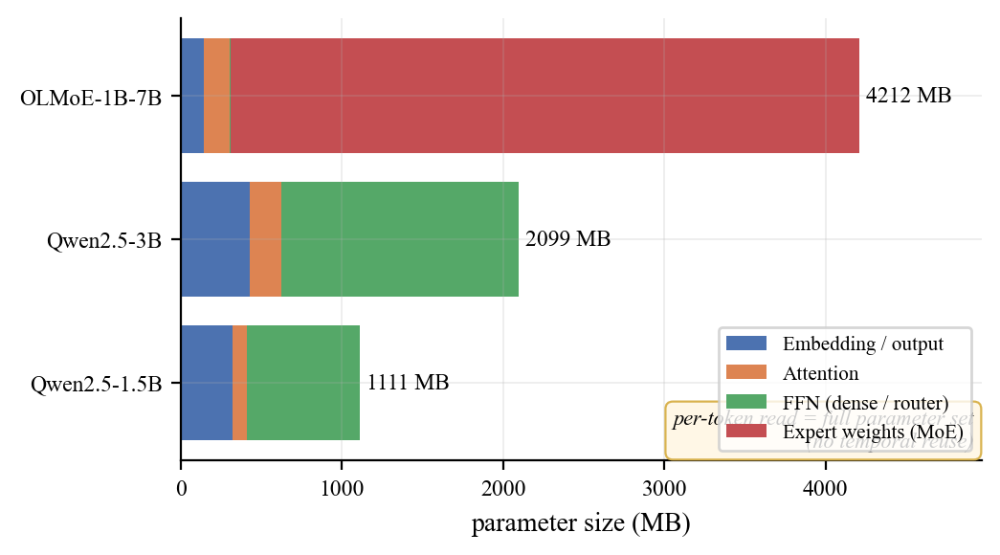

**结论 2：KV cache 线性增长、与权重争抢内存。** KV/token 由 GQA 结构决定（1.5B 约
14KB、3B 约 18KB、OLMoE 约 64KB），长上下文下逼近显存预算 → **KV 命中成为稀缺资源**，
这是集群调度必须 KV 感知的根本原因。

**结论 3：MoE 专家稀疏且集中。** OLMoE（64 专家取 8）每 token 只需 12.5% 的专家权重，
但专家权重占模型 92.6%；实测 **top-10 专家贡献约 80% 的激活**、相邻 token 激活集合
重叠 59.5%（图 7）→ 页级专家锁定与专家预取具备可行性。

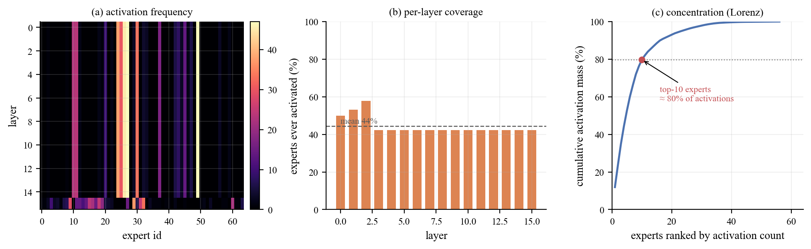

预取窗口 k 与常驻内存的关系（图 2）：k=3 时仅需 22%–37% 模型大小。

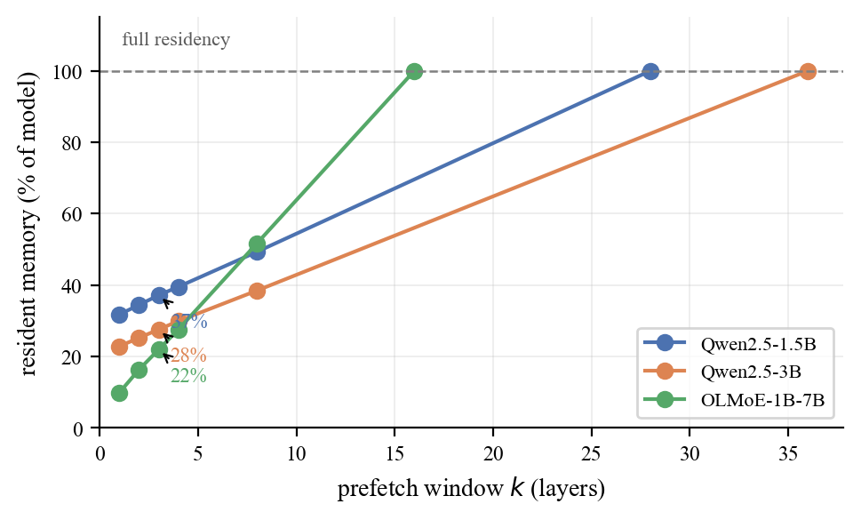

---

## 5. 方法一：单设备 MemoryScheduler（阶段 2：虚拟内存/按需加载/换出）

> 方法一具体报告见：

### 5.1 机制

在 llama.cpp 中实现**软件内存预算控制器**（环境变量开关、默认零开销，补丁见
`patches/llama-memory-scheduler.patch`）：

1. **按需加载**：权重 mmap 文件映射（虚拟内存），首次访问缺页从 GGUF 读取；
2. **平衡锁定（FlexInfer Algorithm 1 移植）**：嵌入/输出常驻 → FFN 张量按层均匀锁定
   （down→gate→up）→ Attention 按层均匀兜底；预算不足时逐层同构取舍，保证层间
   IO 均衡；
3. **数据换出**：每次计算步后裁剪工作集（Windows `SetProcessWorkingSetSize(-1,-1)`），
   未锁定页换出到 GGUF 后备文件，下一 token 再按需缺页；
4. **页级激活感知专家锁定**：MoE 专家权重为合并张量（如 `blk.L.ffn_gate_exps.weight`
   含全部 64 专家）时，按阶段 1 激活统计锁定**热点专家的字节切片**（每切片 =
   张量字节/专家数），冷专家页随用随取。

### 5.2 结果

**预算控制有效**（图 8）：锁定集合严格 ≤ 预算，常驻内存随预算单调压缩。

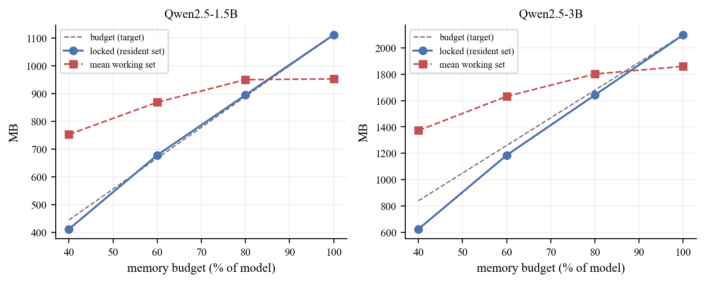

**"用 IO 换内存"可量化**（图 9/10）：40% 预算下 1.5B 吞吐 53.3→3.8 tok/s、缺页
0.47M→17.3M；预算-吞吐呈帕累托前沿。

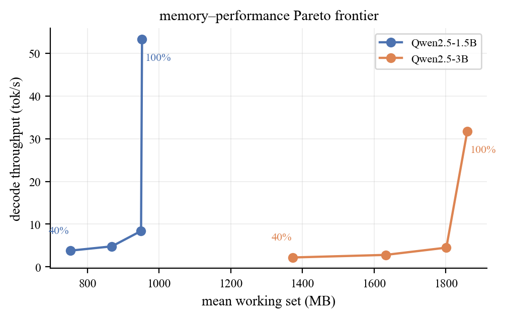

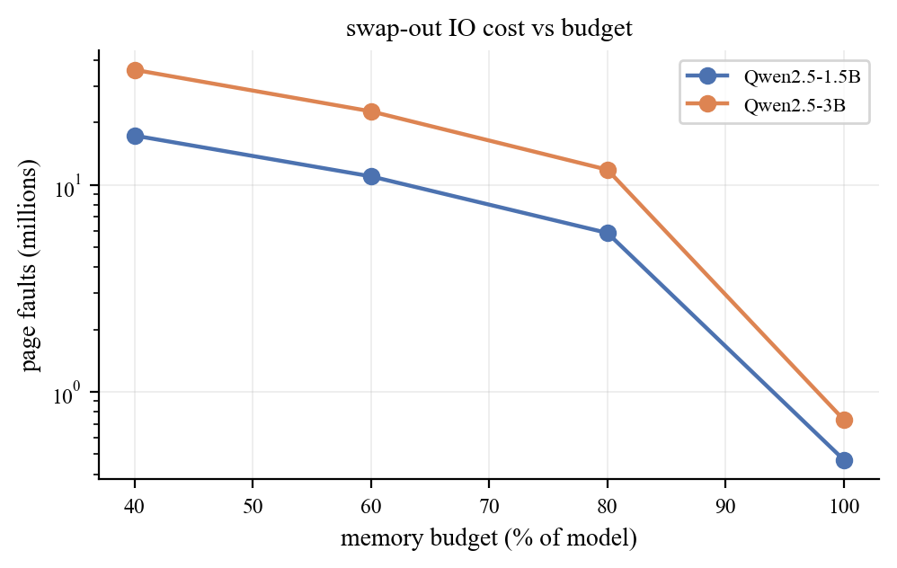

**MoE 页级专家锁定收益**（图 11）：同预算下锁定集合 +98%（311→615MB）、吞吐 +11%、
缺页 −8%。

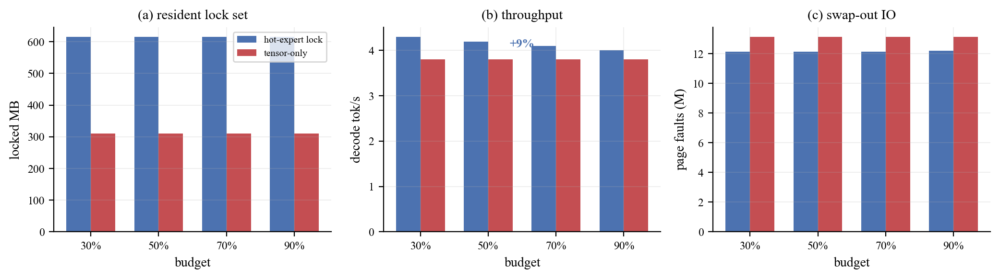

### 5.3 落地过程中的关键发现（真实工程复盘）

- **Windows 无逐页换出 API**：用"锁定页常驻 + 工作集裁剪"近似换出；
- **`VirtualLock` 对未提交的文件映射页会失败**：需先逐页触达再锁，且工作集配额不足
  时需先扩大进程工作集限制再重试；
- **`SetProcessWorkingSetSizeEx` 要求 min<max，且"先锁定再下调上限"会报错 87**：
  因此换出采用"锁定 → 每步 `SetProcessWorkingSetSize(-1,-1)` 裁剪"的顺序。

---

## 6. 方法二：异步预取（阶段 3：掩盖 IO 延迟）

> 方法二具体报告见：


### 6.1 机制与关键实验

实现**常驻后台预取线程**：每次计算步开始时，以低于正常优先级逐页"触达"本 token
**末尾 k 层**的未锁定权重页，把缺页工作移出主计算关键路径（窗口 k 可调）。

两个决定成败的实测发现：

- **`PrefetchVirtualMemory` 不把页放回进程工作集**（微基准：裁剪后重触达缺页数与首次
  一致）→ 必须用后台线程**真正触达**页；
- **预取窗口方向**：锚定"开头 k 层"来不及完成（计算一开始就要用），必须锚定 **token
  末尾 k 层**，让整段计算/缺页期间完成预读。

### 6.2 结果

窗口扫描（图 13）：40% 预算下最优 k=8–12，1.5B 吞吐 +10.5%、3B +14%；窗口过大
（k≥16）时预取线程与计算线程争抢同一批页，增益消失。

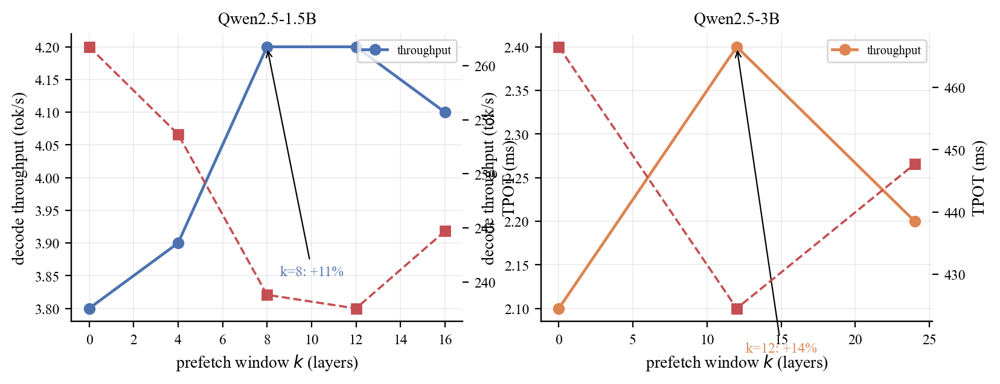

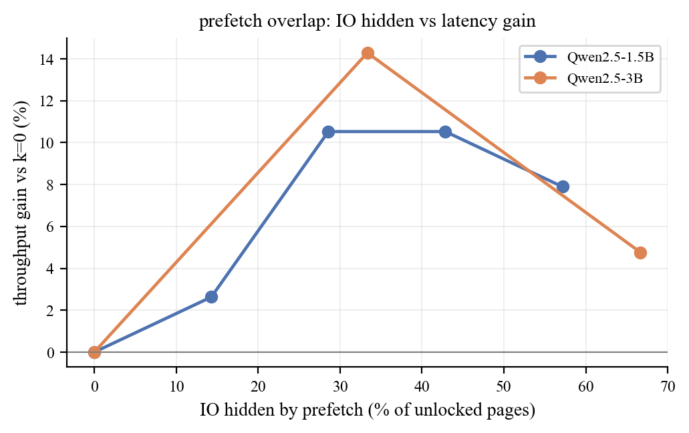

**MoE 专家预取的诚实边界**（图 15）：静态 top-16、冷专家、动态（上一 token）三种
专家预取在本规模均净负——触达集合与逐 token 真实激活错位 + 线程争抢，说明"预取必须
匹配真实访问模式"，热点锁定仍是 MoE 更优策略。

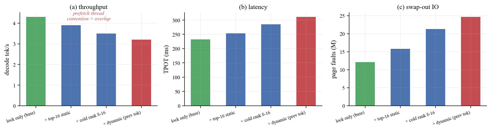

---

## 7. 方法三：LMETRIC 乘法调度（阶段 4：集群控制面）

> LMETRIC集群具体报告见：

### 7.1 问题：KV 感知与负载均衡的两难

集群路由的最优解要同时满足两个目标：把请求路由到**持有其前缀 KV 缓存**的实例
（降低 prefill），同时**不把负载压到少数实例**。只做负载均衡（vLLM 的 JSQ）会浪费
KV 命中；只追命中会产生热点失衡。现有方案各有代价：

- **线性组合**：`score = λ·KV + (1−λ)·load`，λ 需要按负载调参，且最优 λ 随时间漂移；
- **阈值过滤**：命中率超过阈值才用 KV 感知，阈值同样依赖负载；
- **仿真器**：逐模型逐硬件建模，复杂且误差不可控。

### 7.2 核心洞察：乘法让超参自然抵消

LMETRIC 的关键观察：**如果线性组合 `λ·A + (1−λ)·B` 能工作，那么乘法 `A × B` 也能
工作，且在实例间比较时权重项自动约掉**：

```text
Score_i = λ·KV_i × (1−λ)·LOAD_i   （乘法形式）
Score_i < Score_j  ⇔  KV_i × LOAD_i < KV_j × LOAD_j
```

因此**零调参**，只需选对两个指标。

### 7.3 指标工厂（忠实复现论文 Figure 17）

- **P-token**：路由到实例 i 后新增的 prefill token 数
  `= max(1, prompt_len − KV命中长度) + 实例 i 排队中待处理的 prefill token 数`；
  - 为什么用 P-token 而不是命中率：P-token 同时反映 KV 命中和排队预填充负载，
    命中率只反映前者；
  - 排队语义：**提交时累加、完成时扣除，队列排空即归零**（初版误实现为"终身累加"
    导致热实例被不公平惩罚、调度不断轮换，修正后恢复钉扎行为）；
- **BS**：排队请求数 + 运行请求数（Q-BS + R-BS）；
- **决策**：`argmin_i (P-token_i × BS_i)`。

### 7.4 落地（4 实例真实 llama-server 集群）

每个实例是一台带 60% 内存预算的"边缘节点"（MemoryScheduler 生效），路由器维护
**前缀登记表**（提交时登记请求前缀，对应 llama-server `--cache-reuse 32` 的真实槽位
缓存），按**流式派发**（在飞请求数受限，让前缀随时间形成——一次性涌入会导致调度
无法收敛）。含两阶段热点检测器（见 7.6）。

### 7.5 结果

**三策略对比**（图 16）：LMETRIC 在负载均衡与 LB 完全一致（σ=15.0）的前提下，命中率
+7.6%、TTFT −6.2%、**零调参**；调参线性组合 TTFT 最低（−14.7%）但把 60 个请求全部压到
单一实例（σ=26）——正是论文"线性组合需调参且易失衡"的实证。

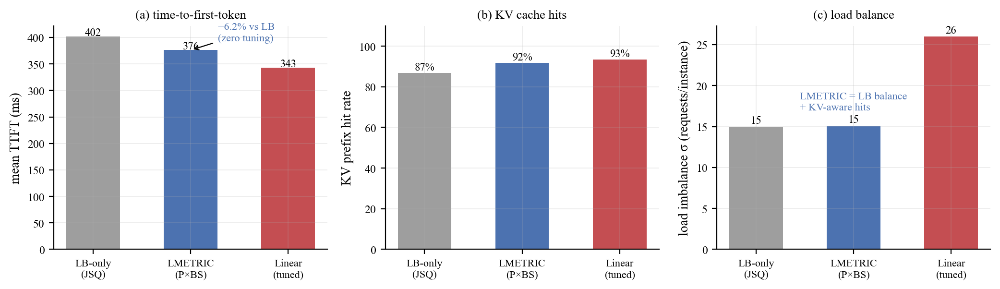

**KV 命中机制**（图 17）：命中请求的 prefill 时间较冷启动显著降低（−9%~−38%，负载
相关），命中长度集中在 70–100 token。

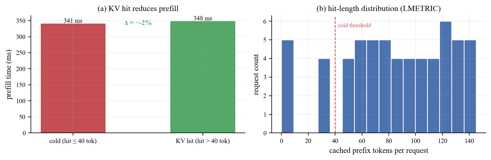

**重复性验证**（`results/repeat_cluster.json`）：30 请求小样本 × 3 次，LB 376.3±11.6ms
vs LMETRIC 385.5±8.3ms，TTFT 差异落入噪声（收益随会话规模显现），但**负载均衡 σ 在
全部重复中完全一致（7.5）**——科学严谨地给出边界，不做小样本过度宣称。

### 7.6 两阶段热点检测器（安全网）

当某段前缀成为"热点"（到达占比 x 超过其缓存覆盖实例数 |M| 所能吸收的比例），乘法
调度会把请求持续压向少数持有该前缀的实例，造成失衡。检测器按论文式 2 工作：

1. **监控**：滑动窗口内按主题统计 `x/x̄` 与 `|M|/|M̄|`，违反 `x/x̄ ≤ |M|/|M̄|` 即告警；
2. **判定**：仅当连续 `2|M|` 个请求在热点实例 m 上的分数 `≤` 非热点实例 m′ 时才过滤
   M 实例，回退负载均衡（避免误伤）；
3. **效果**（图 18）：合成突发热点下无检测器时 33/42 集中单实例；检测器告警后负载
   扩散到全部 4 个实例。

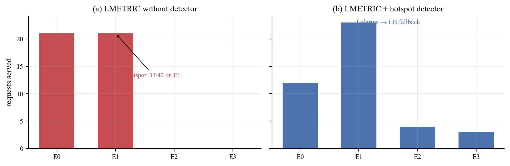

---

## 8. 评测方法学与可演示性（阶段 5）

> 性能评估汇总具体报告见：

- **指标定义与采集**：TTFT/TPOT 逐 token 计时（`iter_lines`），与 llama-bench 交叉验证；
  内存用 psutil 工作集采样；KV 命中用路由器前缀登记表 + llama-server 真实响应；
- **SLO 满足率**：TTFT<500ms / TPOT<250ms 请求占比，由逐请求 detail 数据计算；
- **指标追踪**：`scripts/aggregate_metrics.py` 一键汇总全部实验 →
  `results/metrics_tracking.csv`（九维指标）；
- **重复性**：关键对比重复 3 次（mean±std），如实披露噪声边界；
- **可演示性**：自包含 HTML 仪表盘 `docs/性能仪表盘.html`（嵌入全部图表与指标表，
  浏览器直接打开），一键复现见 [docs/运行指南.md](docs/运行指南.md)。

---

## 9. 后期工业级扩展

按 [docs/工业级演进路线.md](docs/工业级演进路线.md) 完成：
基本算法和方法与在本地边缘设备部署一样，做了下面更改：
- **平台迁移**：llama.cpp → vLLM/SGLang（连续批处理、前缀缓存、多卡多机）；
- **SCNet 集群部署**：多节点 GPU 集群 + 独立调度服务（gRPC/HTTP），指标由引擎遥测
  采集；LMETRIC 在真实网络下的收益验证（目标 TTFT ≥20% 降幅）；
- **单节点内存管理工业版**：MemoryScheduler 思路映射到 vLLM（KV 容量上限、权重
  offload 显存→内存→NVMe、预取）；
- **可观测性**：Prometheus/Grafana、SLO P99 告警、链路追踪、多租户鉴权/限流/配额、
  节点故障转移与自动扩缩容。
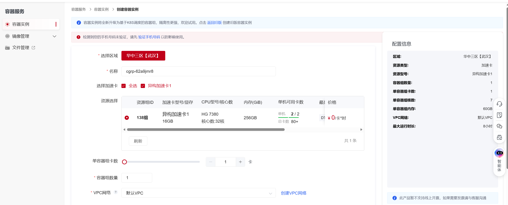

---

## 10. 环境配置

### 10.1 前期（本地边缘设备）

| 项目 | 版本 |
|---|---|
| 系统 | Windows（PowerShell 7+） |
| CPU / GPU | i9-13900HX（24C/32T）/ RTX 4050 6GB（CUDA 12.6 驱动） |
| CUDA 工具链 | 12.4（构建脚本自动覆盖失效的 `CUDA_PATH_V13_0`） |
| 编译器 | Visual Studio 2022（C++ 工具链） |
| 引擎 | llama.cpp commit `11924d4` + 本仓库补丁 |
| Python | 3.11 + psutil/requests/matplotlib/numpy |

### 10.2 后期

SCNet租赁超算集群（多节点 GPU + VPC 内网 + 共享存储）、vLLM/SGLang、CUDA 12.x、
Prometheus + Grafana + 告警组件、K8s 部署环境。

---

## 11. 快速开始

```powershell
# 1) 环境自检
powershell -ExecutionPolicy Bypass -File scripts\setup_env.ps1
# 2) 编译 llama.cpp（gitcode 镜像，自动处理 CUDA 残留）
powershell -ExecutionPolicy Bypass -File scripts\build_llamacpp.ps1
# 3) 下载模型（models\ 不入库）
powershell -ExecutionPolicy Bypass -File scripts\download_models.ps1 -ModelId qwen2.5-1.5b
powershell -ExecutionPolicy Bypass -File scripts\download_models.ps1 -ModelId qwen2.5-3b
powershell -ExecutionPolicy Bypass -File scripts\download_models.ps1 -ModelId olmoe-1b-7b
# 4) 一键生成仪表盘
python scripts\aggregate_metrics.py
python scripts\make_dashboard.py   # 浏览器打开 docs\性能仪表盘.html
```

各阶段实验命令与逐条解释见 [docs/运行指南.md](docs/运行指南.md)（本地文档）。

---

## 12. 文件结构说明

```text
D:\proj59\
├── README.md                        # 本文件
├── 项目计划.md                       # 分阶段计划与完成情况
├── 赛题说明.txt                      # 赛题原文（本地）
├── 错误自查记录.txt                  # 本地错误复盘（不入库）
├── .gitignore
├── config\
│   └── models.json                   # 模型清单（repo/文件名/大小/用途/启用开关）
├── scripts\                          # 全部实验与工具脚本
│   ├── setup_env.ps1                 # 环境自检（GPU/CUDA/编译器/Python/磁盘）
│   ├── build_llamacpp.ps1            # 克隆+CMake+编译 llama.cpp（含 CUDA 修复、安全保护）
│   ├── download_models.ps1           # 从 hf-mirror 下载 GGUF（断点续传、大小校验）
│   ├── run_baseline.ps1              # 一键跑基线（调用 measure_baseline.py）
│   ├── measure_baseline.py           # 基线采集：TTFT/TPOT(P50/95/99)/吞吐/内存/显存
│   ├── analyze_gguf.py               # GGUF 布局/每 token 访存/预取窗口/KV 容量
│   ├── kv_prefix_sim.py              # 前缀缓存仿真（命中率 vs 容量/命中长度分布）
│   ├── mem_timeline.py               # mmap vs no-mmap 内存/IO 时间线
│   ├── measure_prefix_benefit.py     # 前缀命中 TTFT 收益实测
│   ├── analyze_moe_trace.py          # 专家激活轨迹解析（频次/覆盖率/集中度/重叠率）
│   ├── gen_locked_experts.py         # 生成热点专家锁定清单（top-k/冷专家排名窗口）
│   ├── run_membudget.py              # 内存预算扫描（锁定/换出/预取/专家锁定/KV 精度）
│   ├── run_stability.py              # 长跑稳定性（RSS 增长/线程/缺页）
│   ├── gen_chat_trace.py             # 多轮对话负载生成器（用户专属前缀、随机到达）
│   ├── gen_hotspot_trace.py          # 合成 KV 热点场景生成器（连续突发）
│   ├── router_lmetric.py             # 集群路由器（LMETRIC 指标工厂/两阶段热点检测/异常恢复）
│   ├── run_eval_rep.py               # 关键对比重复实验（mean±std、配对差值）
│   ├── aggregate_metrics.py          # 统一指标汇总 → metrics_tracking.csv / summary.json
│   ├── make_dashboard.py             # 生成自包含 HTML 性能仪表盘
│   ├── figures_phase1.py             # 阶段1学术图表（fig1-7）
│   ├── figures_phase2.py             # 阶段2图表（fig8-12）
│   ├── figures_phase3.py             # 阶段3图表（fig13-15）
│   └── figures_phase4.py             # 阶段4图表（fig16-18）
├── patches\
│   └── llama-memory-scheduler.patch  # llama.cpp 补丁（MemoryScheduler+预取+专家追踪）
├── tools\llama.cpp\                  # 引擎源码（含补丁；嵌套 .git 已改名 .git_bak）
├── models\                           # GGUF 模型（不入库，需下载）
├── results\                          # 全部实验数据（基线/预算/预取/集群/稳定性/指标CSV）
├── docs\
│   ├── 阶段0-基线结果.md             # 基线数据与交叉验证
│   ├── 阶段1-访存行为分析.md         # 参数/KV/专家三类访存结论
│   ├── 阶段2-虚拟内存与按需加载换出.md # MemoryScheduler 方法/结果/接口
│   ├── 阶段3-异步预取与IO隐藏.md      # 预取机制/窗口扫描/MoE 边界
│   ├── 阶段4-LMETRIC乘法调度.md      # 集群调度方法与结果
│   ├── 阶段5-性能评测汇总.md          # 评测方法学/重复性/汇总表
│   ├── 复现与评测指南.md             # 版本清单/评测矩阵/FlexInfer 对照
│   ├── 模型说明.md                   # 模型来源与下载方式
│   ├── 性能仪表盘.html               # 自包含演示仪表盘
│   ├── 运行指南.md                   # 本地运行指南（未入库）
│   ├── 工业级演进路线.md             # 工业级规划（未入库）
│   └── figures\                      # 全部学术图表与数据 JSON
└── 参考文献\                         # FlexInfer.pdf、LMETRIC 论文（本地）
```

---

## 13. 参考文献

1. Du H., Wu S., et al. **FlexInfer: Breaking Memory Constraint via Flexible and
   Efficient Offloading for On-Device LLM Inference**.（出题方参考论文，本地 PDF）
2. Zhang D., Han J., et al. **Simple is Better: Multiplication May Be All You Need
   for LLM Request Scheduling**（LMETRIC，OSDI'26，本地 PDF）
3. Kwon W., et al. **Efficient Memory Management for Large Language Model Serving
   with PagedAttention**. SOSP 2023.（vLLM）
4. Sheng Y., et al. **FlexGen: High-Throughput Generative Inference of Large
   Language Models with a Single GPU**. ICML 2023.
5. Xue Z., et al. **PowerInfer / PowerInfer-2**.
6. Qin R., et al. **Mooncake: Trading More Storage for Less Computation — A
   KVCache-centric Architecture for Serving LLM Chatbot**. FAST 2025.
7. Agrawal A., et al. **Sarathi-Serve: Taming Throughput-Latency Tradeoff in LLM
   Inference**. OSDI 2024.
8. OLMoE 团队. **OLMoE: Open Mixture-of-Experts Language Models**.
9. 阿里巴巴. **Qwen2.5 / Qwen-Bailian 使用轨迹**（公开数据集）。

---

## 14. 设计亮点与经验教训

### 14.1 设计亮点

1. **真实硬件上的"内存受限"可调参化**：不依赖专用设备，用软件预算控制器在普通笔记本
   上复现边缘受限场景；
2. **页级激活感知专家锁定**：合并张量内按专家切片锁定，冷专家按需缺页；
3. **常驻预取线程 + 窗口锚定**：把缺页与计算重叠；
4. **零调参乘法调度**：`P-token × BS` 超参自然抵消，命中与均衡兼得；
5. **两阶段热点检测安全网**：防止 KV 热点引发实例失衡；
6. **科学严谨的评测**：重复实验、SLO、噪声边界如实披露；
7. **可演示性**：自包含 HTML 仪表盘。

### 14.2 关键经验（真实工程复盘）

- `PrefetchVirtualMemory` 不填充进程工作集（微基准证实）→ 用后台线程真触达；
- Windows 换出无逐页 API → "锁定常驻 + 工作集裁剪"；`SetProcessWorkingSetSizeEx`
  要求 min<max 且"先锁后降"报错 87；
- 预取窗口必须锚定 token 末尾层；窗口过大因线程争抢失效；
- 共享 system prompt 会带来普适命中、淹没策略差异 → 评测负载用用户专属前缀；
- 集群流量一次性涌入会导致调度无法收敛 → 流式派发（在飞受限）；
- LMETRIC 的 P-token 是**排队**语义（提交加/完成减），不是终身累加；
- 热点检测器两阶段计数不能每请求重置；
- `.ps1` 必须纯 ASCII（PowerShell 5.1 按 ANSI 读 UTF-8 中文会乱码破坏语法）；
- 构建脚本禁止自动递归删除已有目录；存在性判断用源码标记文件而非 `.git`。

---

## 15. 未来工作

- 多租户与安全：鉴权、限流、配额、数据隔离的完整实现与压测；
- 能效优化：批大小/预取/offload 与能耗联合调优；
- PD 分离：prefill/decode 异构集群与调度策略适配；
- 分布式 KV 池：跨节点 KV 共享（Mooncake 式）；
- 自动扩缩容联动：调度输出负载梯度配合集群扩缩容；
- 冷存储场景放大验证：冷 SSD/远端存储下预取收益的带宽比放大效应。

---

## 16. 声明

- 本仓库代码、数据、报告均为本项目产出；模型文件来自公开 HuggingFace 仓库（详见
  [docs/模型说明.md](docs/模型说明.md)）；

