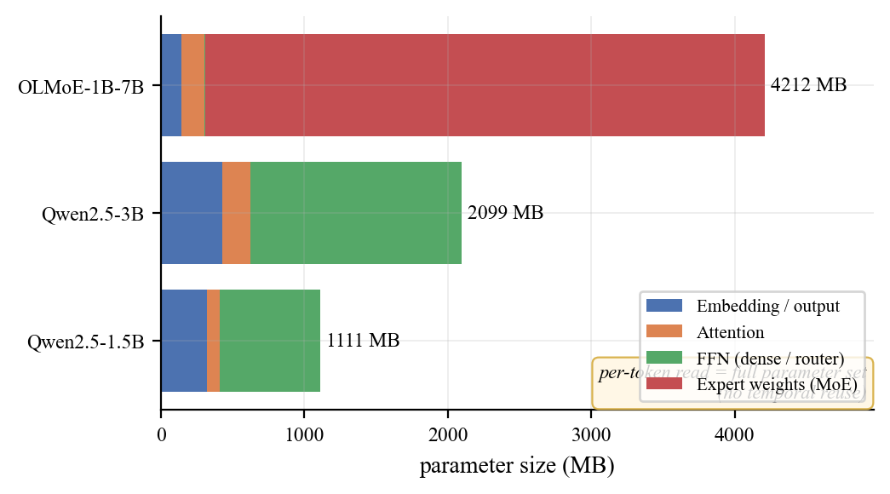
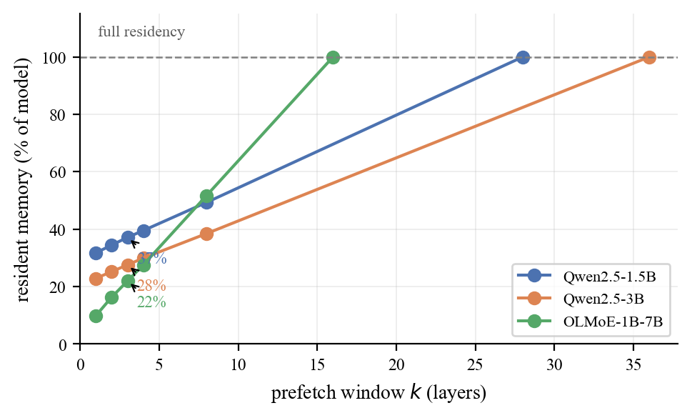
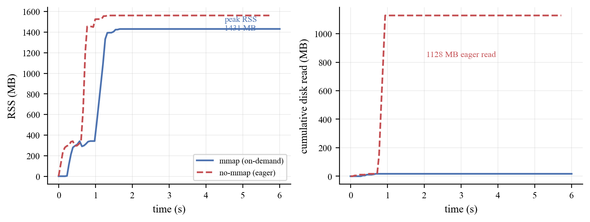
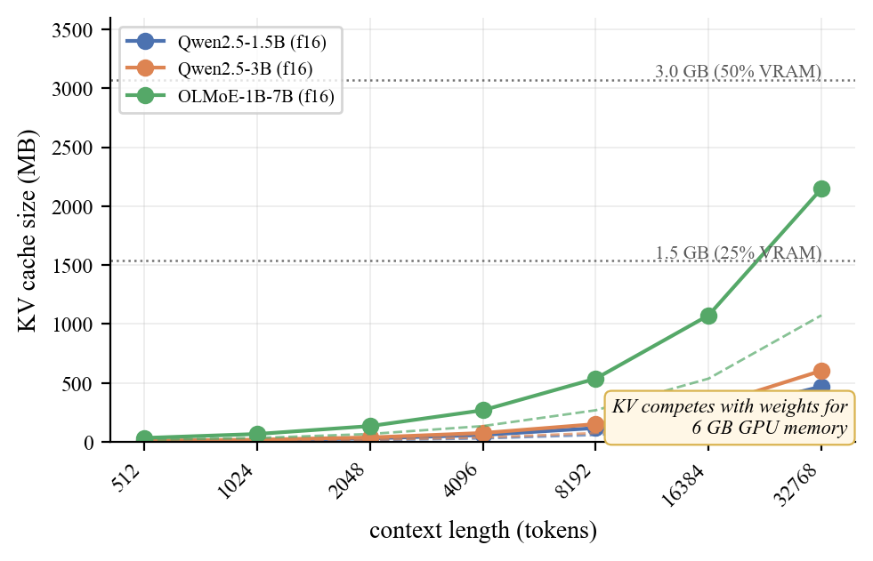
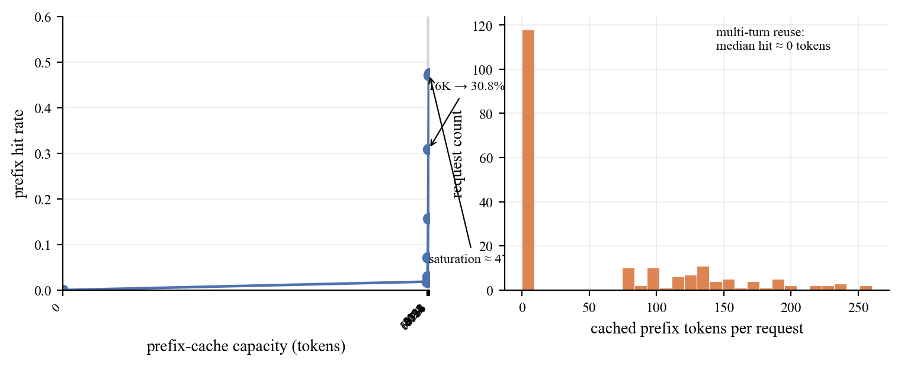
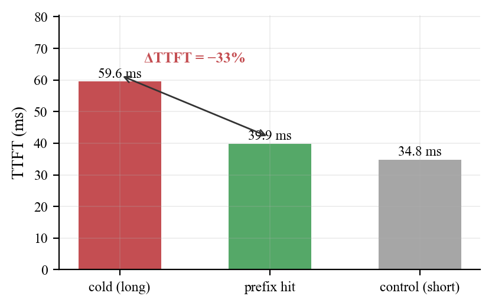
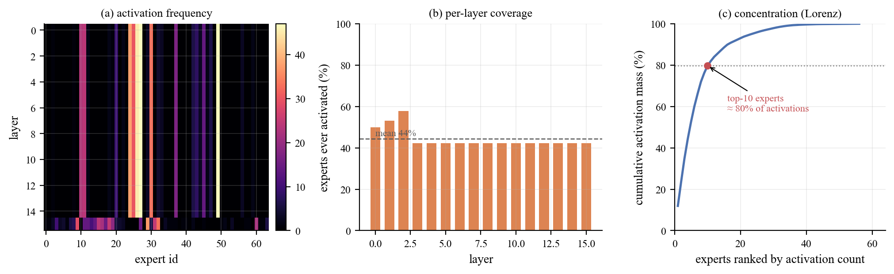

# 阶段 1：访存行为分析报告（赛题任务 1）

日期：2026-08-02　|　引擎：llama.cpp（commit `11924d4`，CPU + CUDA，含专家追踪补丁）
模型：Qwen2.5-1.5B/3B-Instruct（dense，Q4_K_M）、OLMoE-1B-7B-0125（MoE，Q4_K_M）

**摘要**：在 6GB 显存 / 16GB 内存的约束下，通过静态张量布局分析、运行时内存/IO 采样、
前缀缓存仿真与 llama.cpp 专家路由插桩，刻画了 LLM 推理的三大访存特征：
(1) 自回归解码每 token 恰好读取全部参数（无时间局部性），预取窗口 $k$ 可将常驻内存压缩至
模型大小的 $k/n$（$k=3$ 时为 22%–37%）；(2) KV cache 随上下文线性增长，与权重争夺
6GB 显存，前缀命中可将 TTFT 降低 33%；(3) MoE 模型每 token 仅激活 12.5% 的专家权重，
且 top-10 专家集中了约 80% 的激活，相邻 token 激活集合重叠 59.5%，具备专家级预取的强时间局部性。

## 1. 参数加载行为

### 1.1 模型结构与张量布局（`scripts/analyze_gguf.py`）

| 模型 | 层数 | 头/KV头 | 专家 | 总大小 | Attention | FFN | 专家权重 | 每 token 访存 |
|---|---:|---:|---:|---:|---:|---:|---:|---:|
| Qwen2.5-1.5B | 28 | 12/2 | - | 1111 MB | 88 MB | 700 MB | - | 1111 MB |
| Qwen2.5-3B | 36 | 16/2 | - | 2099 MB | 194 MB | 1474 MB | - | 2099 MB |
| OLMoE-1B-7B | 16 | 16/16 | 64 (取 8) | 4212 MB | 160 MB | 8 MB | **3901 MB (92.6%)** | 4212 MB |

权重组成见图 1：dense 模型以 FFN 为主（63%–70%），MoE 模型 92.6% 的参数量集中在专家权重。

### 1.2 关键访存特征（结论 1：无时间局部性）

自回归解码中，**每个生成的 token 恰好访问每个参数一次**（attention/FFN 权重全量参与），
参数之间没有复用，即"每 token 访存 = 模型大小"（上表最后一列）。含义：

- 参数页**使用后即可释放**（换出策略可行，这正是 FlexInfer 的出发点）；
- 常驻内存由**预取窗口 k** 决定：k 层窗口 ≈ k/n 模型大小。

预取窗口足迹（含 embedding，实测数据）：

| 模型 | k=1 | k=3 | k=4 | 全部 |
|---|---:|---:|---:|---:|
| Qwen2.5-1.5B | 353 MB | 413 MB | 439 MB | 1111 MB |
| Qwen2.5-3B | 480 MB | 578 MB | 628 MB | 2099 MB |
| OLMoE-1B-7B | 415 MB | 923 MB | 1160 MB | 4212 MB |

即 k=3 时仅需 ~37%（1.5B）~ 22%（OLMoE）的常驻内存。

常驻内存与窗口大小呈线性关系（图 2），窗口 $k$ 即软件内存预算的调节旋钮。

### 1.3 mmap 按需加载实测（`scripts/mem_timeline.py`，1.5B CPU）

| 模式 | 峰值 RSS | 磁盘读取 | 行为 |
|---|---:|---:|---|
| mmap（按需缺页） | 1431 MB | 16.9 MB* | RSS 随首次访问渐进爬升，页缓存命中时少读盘 |
| no-mmap（全量读入） | 1561 MB | 1128 MB | 启动即读完整模型 |

*注：多次运行后 OS 页缓存已热，mmap 的磁盘读数被缓存掩盖；首次冷启动时读盘量接近模型大小，这正是阶段 2/3 用预取隐藏的 IO。

图 3 对比两种加载策略的 RSS 爬升与磁盘读取时间线：mmap 按需缺页加载使 RSS 渐进增长，
而 no-mmap 在启动阶段即全量读入。

## 2. KV cache 使用

### 2.1 容量模型

| 模型 | KV/token (f16) | KV/token (q8) | ctx=2048 (f16) | ctx=8192 (f16) |
|---|---:|---:|---:|---:|
| Qwen2.5-1.5B | 14.3 KB | 7.2 KB | 29.4 MB | 117 MB |
| Qwen2.5-3B | 18.4 KB | 9.2 KB | 37.7 MB | 151 MB |
| OLMoE-1B-7B | 64.0 KB | 32.0 KB | 134 MB | 537 MB |

在 6GB 显存/16GB 内存环境下，KV cache 与权重争抢内存 → **KV 命中成为稀缺资源**。

图 4 给出三种模型 KV 大小随上下文长度的增长曲线与显存预算线：f16 精度下 32K 上下文时
OLMoE 的 KV 已达 2.1GB，逼近 6GB 显存的三分之一。

### 2.2 前缀缓存仿真（`scripts/kv_prefix_sim.py`）

合成负载（16 用户 × 6 轮多轮对话 + 25% agent 突发），LRU 前缀缓存容量扫描：

| 容量 (tokens) | 0 | 4K | 8K | 16K | 32K | 64K |
|---|---:|---:|---:|---:|---:|---:|
| 命中率 | 0% | 7.1% | 15.7% | 30.8% | 47.2% | 47.5% |

命中率随容量上升并趋于饱和 → 多轮对话/共享 system prompt 场景下前缀缓存收益显著，且与调度策略（把同前缀请求路由到同一实例）强相关。

图 5(a) 显示命中率-容量曲线（16K tokens 时 30.8%，32K 后趋近 47% 饱和）；
图 5(b) 为固定容量下的命中长度分布。

### 2.3 前缀命中实测（`scripts/measure_prefix_benefit.py`，1.5B GPU，--cache-reuse）

- A 冷启动长请求：TTFT = **59.6 ms**
- B 共享前缀命中（A 的内容 + 追加提问）：TTFT = **39.9 ms（-33%）**
- C 无关短请求：34.8 ms

前缀命中直接跳过已缓存的 prefill 计算，TTFT 显著下降；prompt 越长收益越大。

## 3. 专家激活（`scripts/analyze_moe_trace.py` + llama.cpp 专家追踪补丁）

### 3.1 结构稀疏性

OLMoE：16 层 × 64 专家，每 token 每层仅激活 **top-8（12.5%）**。
专家权重占模型 92.6%（3901/4212 MB），即每 token 专家相关访存可从 3901 MB 降至约 **488 MB**（8/64 × 3901）。

### 3.2 实测激活分布（47 个生成 token，CPU 解码，温度 0）

- 64 个专家中 56 个（87.5%）至少被激活一次；
- 每层覆盖率 42%–58%（该层出现过不同专家数 / 64），存在明显热点：
  专家 #27（718 次）、#49（703）、#26（673）、#24（568）、#30（499）、#25（448）……
- **相邻 token 激活集合重叠率 59.5%** —— 激活专家具有强时间局部性。

含义：专家页可按"热点/近期激活"排序做按需加载与预取（阶段 3 的 MoE 专家预取直接依赖此结论）。

图 7 汇总专家激活的稀疏性与集中性：(a) 层×专家激活频次热图；
(b) 各层被激活过的专家占比（42%–58%，即任意 64 专家中仅约一半出现过）；
(c) Lorenz 浓度曲线——**top-10 专家贡献约 80% 的激活**，为"热点专家缓存/预取"提供量化依据。

## 4. 结论 → 设计指导

| 发现 | 设计含义 | 对应阶段 |
|---|---|---|
| 每 token 参数恰好访问一次、无局部性 | 使用后即换出 + 预取窗口控制常驻内存 | 阶段 2/3 |
| k=3 窗口仅需 22%–37% 内存 | 软件内存预算的量化依据 | 阶段 2 |
| mmap 缺页按需加载 vs no-mmap 全量读 | 预取应超前 k 层隐藏缺页 IO | 阶段 3 |
| KV 随上下文线性增长、容量受限 | KV 容量上限 + 前缀缓存 | 阶段 2/4 |
| 前缀命中 TTFT -33%，命中率随容量/调度上升 | 调度应 KV 感知（P-token × BS） | 阶段 4 |
| 专家激活仅 12.5%、热点集中、相邻 token 重叠 59.5% | 专家按需加载 + 专家预取 | 阶段 3 |

图件统一由 `scripts/figures_phase1.py` 生成（200 dpi、serif 字体、期刊风格），
数据文件：`docs/figures/*.json`；原始轨迹：`results/olmoe_moe_trace.bin`（git 忽略，可复现采集）。
