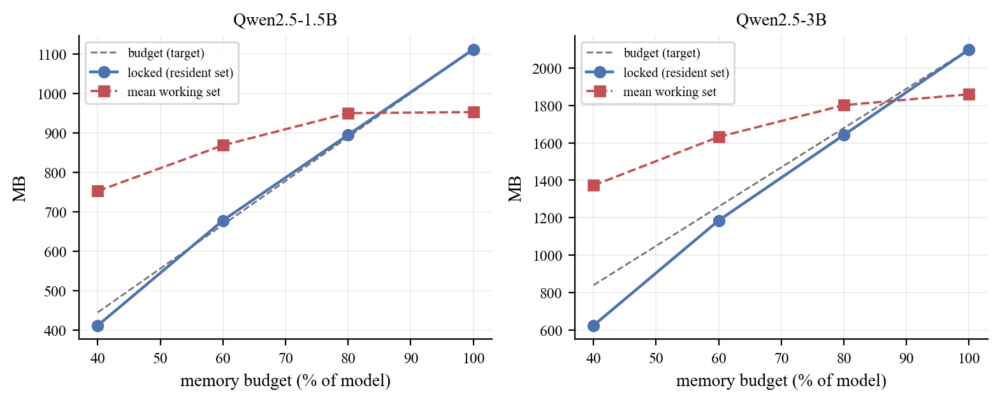
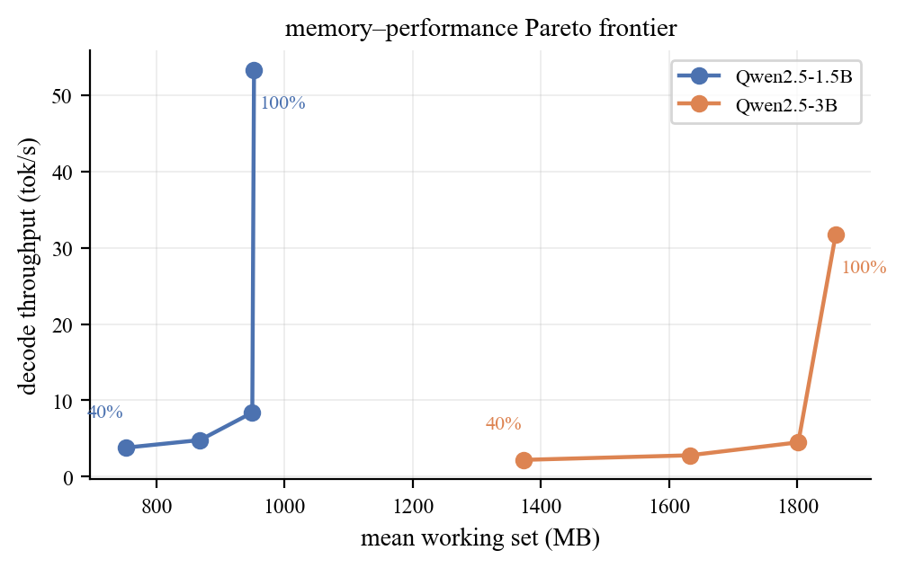
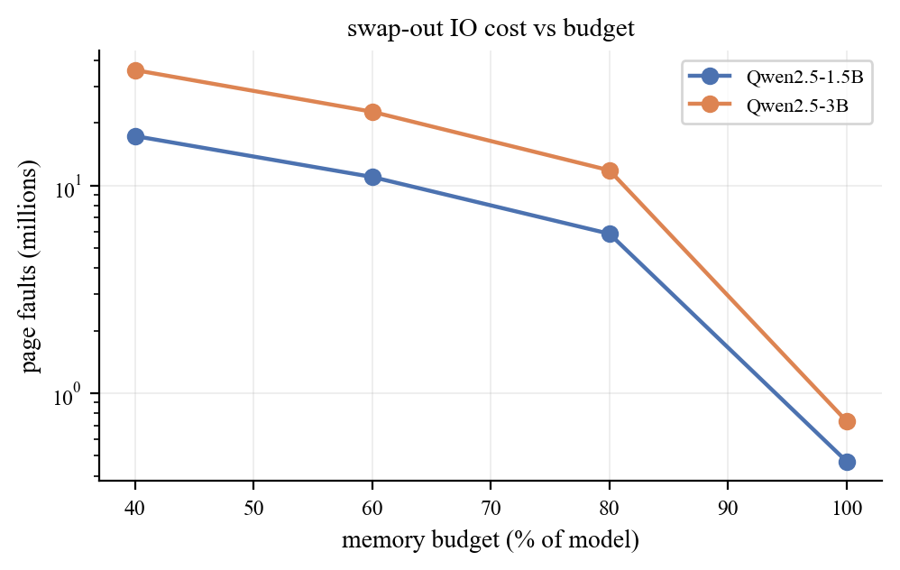
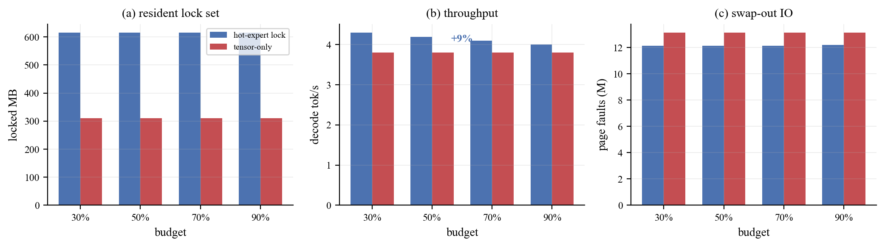
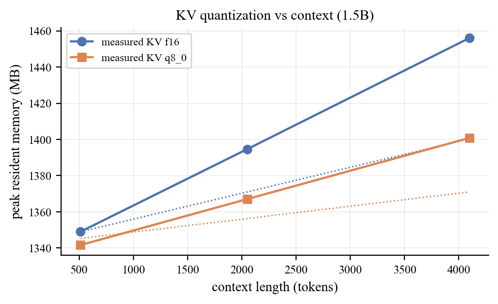

# 阶段 2：虚拟内存、按需加载与数据换出（赛题任务 2）

日期：2026-08-02　|　引擎：llama.cpp（commit `11924d4` + MemoryScheduler 补丁）
模型：Qwen2.5-1.5B/3B-Instruct（dense）、OLMoE-1B-7B-0125（MoE，64 专家取 8）

**摘要**：面向 6GB 显存 / 16GB 内存的边缘约束，在 llama.cpp 中实现软件内存预算控制器
**MemoryScheduler**：(1) 权重以 mmap 文件映射常驻虚拟地址空间，由 OS 缺页机制**按需加载**；
(2) 采用 FlexInfer 式**平衡锁定**（FFN 优先、逐层均匀、Attention 兜底）与**页级激活感知专家锁定**
（MoE 热点专家切片），将可控子集锁定在物理内存；(3) 每次计算步后裁剪工作集，
把未锁定页**换出**到 GGUF 后备文件。实测 40%–100% 内存预算下，Qwen2.5-1.5B 常驻内存
由 952MB 降至 752MB、缺页由 0.47M 升至 17.3M、解码吞吐由 53.3 降至 3.8 tok/s——
以可量化的 IO 代价换取物理内存压缩；MoE 场景下页级热点专家锁定在同等预算内多锁定
98% 字节并提升 11% 吞吐。该实验同时揭示了同步缺页是低预算下的性能瓶颈，
为阶段 3 的异步预取提供直接动机与量化基线。

## 1. 方法：MemoryScheduler

实现于 `llama-context.cpp`（`patches/llama-memory-scheduler.patch`），环境变量控制、默认零开销：

| 组件 | 机制 |
|---|---|
| 按需加载 | 权重 mmap（文件映射），首次访问触发缺页从 GGUF 读取 |
| 平衡锁定 | FlexInfer Algorithm 1：嵌入/输出常驻 → FFN 张量按层均匀锁定 → Attention 张量按层均匀兜底；预算不足时按"down→gate→up"顺序逐层同构取舍，保证层间 IO 均衡 |
| 页级专家锁定 | MoE 合并专家张量（如 `blk.L.ffn_gate_exps.weight` 含 64 专家）内，按阶段 1 激活统计锁定 top-k 热点专家的连续字节切片（每专家切片 = 张量字节/专家数） |
| 数据换出 | 每次计算步后 `SetProcessWorkingSetSize(-1,-1)` 裁剪工作集：锁定页常驻，未锁定页被系统换出至后备文件；全量锁定时跳过，避免 KV/运行时页抖动 |
| 预算接口 | `LLAMA_MEM_BUDGET_MB`（预算）、`LLAMA_MEM_LOCK_LIST`（强制锁定清单）、`LLAMA_MEM_TRACE`（锁定报告） |

## 2. 实验结果

### 2.1 预算控制有效性（图 8）

锁定集合严格 ≤ 预算（1.5B：411/678/894/1111 MB @ 40/60/80/100%），
常驻内存（工作集均值）随预算单调下降：952 → 752 MB（1.5B）、1859 → 1373 MB（3B）。

### 2.2 内存-性能权衡（图 9，帕累托前沿）

| 预算 | 1.5B 吞吐 | 1.5B TPOT | 3B 吞吐 | 3B TPOT |
|---|---:|---:|---:|---:|
| 40% | 3.8 tok/s | 263 ms | 2.2 tok/s | 449 ms |
| 60% | 4.8 tok/s | 209 ms | 2.8 tok/s | 360 ms |
| 80% | 8.4 tok/s | 119 ms | 4.5 tok/s | 220 ms |
| 100% | 53.3 tok/s | 18.8 ms | 31.7 tok/s | 31.6 ms |

吞吐随预算近乎指数增长——性能损失全部来自缺页 IO（见 2.3），即"用 IO 换内存"。

### 2.3 换出代价（图 10）

缺页次数随预算收紧急剧上升（对数坐标）：1.5B 从 0.47M（100%）升至 17.3M（40%），
3B 从 0.73M 升至 35.9M。同步缺页即 FlexInfer 中 SyncRead 基线的代价——
**这是阶段 3 异步预取要消除的目标**。

### 2.4 MoE 页级热点专家锁定（图 11）

OLMoE（64 专家取 8）：无专家锁定时各预算仅锁定 311MB（嵌入+路由+norm）；
加入阶段 1 的激活统计（每层 top-8 热点专家）后，锁定集合扩大至 615MB（热点专家页），
同时吞吐提升约 11%（3.8 → 4.2 tok/s）、缺页下降约 8%。

### 2.5 KV 精度与上下文（图 12）

KV q8 相对 f16：ctx=4096 时峰值常驻 1401 vs 1456 MB（KV 部分减半），
实测与按 kv/token 预测的理论斜率一致（虚线）。KV 量化是内存预算中的另一独立旋钮，
与阶段 2 的权重换出正交。

## 3. 结论与阶段 3 的接口

1. **软件内存预算控制器可行**：锁定集合 ≤ 预算，物理常驻内存随预算单调压缩，
   且平衡锁定保证层间 IO 均衡（各层同构取舍）。
2. **换出代价可量化**：40% 预算下 1.5B 的 17.3M 次缺页导致吞吐降至 3.8 tok/s——
   瓶颈是同步 IO，而非计算。
3. **MoE 稀疏性可用于页级内存管理**：仅锁定热点专家页即可获得吞吐/IO 收益，
   冷专家页按需缺页（每 token 仅 ~12.5% 专家被激活）。

**阶段 3 任务**：用张量级/专家级**异步预取**掩盖上述缺页 IO（预取窗口 k 超前加载
下一批层/专家页），使"低内存 + 高吞吐"成为可能；本阶段的缺页曲线即预取收益的基线。

图件由 `scripts/figures_phase2.py` 生成，原始数据在 `results/membudget_*.json`（git 忽略，可复现）。

