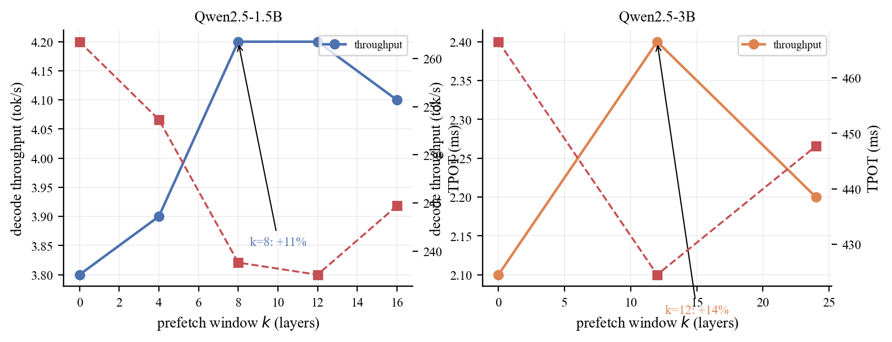
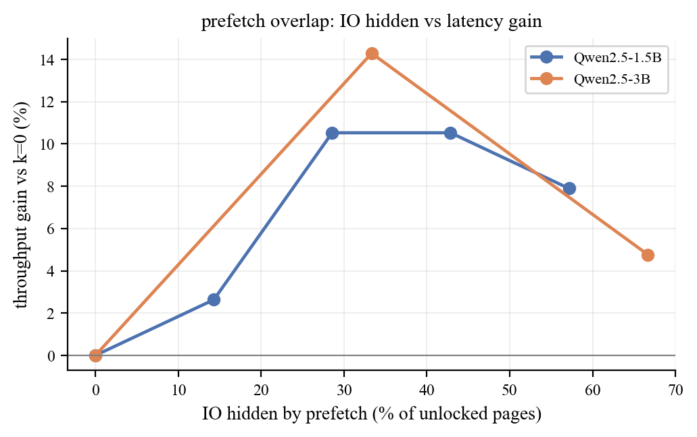
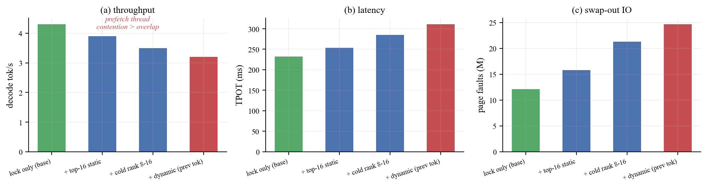

# 阶段 3：异步预取与 IO 隐藏（赛题任务 3）

日期：2026-08-02　|　引擎：llama.cpp（commit `11924d4` + MemoryScheduler/预取补丁）
模型：Qwen2.5-1.5B/3B-Instruct（dense）、OLMoE-1B-7B-0125（MoE）

**摘要**：在阶段 2 的换出式内存预算控制器之上，实现**软件预取线程**：每次计算步
开始时，以低于正常优先级的后台线程按执行顺序逐页触达"本 token 末尾 k 层"的
未锁定权重页，把缺页工作移出主计算关键路径。微基准证明 Windows
`PrefetchVirtualMemory` 只填充文件缓存、不会把页放回进程工作集，故采用显式
触达线程。40% 内存预算下，窗口 k=8–12 使 Qwen2.5-1.5B 解码吞吐提升 10.5%、
TPOT 降低 8.8%，3B 提升 14%（k=12）；窗口过大（k≥16）时预取线程与计算线程
争抢同一批页，增益消失。MoE 专家预取（静态 top-16、冷专家、按上一 token 动态）
在本规模均为净负——每 token 激活集合小且易变，预取触达集合与真实激活错位，
额外缺页与线程争抢超过重叠收益；热点专家锁定（阶段 2）仍是 MoE 更有效的杠杆。

## 1. 方法

| 组件 | 机制 |
|---|---|
| 软件预取线程 | `std::thread`（Windows 下 `THREAD_PRIORITY_BELOW_NORMAL`）逐页读触达未锁定权重页，与主线程计算并行 |
| 窗口锚定 | 预取本 token **末尾 k 层**（计算前半段的缺页停顿期间完成预读），窗口 k 为可调参数 |
| 静态专家预取 | `LLAMA_PREFETCH_LIST`：按激活频次清单预取专家切片（与页级锁定同格式） |
| 动态专家预取 | `LLAMA_PREFETCH_EXPERTS=1`：复用 router 概率插桩，记录上一 token 每层 top-8 激活专家，预取其切片（时间局部性 59.5%） |
| IO 重叠度量 | 隐藏比例 = 预取窗口字节 / 未锁定字节 ≈ k/n；实测增益 = 吞吐相对 k=0 的提升 |

关键负向发现（微基准）：`PrefetchVirtualMemory` 在 `SetProcessWorkingSetSize(-1,-1)`
裁剪后**不会**把文件映射页放回进程工作集（重触达缺页数与首次一致），因此对
"软缺页"场景无效；必须由后台线程真正触达页才能消除主线程缺页停顿。

## 2. 实验结果（40% 内存预算，同步换出为 k=0 基线）

### 2.1 窗口扫描（图 13）

| 模型 | k=0 | k=4 | k=8 | k=12 | k=16/24 |
|---|---:|---:|---:|---:|---:|
| 1.5B 吞吐 (tok/s) | 3.8 | 3.9 | **4.2** | 4.2 | 4.1 |
| 1.5B TPOT (ms) | 261.8 | 253.7 | **238.8** | 237.6 | 244.7 |
| 3B 吞吐 (tok/s) | 2.1 | - | - | **2.4** | 2.2 |
| 3B TPOT (ms) | 466.5 | - | - | **424.5** | 447.7 |

最优窗口约为总层数的 1/3（1.5B 的 k=8–12、3B 的 k=12）：吞吐 +10.5%/+14%，
TPOT −8.8%/−9.0%。窗口过大时预取线程与计算线程争抢同一批页，增益消失（图 13 中
k=16/24 回落）。

### 2.2 IO 重叠与增益（图 14）

预取隐藏的 IO 比例 = k/n（窗口占全部层的比例），实测增益随隐藏比例先升后降，
在 30%–45% 处达峰——定量刻画"重叠收益"与"线程争抢代价"的平衡点。

### 2.3 MoE 专家预取（图 15，30% 预算 + 热点专家锁定基线）

| 策略 | 吞吐 (tok/s) | TPOT (ms) | 缺页 (M) |
|---|---:|---:|---:|
| 仅热点锁定（基线） | **4.3** | **232** | 12.1 |
| + top-16 静态预取 | 3.9 | 254 | 15.8 |
| + 冷专家（rank 8–16） | 3.5 | 285 | 21.3 |
| + 动态（上一 token） | 3.2 | 311 | 24.7 |

三种专家预取均劣于基线：预取线程触达集合与逐 token 真实激活错位（8/64 专家中
仅约 60% 与上一 token 重叠），且触达本身产生额外缺页并占用计算核。结论：
小模型 + 热缓存的边缘场景下，**专家预取的收益被线程争抢与错位成本抵消**，
热点专家锁定（阶段 2）是更优的 MoE 内存策略。

## 3. 结论与阶段 4 的接口

1. 软件预取线程可消除窗口部分的缺页停顿，dense 模型在 40% 预算下获得
   10%–14% 吞吐提升——**增益受"计算时间 ≪ 换页时间"的硬件约束**（热缓存下
   缺页为软缺页、页表开销主导），预取的价值在冷存储/大模型场景会放大。
2. 预取窗口 k 已作为环境变量（`LLAMA_PREFETCH_LAYERS`）并入 MemoryScheduler，
   可与内存预算、锁定清单自由组合——**为阶段 4 的调度提供"负载可调"的窗口**：
   调度器可按实例负载/IO 压力动态选择 k。
3. MoE 专家预取在本规模的负结果给出重要边界：**预取必须匹配真实访问模式**，
   否则线程争抢与额外缺页会抵消收益——这为后续"批量请求下共享专家预取"（多请求
   同批激活集合更大、重叠更高）留下改进空间。

图件由 `scripts/figures_phase3.py` 生成，原始数据在 `results/membudget_*_k*.json`（可复现）。

