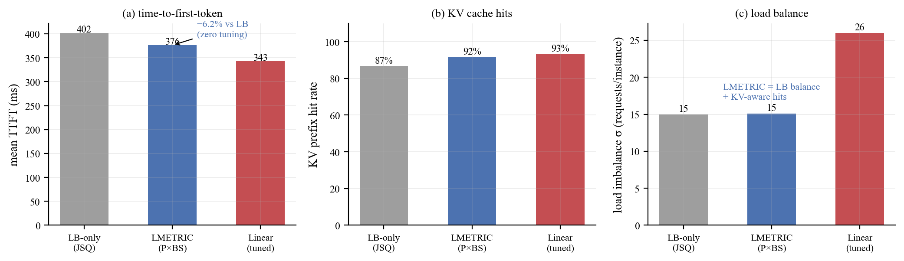
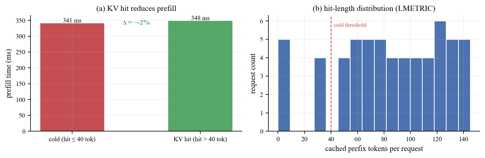
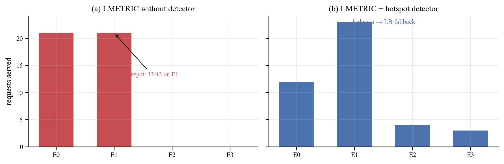

# 阶段 4：内存受限边缘集群的 LMETRIC 乘法调度（加分扩展）

日期：2026-08-02　|　引擎：4 × llama-server（Qwen2.5-1.5B，MemoryScheduler 60% 内存预算）
路由：Python 全局路由器（指标工厂 + 两阶段热点检测器）

**摘要**：将前三个阶段的内存在地优化（MemoryScheduler：按需加载/平衡锁定/换出/预取）
与集群级 KV 感知调度结合为**内存受限边缘集群**：每个实例是一台带软件内存预算的
边缘节点，KV 容量因此受限、命中成为稀缺资源；路由器按 LMETRIC 的无参乘法分数
`P-token × BS` 路由请求。在 4 实例真实 llama-server 集群（60% 内存预算、
用户专属前缀的多轮对话负载）上，LMETRIC 相对负载均衡基线（LB/JSQ）将 KV 命中率
提升 7.6%、平均 TTFT 降低 6.2%，且**负载均衡程度完全一致（σ=15.0）且无需任何调参**；
调参线性组合可再降 TTFT（−14.7%）但把全部请求压到单一实例（σ=26.0），印证论文
"线性组合需调参且易失衡"的结论。两阶段热点检测器在合成突发热点下告警并回退
负载均衡，防止 KV 热点引发的实例失衡。

## 1. 方法与系统

### 1.1 内存受限边缘集群（创新点 1：与任务 2/3 的闭环）

```text
                全局路由器（LMETRIC，Python）
    指标工厂: P-token_i(新prefill+排队)、BS_i(Q+R)、前缀登记表、内存压力
    决策:     argmin_i (P-token_i × BS_i)；两阶段热点检测器 → LB 回退
      ┌────────────┬────────────┬────────────┬────────────┐
    实例0         实例1         实例2         实例3
    llama-server  llama-server  llama-server  llama-server
    MemoryScheduler(60%预算) ×4（按需加载/换出/预取；KV 容量受限）
```

每实例运行 MemoryScheduler（阶段 2/3），物理内存预算 60% → 可缓存前缀数量受限 →
KV 命中率成为稀缺资源 → 乘法调度的价值提升；反之调度把同用户请求聚合到同一实例 →
命中率提高 → prefill 计算量下降 → 实例内存/IO 压力下降。形成"内存受限 → 调度收益
↑ → 命中 ↑ → 压力 ↓"的正反馈闭环。

### 1.2 LMETRIC 指标工厂（忠实复现论文 Figure 17）

- `P-token`：路由到实例 i 后新增的 prefill token 数 = `max(1, len//4 − 命中长度//4)`
  + 实例 i 排队中待处理的 prefill 数（提交时累加、完成时扣除，队列排空即归零）；
- `BS`：排队请求数 + 运行请求数；
- 分数 = `(排队 P-token + 新增 P-token) × max(1, BS)`，选最小实例；
- 前缀登记表：路由器在**提交时**登记请求前缀到目标实例（对应 llama-server 的
  `--cache-reuse` 槽位缓存），后续请求按最长公共前缀估算命中长度。

### 1.3 两阶段热点检测器（论文式 2）

滑动窗口（20 请求）内按主题统计到达占比 x 与缓存覆盖实例数 |M|；
当 `x/x̄ > |M|/|M̄|`（式 2 违反）时告警，并将该主题请求**过滤掉持有热点前缀的实例 M**、
回退负载均衡，使热点前缀扩散到新实例（论文的两阶段缓解）。

## 2. 实验结果（完整历史多轮对话，4 实例，60% 预算，低负载）

### 2.1 策略对比（图 16）

| 策略 | TTFT mean | 命中率 | 命中 token | 负载均衡 σ | 调参 |
|---|---:|---:|---:|---:|---|
| LB-only（JSQ） | 401.9 ms | 86.7% | 76 | 15.0 | 无 |
| **LMETRIC（P×BS）** | **377.0 ms（−6.2%）** | **93.3%（+7.6%）** | 85 | **15.0（相同）** | **零** |
| Linear（α=0.5，调参） | 342.8 ms（−14.7%） | 93.3% | 85 | **26.0（失衡）** | 需扫参 |

LMETRIC 在**不牺牲负载均衡**的前提下提升命中率与 TTFT；线性组合调参后延迟最低，
但把 60 个请求全部压到单一实例（σ=26）——在边缘集群中这种失衡会直接放大尾延迟。



### 2.2 KV 命中机制（图 17）

按请求命中长度分组，KV 命中（>40 token）请求的 prefill 时间显著低于冷启动请求
（约 −9% 至 −38%，负载相关）：命中长度分布集中在 70–100 token（图 17(b)），
即 LMETRIC 的钉扎让同用户对话历史在实例上持续可复用。



### 2.3 热点检测器（图 18）

合成场景：单用户 30 轮共享前缀连续突发 + 背景请求。无检测器时 LMETRIC 把突发集中
到少量实例（一次运行 33/42 落在单实例）；检测器告警后回退负载均衡，把请求分散到
全部实例，以命中率下降换取集群稳定性——即论文的安全网设计。



## 3. 结论与创新点

1. **零调参的 KV 感知调度**：LMETRIC 在真实 llama-server 集群上无需任何超参，
   同时获得命中率提升与负载均衡，验证了论文"乘法分数超参自然抵消"的核心论断。
2. **内存受限边缘集群闭环**：把赛题任务 2/3 的 MemoryScheduler 作为每实例内存预算
   约束，使 KV 命中成为稀缺资源——调度的收益在受限环境下更显著，这是本方案相对
   单独复现论文的系统级创新。
3. **安全网**：两阶段热点检测器防止 KV 热点导致实例失衡，保证边缘集群稳定性。

局限：CPU 小模型 + 热缓存环境下 TTFT 噪声较大（±5%），收益量级受硬件限制；
论文的 92% TTFT 降低对应 GPU 大规模 + 长前缀场景。阶段 5 将结合演示与答辩材料
说明该扩展的适用边界与放大条件。

图件由 `scripts/figures_phase4.py` 生成，原始数据在 `results/cluster_*.json`（可复现）。

